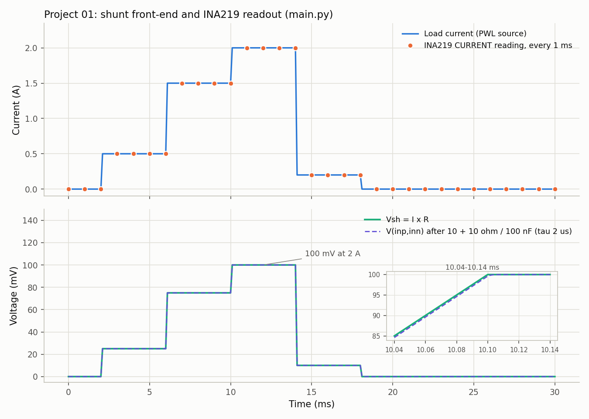
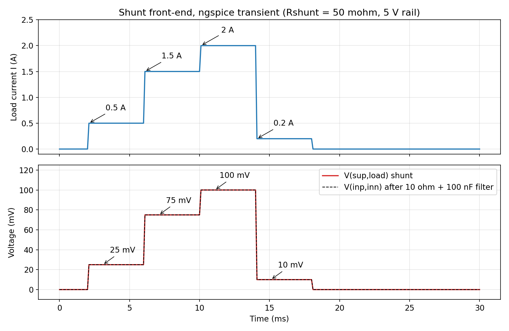
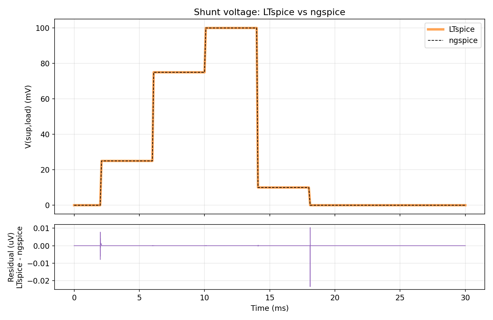
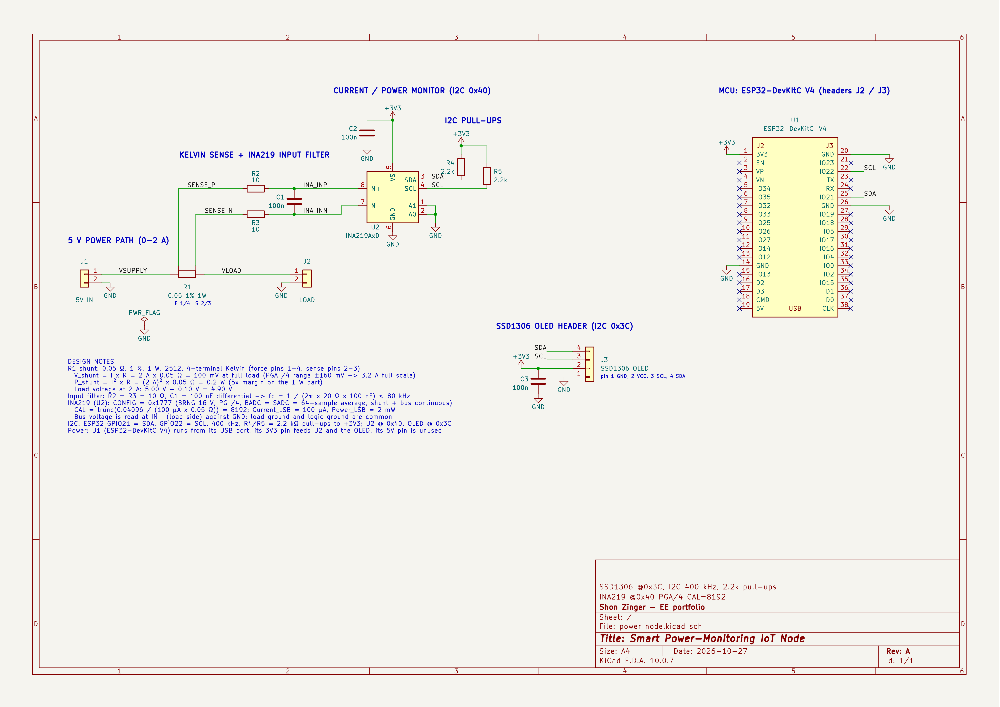
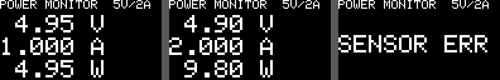

# 01 - Smart Power-Monitoring IoT Node (ESP32 + INA219 + SSD1306)

Monitors a 5 V rail at up to 2 A. A high-side 50 mOhm shunt feeds an INA219 set to PGA /4 (+/-160 mV full scale, 3.2 A range, 100 mV at 2 A), with Current_LSB 100 uA/bit, CAL = 8192 and Power_LSB 2 mW. Firmware runs FreeRTOS on the ESP32 Arduino core: sensorTask (priority 3) every 100 ms using vTaskDelayUntil, displayTask (priority 2) every 500 ms, both pinned to core 1. A length-1 queue with xQueueOverwrite/xQueuePeek acts as a latest-value mailbox. A mutex (priority inheritance) serialises the shared 400 kHz I2C bus. The INA219 driver is register-level; no INA219 library is used.

## Quick start

Python 3.9+. The model needs only numpy and matplotlib: no SPICE, simulator or hardware.

```
pip install numpy matplotlib
python3 main.py
```

It prints a PASS/FAIL self-check (analog front-end against the SPICE netlist's expectations, INA219 readings against the live Wokwi run) and writes docs/img/main_py_frontend.png; add `--no-plot` to skip the figure.

## Engineering why

A 50 mOhm shunt trades resolution for burden: at 2 A it drops 100 mV (2 % of the 5 V rail) and dissipates 0.2 W, where 100 mOhm would double both for resolution the INA219's 12-bit ADC does not need. Choosing PGA /4 (+/-160 mV) leaves 60 % headroom above the 2 A design load, but with CAL = 8192 the chip's OVF bit can never fire, so the firmware treats a SHUNT register at +/-159.9 mV as saturated instead of reporting a clipped 3.2 A. In firmware, 64-sample averaging (about 68 ms per shunt + bus conversion) fits inside the 100 ms sensor period, and a length-1 overwrite queue hands the display the newest sample without blocking, at the cost of keeping no history.

## Verification

Each block below is copied from a log or from the command shown above it (run 2026-10-27 on macOS). Everything is simulation and host tests; no hardware was built.

### Standalone model (main.py)

`python3 main.py` reproduces the shunt front-end and the INA219 register chain without SPICE or hardware, then checks itself. Exit code 0 means every check passed.

```
Smart Power Node 01 - main.py
Constants (mirrored from src/power_node/config.h)
  R_shunt 0.05 ohm | rail 5 V | PGA /4 (+/-160 mV) | Current_LSB 100 uA
  CAL 8192 | Power_LSB 2 mW | saturation threshold 15990 counts (159.9 mV)
  CAL                    8192     expected 8192     PASS
  saturation threshold   15990    expected 15990    PASS
  Power_LSB mW           2        expected 2        PASS

Analog transient: 30001 points, 1 us grid, 0 to 30 ms, filter tau 2.0 us
check                expected     computed   rel err  result
Vsh_max                 0.1 V        0.1 V   0.0000%  PASS
Vina_max                0.1 V        0.1 V   0.0000%  PASS
Vload_min               4.9 V        4.9 V   0.0000%  PASS
Psh_pk                  0.2 W        0.2 W   0.0000%  PASS
Isense_pk                 2 A          2 A   0.0000%  PASS
Vsh_at_1p5 (9 ms)     0.075 V      0.075 V   0.0000%  PASS

INA219 digital model vs live Wokwi run (exact string match)
CSV fields: bus_V,shunt_mV,current_mA,power_mW
load     Wokwi                       model                       result
1000 mA  4.952,50.00,1000.0,4952.0   4.952,50.00,1000.0,4952.0   PASS
         registers: SHUNT=5000 BUS=1238 CURRENT=10000 POWER=2476
2000 mA  4.900,100.00,2000.0,9800.0  4.900,100.00,2000.0,9800.0  PASS
         registers: SHUNT=10000 BUS=1225 CURRENT=20000 POWER=4900
3200 mA  invalid (SENSOR ERR)        invalid (SENSOR ERR)        PASS
         registers: SHUNT=16000 BUS=1210 CURRENT=32000 POWER=7744

Saturation boundary (threshold 15990 counts)
3197 mA  SHUNT=15985  valid    PASS
3198 mA  SHUNT=15990  invalid  PASS
OVF unreachable: max CURRENT raw at full scale = 32000 <= 32767  PASS

Firmware samples every 100 ms: 1 sample falls inside the 30 ms profile (t = 0).
Figure written: docs/img/main_py_frontend.png (INA219 markers every 1 ms)

RESULT: ALL PASS
```

The Wokwi side of this comparison runs this repository's own INA219 chip model (sim/wokwi/ina219.chip.c), so the match confirms the firmware read-out path and the Python port of that model, not the behaviour of real INA219 silicon.



*main.py figure: load current with the INA219 CURRENT reading as markers (top); Vsh and the filtered V(inp,inn) in mV (bottom), with an inset on the 2 A ramp where the 2 us filter lag is visible. The firmware samples every 100 ms, which would put one sample (t = 0) inside this 30 ms profile, so the markers are spaced 1 ms apart.*

The digital model is instantaneous, like the Wokwi chip model. The real INA219 averages 64 conversions per channel in this configuration, so it would smear the 30 ms profile.

### LTspice shunt front-end

```
/Applications/LTspice.app/Contents/MacOS/LTspice -b sim/shunt_frontend.cir
```

Load profile: PWL steps 0 -> 0.5 -> 1.5 -> 2 -> 0.2 -> 0 A over 30 ms; 10 ohm + 10 ohm + 100 nF differential input filter. Measured values from docs/sim_ltspice.log.

| Check | Expected | Measured | PASS |
|---|---|---|---|
| Vsh_max | 100 mV | 0.0999999 V | PASS |
| Vina_max | ~100 mV | 0.0999999 V | PASS |
| Vload_min | 4.90 V | 4.9 V | PASS |
| Psh_pk | 0.2 W | 0.2 W | PASS |
| Isense_pk | 2 A | 2 A | PASS |
| Vsh_at_1p5 (t = 9 ms) | 75 mV | 0.0749998 V | PASS |

Measurement lines from docs/sim_ltspice.log (the log is UTF-16 with a BOM; shown converted):

```
vsh_max: MAX(v(sup,load))=0.0999999 FROM 0 TO 0.03
vina_max: MAX(v(inp,inn))=0.0999999 FROM 0 TO 0.03
vload_min: MIN(v(load))=4.9 FROM 0 TO 0.03
psh_pk: MAX(v(sup,load)*i(rsh))=0.2 FROM 0 TO 0.03
isense_pk: MAX(v(sup,load)/rshunt)=2 FROM 0 TO 0.03
vsh_at_1p5: v(sup,load)=0.0749998 at 0.009
```



*ngspice transient: load current steps (top); shunt voltage V(sup,load) and filtered INA219 input V(inp,inn) in mV (bottom).*

### ngspice 47 cross-check

```
ngspice -b sim/ngspice/shunt_frontend_ngspice.cir
python3 sim/ngspice/plot_waveforms.py
```

The netlist is ported from LTspice; dialect changes: `.tran` step syntax, `.meas` moved into a control block, and no `plotwinsize`. Result from docs/sim_ngspice.log (PASS: rel <= 0.1 % or abs <= 1e-6):

| Check | LTspice | ngspice | Diff | Rel % | Result |
|---|---|---|---|---|---|
| Vsh_max | 0.0999999 | 0.1 | 1.0e-07 | 0.0001 | PASS |
| Vina_max | 0.0999999 | 0.1 | 1.0e-07 | 0.0001 | PASS |
| Vload_min | 4.9 | 4.9 | 0 | 0.0000 | PASS |
| Psh_pk | 0.2 | 0.2 | 0 | 0.0000 | PASS |
| Isense_pk | 2 | 2 | 0 | 0.0000 | PASS |
| Vsh_at_1p5 | 0.0749998 | 0.075 | 2.0e-07 | 0.0003 | PASS |

6/6 within 0.1 % of LTspice. Max residual of V(sup,load), LTspice minus ngspice, on a 1 us grid: 0.023 uV (at t = 18.1010 ms).

Comparison block from docs/sim_ngspice.log:

```
# Comparison ngspice vs LTspice (PASS: rel <= 0.1 % or abs <= 1e-6)
measurement        LTspice       ngspice         diff     rel %  result
Vsh_max          0.0999999           0.1    1.000e-07    0.0001  PASS
Vina_max         0.0999999           0.1    1.000e-07    0.0001  PASS
Vload_min              4.9           4.9    0.000e+00    0.0000  PASS
Psh_pk                 0.2           0.2    0.000e+00    0.0000  PASS
Isense_pk                2             2    0.000e+00    0.0000  PASS
Vsh_at_1p5       0.0749998         0.075    2.000e-07    0.0003  PASS
RESULT: 6/6 PASS
max |residual| V(sup,load) LTspice-ngspice on 1 us grid: 0.023 uV at t = 18.1010 ms
```



*LTspice and ngspice traces overlaid, with their difference.*

### Firmware build

```
arduino-cli compile --fqbn esp32:esp32:esp32 --warnings all src/power_node
```

```
# arduino-cli compile, Tue Oct 27 08:40:00 EDT 2026
arduino-cli  Version: 1.2.0 Commit: 9c495211 Date: 2025-02-24T15:57:28Z
# cmd: arduino-cli compile --fqbn esp32:esp32:esp32 --warnings all src/power_node
Sketch uses 335986 bytes (25%) of program storage space. Maximum is 1310720 bytes.
Global variables use 22020 bytes (6%) of dynamic memory, leaving 305660 bytes for local variables. Maximum is 327680 bytes.
EXIT=0
```

Compile only; the firmware has not run on hardware.

### Host test of the INA219 model and driver

```
make -C test/host test
```

```
PASS  power-on CONFIG              got 0x399F want 0x399F (mask 0xFFFF)
PASS  power-on CAL                 got 0x0000 want 0x0000 (mask 0xFFFF)
PASS  power-on SHUNT (50 mV)       got 0x1388 want 0x1388 (mask 0xFFFF)
PASS  CURRENT = 0 before CAL       got 0x0000 want 0x0000 (mask 0xFFFF)
PASS  POWER = 0 before CAL         got 0x0000 want 0x0000 (mask 0xFFFF)
PASS  BUS CNVR=1 bit2=0 OVF=0      got 0x0002 want 0x0002 (mask 0x0007)
PASS  CAL bit0 reads 0             got 0x2000 want 0x2000 (mask 0xFFFF)
PASS  CURRENT after CAL            got 0x2710 want 0x2710 (mask 0xFFFF)
PASS  CONFIG after RST             got 0x399F want 0x399F (mask 0xFFFF)
PASS  CAL cleared by RST           got 0x0000 want 0x0000 (mask 0xFFFF)
PASS  begin()                      reset, CAL, CONFIG, read-back
PASS  CONFIG after begin()         got 0x1777 want 0x1777 (mask 0xFFFF)
PASS  CAL after begin()            got 0x2000 want 0x2000 (mask 0xFFFF)
PASS  read() at 0 mA               shunt 0.000/0.000 mV  I 0.00/0.00 mA  bus 5.000/5.000 V  P 0.0/0.0 mW
PASS  read() at 500 mA             shunt 25.000/25.000 mV  I 500.00/500.00 mA  bus 4.976/4.975 V  P 2488.0/2488.0 mW
PASS  read() at 1500 mA            shunt 75.000/75.000 mV  I 1500.00/1500.00 mA  bus 4.924/4.925 V  P 7386.0/7386.0 mW
PASS  read() at 2000 mA            shunt 100.000/100.000 mV  I 2000.00/2000.00 mA  bus 4.900/4.900 V  P 9800.0/9800.0 mW
PASS  read() at 3000 mA            shunt 150.000/150.000 mV  I 3000.00/3000.00 mA  bus 4.852/4.850 V  P 14556.0/14556.0 mW
PASS  read() at 3196 mA            shunt 159.800/159.800 mV  I 3196.00/3196.00 mA  bus 4.840/4.840 V  P 15468.0/15468.6 mW
PASS  read() at 3198 mA (sat)      false (saturated, invalid)
PASS  read() at 3200 mA (sat)      false (saturated, invalid)
PASS  read() at 3300 mA (sat)      false (saturated, invalid)
PASS  shuntSaturated(0)            want false
PASS  shuntSaturated(15980)        want false
PASS  shuntSaturated(15990)        want true
PASS  shuntSaturated(16000)        want true
PASS  shuntSaturated(-15980)       want false
PASS  shuntSaturated(-15990)       want true
PASS  shuntSaturated(-16000)       want true
PASS  shuntSaturated(-32768)       want true
PASS  POWER 39000 (above 32767)    got 0x9858 want 0x9858 (mask 0xFFFF)
PASS  no OVF for POWER 39000       got 0x0000 want 0x0000 (mask 0x0001)
PASS  CURRENT overflow sets OVF    got 0x0001 want 0x0001 (mask 0x0001)
ALL PASS: 0 failure(s)
```

`make -C test/host negcheck` breaks the CURRENT formula in a copy of the chip model and requires the same test to fail against it; it ends with `FAILED: 7 failure(s)` and `negcheck: OK - the test failed against the broken model, as it must`.

### KiCad ERC and netlist check

```
kicad-cli sch erc hw/kicad/power_node.kicad_sch
python3 hw/kicad/check_netlist.py
```

Summary lines of the ERC run (the report also lists four checks set to ignore) and the full netlist check output:

```
Found 0 violations
 ** ERC messages: 0  Errors 0  Warnings 0

 ** Ignored checks:
    - Global label only appears once in the schematic
    - Four connection points are joined together
    - SPICE model issue
    - Assigned footprint doesn't match footprint filters

PASS VSUPPLY  J1.1 R1.1
PASS VLOAD    J2.1 R1.4
PASS SENSE_P  R1.2 R2.1
PASS SENSE_N  R1.3 R3.1
PASS INA_INP  C1.1 R2.2 U2.8
PASS INA_INN  C1.2 R3.2 U2.7
PASS SDA      J3.4 R4.2 U1.25 U2.3
PASS SCL      J3.3 R5.2 U1.22 U2.4
PASS +3V3     C2.1 C3.1 J3.2 R4.1 R5.1 U1.1 U2.5
PASS GND      C2.2 C3.2 J1.2 J2.2 J3.1 U1.14 U1.20 U1.26 U2.1 U2.2 U2.6
info: 32 single-pin nets (expected 32: the U1 pins with no-connect flags)
RESULT: PASS
```



*Schematic: KiCad 10, ERC 0 errors / 0 warnings, netlist check PASS on 10 nets.*

### Wokwi live run

Serial CSV from the unmodified firmware (wokwi-cli 0.29.1, every 500 ms), copied from docs/wokwi_serial_steps.log. The scenario steps the load slider through 1 A, 2 A and 3.2 A; the 1 A and 2 A steps give the rows below, and the 3.2 A step prints no row because the sample is invalid:

```
ms,bus_V,shunt_mV,current_mA,power_mW
633,4.952,50.00,1000.0,4952.0
1133,4.952,50.00,1000.0,4952.0
1633,4.952,50.00,1000.0,4952.0
2133,4.952,50.00,1000.0,4952.0
2633,4.900,100.00,2000.0,9800.0
3133,4.900,100.00,2000.0,9800.0
3633,4.900,100.00,2000.0,9800.0
```

| Load (slider) | bus_V | shunt_mV | current_mA | power_mW | OLED |
|---|---|---|---|---|---|
| 1000 mA | 4.952 | 50.00 | 1000.0 | 4952.0 | 4.95 V / 1.000 A / 4.95 W |
| 2000 mA | 4.900 | 100.00 | 2000.0 | 9800.0 | 4.90 V / 2.000 A / 9.80 W |
| 3200 mA | (no row: sample invalid) | | | | SENSOR ERR |



*Simulated SSD1306 at 1 A, 2 A and 3.2 A (over-range -> SENSOR ERR), captured by the scenario in the Wokwi section below.*

The 1 A bus reading is 4.952 V, not 4.950 V, because the INA219 bus register has a 4 mV LSB (4.95 V / 4 mV = 1237.5, rounded to 1238 by the chip model's round-half-away-from-zero division). main.py reproduces these rows exactly.

## Shunt choice

P = I^2 R = 2^2 x 0.05 = 0.2 W at 2 A. Specify >= 0.5 W (prefer 1 W, 1 %, 2512 or through-hole) for 2.5x+ derating. The 100 mV drop is 2 % of the 5 V rail.

## Pin map

| Signal | ESP32 | Notes |
|---|---|---|
| SDA | GPIO21 | Shared by INA219 @0x40 and SSD1306 @0x3C |
| SCL | GPIO22 | Shared by INA219 @0x40 and SSD1306 @0x3C |
| VCC | 3V3 | To both modules |
| GND | GND | Common |

- 2.2k-3.3k pull-ups to 3V3 on SDA/SCL if the modules lack them.
- 100 nF decoupling at each module VCC.
- INA219 VIN+ = supply side of shunt, VIN- = load side.

## Layout

```
01-smart-power-node/
  README.md
  main.py                              standalone model + self-check (numpy + matplotlib)
  src/power_node/   power_node.ino, config.h, Ina219.h
  sim/
    shunt_frontend.cir                 LTspice netlist
    ngspice/                           shunt_frontend_ngspice.cir, plot_waveforms.py, ngspice_wave.txt
    wokwi/                             ina219.chip.c/.json, diagram.json, wokwi.toml, libraries.txt,
                                       load_steps.test.yaml, make_web_bundle.sh, README_WOKWI.md,
                                       web/ (7-file web bundle)
  hw/kicad/                            gen_schematic.py, check_netlist.py, power_node.kicad_sch/_pro/_sym,
                                       sym-lib-table, fp-lib-table
  test/host/                           Makefile, test_ina219.cpp, mock_wokwi.c/.h, wokwi-api.h, mock/{Arduino,Wire}.h
  docs/                                compile.log, compile_before_fix.log, sim_ltspice.log, sim_ngspice.log,
                                       wokwi_serial.log, wokwi_serial_steps.log
  docs/img/                            schematic.{png,svg,pdf}, waveform_shunt.png, waveform_ltspice_vs_ngspice.png,
                                       main_py_frontend.png, wokwi_oled*.png
```

## Build

```
arduino-cli compile --fqbn esp32:esp32:esp32 src/power_node
```

Versions: arduino-cli 1.2.0, esp32 core 3.2.0, Adafruit GFX 1.12.0, SSD1306 2.5.13, BusIO 1.17.0.

- Sketch uses 335986 bytes (25%) of program storage space. Maximum is 1310720 bytes.
- Global variables use 22020 bytes (6%) of dynamic memory, leaving 305660 bytes for local variables. Maximum is 327680 bytes.

Verified 2026-10-27, log in docs/compile.log. Compile only; not run on hardware.

## Simulation

Run the LTspice netlist and the ngspice port with the commands in the Verification section; their results and plots are there. main.py reproduces the same front-end in Python.

## Hardware (KiCad)

Files are in hw/kicad/ and are generated by gen_schematic.py (stdlib only, deterministic: fixed uuid5 UUIDs, no timestamps).

```
python3 hw/kicad/gen_schematic.py --export     # regenerate; --export also writes docs/img/schematic.{svg,pdf,png}
kicad-cli sch erc hw/kicad/power_node.kicad_sch
python3 hw/kicad/check_netlist.py
```

- R1 is a 4-terminal Kelvin shunt: force pins 1/4, sense pins 2/3; Vishay WSK2512 footprint.
- U1 is an embedded ESP32-DevKitC-V4 symbol (pins 1-19 = header J2, 20-38 = J3; IO21 = U1.25, IO22 = U1.22). It has no footprint because it is a plug-in module.
- INA219 A0/A1 tied to GND = address 0x40.
- 2.2 k pull-ups on SDA/SCL.
- One PWR_FLAG on GND.
- Result: ERC 0 errors / 0 warnings; check_netlist.py PASS on 10 nets. Schematic only; no PCB layout and no hardware built.

## Wokwi simulation + INA219 model

Wokwi has no INA219 part, so sim/wokwi/ has a custom chip (ina219.chip.c / ina219.chip.json) modelling the TI SBOS448 registers: pointer; CONFIG reset 0x399F; SHUNT 10 uV LSB clamped to the PGA range; BUS 4 mV LSB with CNVR/OVF; CURRENT = SHUNT*CAL/4096; POWER = CURRENT*BUS/5000 (unsigned); CAL bit 0 masked. A "Load current (mA)" slider (0-3200) sets the load.

Host test (no simulator):

```
make -C test/host test      # 33/33 PASS
make -C test/host negcheck  # broken model must fail (7 FAIL)
```

`test` builds the real chip C code and the unmodified src/power_node/Ina219.h and config.h against a mock Wire/Wokwi API. `negcheck` breaks the CURRENT formula in a copy of the chip and proves the test then fails (7 FAIL).

How to run in Wokwi (details in sim/wokwi/README_WOKWI.md):

- Web: run sim/wokwi/make_web_bundle.sh, then add the 7 files in sim/wokwi/web/ to a new ESP32 project on wokwi.com.
- wokwi-cli: needs your own free WOKWI_CLI_TOKEN; compile the chip first (`wokwi-cli chip compile ina219.chip.c -o ina219.chip.wasm`).

### Live Wokwi run (2026-10-27, wokwi-cli 0.29.1)

```
cd sim/wokwi
wokwi-cli chip compile ina219.chip.c -o ina219.chip.wasm
WOKWI_CLI_TOKEN=... wokwi-cli . --timeout 10000 --expect-text "ms,bus_V" \
  --serial-log-file ../../docs/wokwi_serial.log \
  --screenshot-part oled --screenshot-time 8000 --screenshot-file ../../docs/img/wokwi_oled.png
WOKWI_CLI_TOKEN=... wokwi-cli . --timeout 20000 --scenario load_steps.test.yaml \
  --serial-log-file ../../docs/wokwi_serial_steps.log
```

Both runs exit 0 (TEST PASSED / scenario completed). The scenario (sim/wokwi/load_steps.test.yaml) moves the chip's currentMa control with `set-control` and saves an OLED screenshot after each step. Logs: docs/wokwi_serial.log, docs/wokwi_serial_steps.log. Results are in the Verification section.

## Known limitations

- Fixed: with PGA /4 and CAL 8192 the INA219 OVF bit cannot fire, so the driver treats |shunt| >= 159.9 mV as invalid (read() false -> SENSOR ERR). Negative over-range is covered by helper tests only.
- Real I2C timing, noise and PCB layout are not simulated.
- main.py and the Wokwi chip model return instantaneous readings. The real INA219 averages 64 conversions in this configuration (about 68 ms per shunt + bus pair), so a real reading lags a fast load step.

## Changes vs original source

1. power_node.ino: `[[noreturn]] static void fatal` became `__attribute__((noreturn)) static void fatal`, because the Arduino preprocessor auto-inserts a prototype without the attribute and C++ requires [[noreturn]] on the first declaration (original error kept in docs/compile_before_fix.log).

2. Ina219.h / config.h: shunt saturation guard. |shunt| >= 159.9 mV (raw 15990, named INA219_SHUNT_SAT_RAW) makes read() return false, so a load above 3.2 A shows SENSOR ERR instead of a clipped 3.200 A. Host test extended (33 cases).

## Status

Done:
- Firmware compiles (no hardware run).
- main.py standalone model: analog checks, digital readings vs the live Wokwi run, all PASS.
- LTspice shunt front-end sim 6/6.
- ngspice cross-check 6/6.
- KiCad schematic (ERC clean, netlist verified).
- INA219 Wokwi chip model + host test 33/33.
- Firmware saturation fix (|shunt| >= 159.9 mV -> SENSOR ERR).
- Live Wokwi run: firmware + INA219 chip in the simulator, 1 A / 2 A / over-range checked (exit 0, screenshots above).

Not done:
- Optional PCB layout.

## Tools used

- arduino-cli 1.2.0 + esp32 core 3.2.0
- LTspice
- ngspice 47 (built from source)
- KiCad 10.0.7
- wokwi-cli 0.29.1 (Wokwi CI, free token)
- Python 3 + numpy + matplotlib
- clang

## Credits

Designed, specified and verified by Shon Zinger. Claude (Anthropic) assisted with: reviewing the firmware and the Arduino prototype fix, the INA219 Wokwi custom-chip model and host test harness, the KiCad schematic generator, the ngspice port and plotting scripts, main.py, and documentation.
