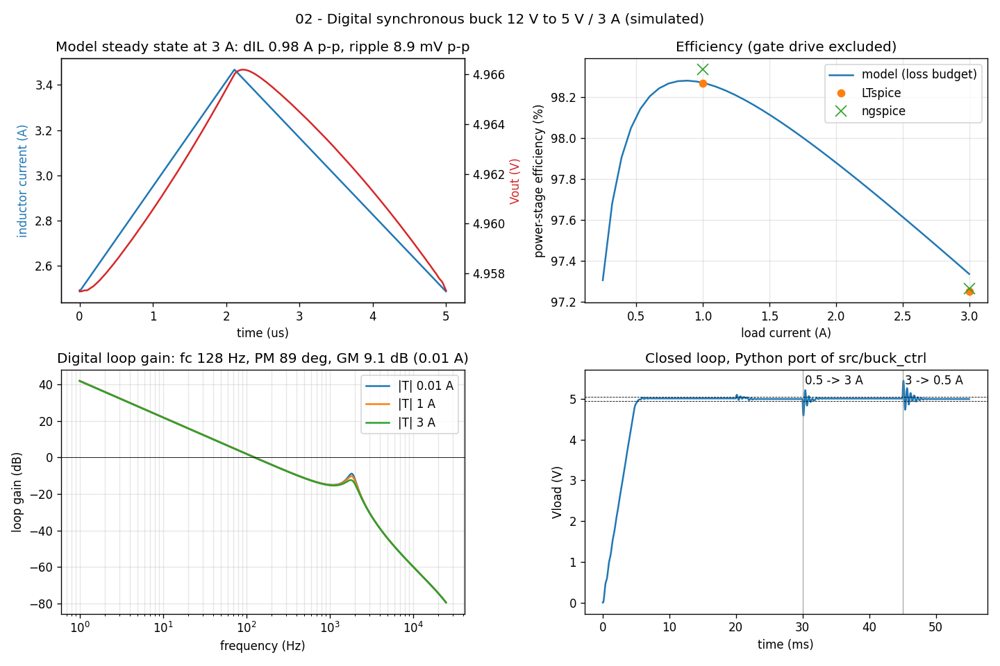
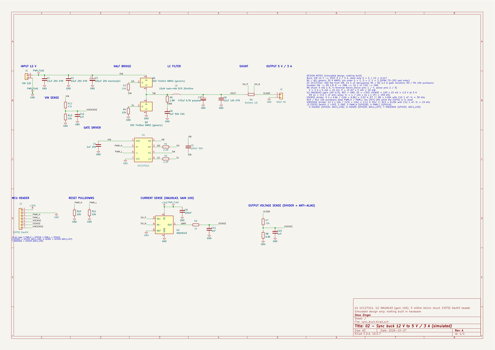

# 02 - Digital Synchronous Buck Converter (12 V to 5 V / 3 A)

A simulated design of a digitally controlled synchronous buck: 12 V in, 5 V out at up to 3 A, 200 kHz, two discrete 40 V N-MOSFETs driven by a UCC27211 half-bridge driver, 15 uH / 470 uF output filter, RC snubber on the switch node, and an ESP32-class controller closing the loop in C. The controller samples the output (10k / 6.8k divider), the load current (5 mOhm shunt + INA181A3) and the input voltage (47k / 10k divider) at 50 kHz and runs a PI loop on volts with input-voltage and reference feed-forward, an integrator dead band, DPWM hysteresis, anti-windup, a pre-bias-safe soft start and a latching over-current trip. Everything is simulation and host tests; no hardware was built.

| Item | Value |
|---|---|
| Input / output | 12 V (10.8 to 13.2 V) / 5.0 V, 3 A |
| Switching | 200 kHz, 400-tick DPWM (80 MHz MCPWM timer), 50 ns dead time |
| Power stage | 2 x 40 V N-MOSFET (about 7 mOhm), 15 uH (DCR 20 mOhm, Isat 6 A), 470 uF polymer + 10 uF X7R, 1.8 ohm + 1 nF snubber |
| Control | PI on volts, Kp 0.02 V/V, Ki 800 V/(V s), 50 kHz, crossover 128 Hz, PM 89 deg, GM 9.1 dB at no load |
| Simulated results | ripple 9 mV p-p, efficiency 97.3 % at 3 A and 98.3 % at 1 A (power stage, gate drive excluded), 2.5 A load step -8.3 % / +8.8 %, recovery 1.3 ms / 2.1 ms |

## Quick start

Python 3.9+ with numpy and matplotlib. The model needs no SPICE, simulator or hardware.

```
pip install numpy matplotlib
python3 main.py
```

It prints a PASS/FAIL self-check (design equations, the model against the LTspice and ngspice logs, LTspice against ngspice, the digital loop margins, and a Python port of the controller against the C host test) and writes docs/img/main_py_buck.png; add `--no-plot` to skip the figure.

Other checks, from this folder:

```
sh sim/run_spice.sh                 # LTspice + ngspice 47, logs to docs/ (about 50 s)
make -C test/host test              # controller host test, model in the loop
make -C test/host negative          # the same test against four broken controllers
cd hw/kicad && python3 gen_schematic.py --export && python3 check_netlist.py
```

## Engineering why

The 15 uH inductor keeps ripple at 32 % of the 3 A load and the peak at 3.5 A against a 6 A saturation rating, but the 470 uF output capacitor is sized for load steps rather than the 9 mV ripple, because a PI loop sampled at 50 kHz has to cross over near 130 Hz, far below the 1.9 kHz LC resonance, so the first millisecond of a 2.5 A step is carried by the filter's 0.18 ohm characteristic impedance (an 8 % dip) and not by the controller. Running the PI on volts with input-voltage and reference feed-forward keeps the loop gain constant from 10.8 to 13.2 V and lets soft start follow its ramp, while a 20 mV integrator dead band and 0.75 LSB of duty hysteresis stop the 30 mV DPWM step from pumping that resonance into a limit cycle, at the cost of up to about 20 mV of static error. On the switch node, 40 V FETs and a 1.8 ohm + 1 nF snubber spend about 40 mW (0.3 points of efficiency) to cut the simulated ringing peak from 27.9 V to 22.2 V in LTspice (22.8 V to 20.1 V in ngspice), leaving more than 40 % margin to the 40 V rating.

## Verification

Each block below is copied from the log named above it, produced by the command shown (run 2026-10-27 on macOS). Everything is simulation and host tests; no hardware was built.

### Standalone model (main.py)

`python3 main.py` (docs/main_py.log). Exit code 0 means every check passed.

```
Sync buck 02 - main.py (simulated design; no hardware built)
Constants from src/buck_ctrl/buck_config.h: Kp 0.02 V/V, Ki 800 V/(V s), Ts 20 us, DPWM 400 ticks, dead band 20 mV, hysteresis 0.75 LSB

[1] Netlist and firmware constants
  C01 model values = sim/buck_sync.cir           D, L, C7, ESR, DCR, Rsh, dead time           PASS
  C02 firmware fsw / ticks / dead time           200 kHz, 400 ticks, 4 x 12.5 ns = 50 ns      PASS

[2] Design equations (3 A, 12 V)
    D = 0.4167, dIL = 0.972 A p-p (32 % of 3 A), Ipk = 3.49 A, f0 = 1876 Hz, Z0 = 0.177 ohm
  C03 inductor ripple 20-40 % of Iout            32 %                                         PASS
  C04 Ipk <= Isat / 1.2                          3.49 A vs 5.00 A                             PASS
  C05 2.5 A step: Z0 * dI <= 10 % Vout           442 mV (limit 500 mV)                        PASS
  C06 LC resonance > 10 x loop crossover         f0 1876 Hz, fc 127 Hz                        PASS

[3] LTspice vs ngspice (cases: 1 = 3 A, 2 = 1 A, 3 = 3 A no snubber)
  C07 vout_avg case 1                            LT 4.9613  ng 4.965  rel 0.0752 %            PASS
  C07 vout_avg case 2                            LT 5.0457  ng 5.047  rel 0.0272 %            PASS
  C07 il_pp case 1                               LT 0.97635  ng 0.97772  rel 0.14 %           PASS
  C07 il_pp case 2                               LT 0.97872  ng 0.97857  rel 0.0155 %         PASS
  C07 vout_pp case 1                             LT 0.0091524  ng 0.0092951  rel 1.56 %       PASS
  C07 vout_pp case 2                             LT 0.0089283  ng 0.0089842  rel 0.626 %      PASS
  C07 pin case 1                                 LT 15.186  ng 15.207  rel 0.135 %            PASS
  C07 pin case 2                                 LT 5.1814  ng 5.1807  rel 0.0118 %           PASS
  C07 pout case 1                                LT 14.768  ng 14.791  rel 0.15 %             PASS
  C07 pout case 2                                LT 5.0917  ng 5.0945  rel 0.0544 %           PASS
  C07 eff case 1                                 LT 0.9725  ng 0.97264  abs 0.000146          PASS
  C07 eff case 2                                 LT 0.98271  ng 0.98336  abs 0.000651         PASS
  C07 pgate case 1                               LT 0.095451  ng 0.095092  rel 0.376 %        PASS
  C07 pgate case 2                               LT 0.095232  ng 0.095293  rel 0.0637 %       PASS
  C08 LTspice Vsw peak < 0.75 BVdss              max 27.9 V (limit 30 V)                      PASS
  C09 LTspice snubber lowers the Vsw peak        22.2 V with, 27.9 V without                  PASS
  C08 ngspice Vsw peak < 0.75 BVdss              max 22.8 V (limit 30 V)                      PASS
  C09 ngspice snubber lowers the Vsw peak        20.1 V with, 22.8 V without                  PASS

[4] Model vs SPICE
  C10 Vout full 3 A vs LT                        model 4.9619 V, SPICE 4.9613 V               PASS
  C11 dIL p-p full 3 A vs LT                     model 0.981 A, SPICE 0.976 A                 PASS
  C12 Vout ripple full 3 A vs LT                 model 8.91 mV, SPICE 9.15 mV                 PASS
  C13 efficiency full 3 A vs LT                  model 97.34 %, SPICE 97.25 %                 PASS
  C14 gate drive full 3 A vs LT                  model 87 mW, SPICE 95 mW                     PASS
  C15 snubber loss full 3 A vs LT                C Vin^2 fsw 28.8 mW (+/-50 %), SPICE 41.2 mW PASS
  C10 Vout full 3 A vs ng                        model 4.9619 V, SPICE 4.9650 V               PASS
  C11 dIL p-p full 3 A vs ng                     model 0.981 A, SPICE 0.978 A                 PASS
  C12 Vout ripple full 3 A vs ng                 model 8.91 mV, SPICE 9.30 mV                 PASS
  C13 efficiency full 3 A vs ng                  model 97.34 %, SPICE 97.26 %                 PASS
  C14 gate drive full 3 A vs ng                  model 87 mW, SPICE 95 mW                     PASS
  C15 snubber loss full 3 A vs ng                C Vin^2 fsw 28.8 mW (+/-50 %), SPICE 36.7 mW PASS
    loss budget at 3 A (mW): HS conduction 26, LS conduction 34, inductor DCR 179, shunt 44, Cin ESR 6, Cout ESR 1, HS switching 11, dead-time diode 45, reverse recovery 30, snubber 29
  C16 FET Tj at 50 degC ambient < 100 degC       HS 66 mW, LS 79 mW -> Tj 54 degC             PASS
  C17 inductor temperature < 100 degC            179 mW -> 57 degC                            PASS
  C10 Vout light 1 A vs LT                       model 5.0272 V, SPICE 5.0457 V               PASS
  C11 dIL p-p light 1 A vs LT                    model 0.979 A, SPICE 0.979 A                 PASS
  C12 Vout ripple light 1 A vs LT                model 8.94 mV, SPICE 8.93 mV                 PASS
  C13 efficiency light 1 A vs LT                 model 98.27 %, SPICE 98.27 %                 PASS
  C14 gate drive light 1 A vs LT                 model 87 mW, SPICE 95 mW                     PASS
  C15 snubber loss light 1 A vs LT               C Vin^2 fsw 28.8 mW (+/-50 %), SPICE 24.5 mW PASS
  C10 Vout light 1 A vs ng                       model 5.0272 V, SPICE 5.0470 V               PASS
  C11 dIL p-p light 1 A vs ng                    model 0.979 A, SPICE 0.979 A                 PASS
  C12 Vout ripple light 1 A vs ng                model 8.94 mV, SPICE 8.98 mV                 PASS
  C13 efficiency light 1 A vs ng                 model 98.27 %, SPICE 98.34 %                 PASS
  C14 gate drive light 1 A vs ng                 model 87 mW, SPICE 95 mW                     PASS
  C15 snubber loss light 1 A vs ng               C Vin^2 fsw 28.8 mW (+/-50 %), SPICE 24.7 mW PASS

[5] Digital loop (PI + feed-forward, 50 kHz, 1-sample delay)
  C18 margins 0.01 A                             fc 128 Hz, PM 89 deg, GM 9.1 dB              PASS
  C18 margins 1 A                                fc 127 Hz, PM 89 deg, GM 10.5 dB             PASS
  C18 margins 3 A                                fc 126 Hz, PM 89 deg, GM 12.9 dB             PASS
  C18 margins 0.01 A, L +20 %                    fc 128 Hz, PM 89 deg, GM 7.6 dB              PASS
  C18 margins 0.01 A, C -20 %                    fc 128 Hz, PM 90 deg, GM 8.9 dB              PASS
  C18 margins 0.01 A, L -20 % C +20 %            fc 128 Hz, PM 89 deg, GM 11.0 dB             PASS

[6] Python port of the controller vs the C host test
  C19 host test log RESULT all PASS              19/19                                        PASS
  C20 0.5 -> 3 A dip: Python vs C                Python 4.5864 V, C 4.5864 V                  PASS
  C21 3 -> 0.5 A peak: Python vs C               Python 5.4419 V, C 5.4419 V                  PASS

RESULT: 59/59 PASS
figure: docs/img/main_py_buck.png
```



*main.py: modelled inductor current and output ripple at 3 A (top left), efficiency from the loss budget with the LTspice and ngspice points (top right), digital loop gain at three loads (bottom left), and the Python port of the controller through soft start and the 2.5 A load steps (bottom right).*

### LTspice power stage

`sh sim/run_spice.sh` runs `LTspice -b sim/buck_sync.cir` (open loop, fixed duty 0.4195, three stepped cases: 1 = 3 A, 2 = 1 A, 3 = 3 A without snubber, measured over 1.00 to 1.05 ms after starting from the settled operating point). Measurement section of docs/sim_ltspice.log (the script converts LTspice's UTF-16 log to UTF-8):

```
Measurement: vout_avg
  step	AVG(v(vload))	FROM	TO
     1	4.96132	0.001	0.00105
     2	5.04566	0.001	0.00105
     3	4.95987	0.001	0.00105

Measurement: vout_pp
  step	PP(v(vload))	FROM	TO
     1	0.00915241	0.001	0.00105
     2	0.0089283	0.001	0.00105
     3	0.00914478	0.001	0.00105

Measurement: il_avg
  step	AVG(i(l1))	FROM	TO
     1	2.97249	0.001	0.00105
     2	1.00848	0.001	0.00105
     3	2.97174	0.001	0.00105

Measurement: il_pp
  step	PP(i(l1))	FROM	TO
     1	0.976345	0.001	0.00105
     2	0.978718	0.001	0.00105
     3	0.976289	0.001	0.00105

Measurement: pin
  step	AVG(-v(vsrc)*i(v1))	FROM	TO
     1	15.1862	0.001	0.00105
     2	5.18135	0.001	0.00105
     3	15.1747	0.001	0.00105

Measurement: pout
  step	AVG(v(vload)*v(vload)/rload)	FROM	TO
     1	14.7685	0.001	0.00105
     2	5.09174	0.001	0.00105
     3	14.7599	0.001	0.00105

Measurement: pgate
  step	AVG(-(v(ghd,sw)*i(vgh)+v(gld)*i(vgl)))	FROM	TO
     1	0.0954512	0.001	0.00105
     2	0.0952321	0.001	0.00105
     3	0.0945081	0.001	0.00105

Measurement: psnub
  step	AVG(v(sw,snb)*i(rsn))	FROM	TO
     1	0.0411916	0.001	0.00105
     2	0.0244952	0.001	0.00105
     3	6.20517e-10	0.001	0.00105

Measurement: vsw_max
  step	MAX(v(sw))	FROM	TO
     1	22.2205	0.001	0.00105
     2	17.8984	0.001	0.00105
     3	27.9306	0.001	0.00105

Measurement: eff
  step	pout/pin
     1	0.972498
     2	0.982705
     3	0.972665
```

### ngspice 47 cross-check

The same circuit and VDMOS card in ngspice dialect (sim/ngspice/buck_sync_ngspice.cir): the `.step`/`table()` sweep becomes a control-block loop with `alterparam` + `reset`, and the measurements move into the control block. Measurement lines of docs/sim_ngspice.log (`grep -E "^step|^[a-z_]+ += " docs/sim_ngspice.log`):

```
step 1 RLOAD=1.6667 SNUB=1
vout_avg            =  4.96505e+00 from=  1.00000e-03 to=  1.05000e-03
vout_pp             =  9.29507e-03 from=  1.00000e-03 to=  1.05000e-03
il_avg              =  2.97308e+00 from=  1.00000e-03 to=  1.05000e-03
il_pp               =  9.77716e-01 from=  1.00000e-03 to=  1.05000e-03
pin                 =  1.52067e+01 from=  1.00000e-03 to=  1.05000e-03
pout                =  1.47907e+01 from=  1.00000e-03 to=  1.05000e-03
pgate               =  9.50925e-02 from=  1.00000e-03 to=  1.05000e-03
psnub               =  3.66659e-02 from=  1.00000e-03 to=  1.05000e-03
vsw_max             =  2.01266e+01 at=  1.04506e-03
eff = 0.972644
step 2 RLOAD=5 SNUB=1
vout_avg            =  5.04703e+00 from=  1.00000e-03 to=  1.05000e-03
vout_pp             =  8.98421e-03 from=  1.00000e-03 to=  1.05000e-03
il_avg              =  1.00808e+00 from=  1.00000e-03 to=  1.05000e-03
il_pp               =  9.78566e-01 from=  1.00000e-03 to=  1.05000e-03
pin                 =  5.18074e+00 from=  1.00000e-03 to=  1.05000e-03
pout                =  5.09451e+00 from=  1.00000e-03 to=  1.05000e-03
pgate               =  9.52928e-02 from=  1.00000e-03 to=  1.05000e-03
psnub               =  2.47471e-02 from=  1.00000e-03 to=  1.05000e-03
vsw_max             =  1.76416e+01 at=  1.02006e-03
eff = 0.983356
step 3 RLOAD=1.6667 SNUB=0
vout_avg            =  4.96347e+00 from=  1.00000e-03 to=  1.05000e-03
vout_pp             =  9.22277e-03 from=  1.00000e-03 to=  1.05000e-03
il_avg              =  2.97294e+00 from=  1.00000e-03 to=  1.05000e-03
il_pp               =  9.77638e-01 from=  1.00000e-03 to=  1.05000e-03
pin                 =  1.52103e+01 from=  1.00000e-03 to=  1.05000e-03
pout                =  1.47813e+01 from=  1.00000e-03 to=  1.05000e-03
pgate               =  9.47475e-02 from=  1.00000e-03 to=  1.05000e-03
psnub               =  4.67871e-12 from=  1.00000e-03 to=  1.05000e-03
vsw_max             =  2.27861e+01 at=  1.01506e-03
eff = 0.971796
```

main.py compares the two simulators (check group [3] above): Vout within 0.08 %, inductor ripple within 0.14 %, output ripple within 1.6 %, efficiency within 0.07 points, gate-drive power within 0.4 %. The switch-node peaks differ (27.9 V vs 22.8 V without snubber) because the ringing lasts a few nanoseconds and each simulator resolves it with its own time-step control; both stay below 30 V (75 % of BVdss) and both show the snubber lowering the peak.

### Controller host test (model in the loop)

`make -C test/host test` (docs/host_test.log). The controller (src/buck_ctrl) is compiled for the host with `-Wall -Wextra -Werror` and run against an averaged model of the power stage (test/host/plant.c, same component values as the SPICE decks), with 12-bit ADC quantisation, the 1 nF anti-alias filter, the 400-tick DPWM and a one-period computation delay.

```
./build/test_buck
02 sync buck controller - host test (model in the loop)
Kp 0.02 V/V, Ki 800 V/(V s), Ts 20 us, DPWM 400 ticks, dead band 20 mV, DPWM hysteresis 0.75 LSB, OCP 4.5 A x 3
# closed loop: soft start at 1 A, Vin 12 V
PASS startup overshoot <= 2 %         max 5.0271 V (limit 5.10 V)
PASS startup settle +/-1 % <= 8 ms    5.26 ms (limit 8 ms)
# steady state 1 A, 12-20 ms
PASS dc error <= 0.5 %                mean 5.0081 V (target 5.0 V)
PASS no limit cycle (duty steady)     0 duty-code changes (limit 0)
PASS low-frequency p-p <= 5 mV        0.00 mV (limit 5 mV)
# load step 0.5 -> 3 A at 30 ms, release 3 -> 0.5 A at 45 ms
PASS step dip >= 4.50 V (-10 %)       min 4.5864 V (limit 4.50 V)
PASS step recovery +/-1 % <= 5 ms     1.30 ms (limit 5 ms)
PASS release peak <= 5.50 V (+10 %)   max 5.4419 V (limit 5.50 V)
PASS release recovery +/-1 % <= 5 ms  2.10 ms (limit 5 ms)
# line ramps at 1 A: 12 -> 10.8 V at 65 ms, 10.8 -> 13.2 V at 80 ms (1 ms each)
PASS line deviation <= 2 %            80.8 mV (limit 100 mV)
PASS line recovery +/-1 % <= 5 ms     0.86 ms (limit 5 ms)
# overload 0.8 ohm (6.25 A) at 100 ms
PASS OCP latches within 3 samples     3 samples (limit 3)
PASS inductor peak < Isat 6 A         2.19 A (limit 6.0 A)
PASS stays off after the trip         duty 0, state 3
# unit: integrator windup (output held at 0 V for 20 ms, then 5.5 V)
PASS Vref + integrator <= Dmax x Vin  10.800 V (limit 10.80 V)
PASS unwinds to 50 % within 1.1 x bound 11.96 ms (limit 13.17 ms)
# unit: OCP needs consecutive samples, then latches
PASS 2 + 2 split samples: no trip     state 2 (fault = 3)
PASS 3rd sample trips, start ignored  state 3, fault code 1
# unit: pre-biased start
PASS soft start begins at 3 V pre-bias vref 3.000 V (expected 3.0 V)
RESULT: 19/19 PASS
```

### Negative gate

`make -C test/host negative` (docs/host_negative.log) builds four broken controllers and passes only if the host test fails against every one: M1 without the integrator dead band (limit cycle), M2 with both anti-windup lines deleted (the integrator winds up to 75 V), M3 with the over-current trip out of reach (the inductor reaches 9.7 A), M4 with plain rounding instead of DPWM hysteresis (the load release rings for about 10 ms).

```
== mutant m1 ==
FAIL no limit cycle (duty steady)     5 duty-code changes (limit 0)
FAIL low-frequency p-p <= 5 mV        76.42 mV (limit 5 mV)
RESULT: 17/19 PASS
mutant m1: test FAILED as required
== mutant m2 ==
FAIL Vref + integrator <= Dmax x Vin  74.980 V (limit 10.80 V)
FAIL unwinds to 50 % within 1.1 x bound 40.00 ms (limit 13.17 ms)
RESULT: 17/19 PASS
mutant m2: test FAILED as required
== mutant m3 ==
FAIL OCP latches within 3 samples     -1 samples (limit 3)
FAIL inductor peak < Isat 6 A         9.65 A (limit 6.0 A)
FAIL stays off after the trip         duty 157, state 2
FAIL 3rd sample trips, start ignored  state 1, fault code 0
RESULT: 15/19 PASS
mutant m3: test FAILED as required
== mutant m4 ==
FAIL release recovery +/-1 % <= 5 ms  9.72 ms (limit 5 ms)
RESULT: 18/19 PASS
mutant m4: test FAILED as required
NEGATIVE GATE: 4/4 mutants caught
```

### KiCad ERC and netlist check

`cd hw/kicad && python3 gen_schematic.py --export`, then `kicad-cli sch erc` and `python3 check_netlist.py` (docs/kicad_erc.log; the ERC report also lists four checks set to ignore, as in project 01):

```
# cmd: cd hw/kicad && python3 gen_schematic.py --export
# cmd: kicad-cli sch erc --severity-all -o erc.rpt sync_buck.kicad_sch
# cmd: python3 check_netlist.py
 ** ERC messages: 0  Errors 0  Warnings 0
    - Global label only appears once in the schematic
    - Four connection points are joined together
    - SPICE model issue
    - Assigned footprint doesn't match footprint filters
PASS VIN      C1.1 C2.1 C3.1 C4.1 J1.1 Q1.2 R12.1 U1.1
PASS GND      C1.2 C10.2 C11.2 C12.2 C2.2 C3.2 C4.2 C6.2 C7.2 C8.2 C9.2 J1.2 J2.2 J3.2 Q2.3 R10.2 R11.2 R13.2 R4.2 R8.2 U1.7 U2.2 U2.5
PASS SW       C5.2 L1.1 Q1.3 Q2.2 R3.2 R5.1 U1.4
PASS GH       Q1.1 R1.2 R3.1
PASS GL       Q2.1 R2.2 R4.1
PASS HO       R1.1 U1.3
PASS LO       R2.1 U1.8
PASS HB       C5.1 U1.2
PASS SNB      C6.1 R5.2
PASS VOUT     C7.1 C8.1 L1.2 R6.1
PASS SH_P     R6.2 U2.3
PASS SH_N     R6.3 U2.4
PASS VLOAD    J2.1 R6.4 R7.1
PASS VSENSE   C10.1 J3.5 R7.2 R8.1
PASS VINSENSE C12.1 J3.7 R12.2 R13.1
PASS IAMP     R9.1 U2.1
PASS ISENSE   C11.1 J3.6 R9.2
PASS PWM_H    J3.3 R10.1 U1.5
PASS PWM_L    J3.4 R11.1 U1.6
PASS +3V3     C9.1 J3.1 U2.6
info: 0 single-pin nets (expected 0)
RESULT: PASS
```



*Schematic: KiCad 10, generated by hw/kicad/gen_schematic.py, ERC 0 errors / 0 warnings, netlist check PASS on every net.*

## Design notes

- Duty and ripple: D = 5/12 = 0.417; with 15 uH at 200 kHz the inductor ripple is 0.97 A p-p (32 % of 3 A), peak 3.49 A against Isat 6 A (C04: limit Isat/1.2).
- Output capacitor: the ripple target alone would allow far less than 470 uF; the capacitor is sized so that Z0 x dI = 0.177 ohm x 2.5 A = 442 mV stays under 10 % of Vout (C05). The ripple is 9 mV p-p, mostly the polymer capacitor's 10 mOhm ESR.
- Losses at 3 A (main.py loss budget): inductor DCR 179 mW is the largest term, then dead-time body-diode conduction 45 mW, shunt 44 mW, low-side conduction 34 mW, reverse recovery 30 mW, snubber 29 mW, high-side conduction 26 mW, high-side switching 11 mW. A lower-DCR inductor is the first efficiency lever.
- Thermal: about 66 mW (high side) and 79 mW (low side) per FET; at an assumed 50 degC/W (SO-8 class on 1 in^2 of copper) and 50 degC ambient the junctions stay near 54 degC (C16).
- Effective duty: SPICE runs at a commanded 0.4195 but the high-side switch stays on longer than its gate command by its turn-off delay, which main.py estimates from the VDMOS card (gate RC to the Miller plateau); this is why the open-loop output is 4.96 V and not 0.4195 x 12 - drops.
- Snubber: R close to sqrt(Lloop / Coss) for a 1 nH commutation loop and about 0.3 nF of switch-node capacitance, C about 3 to 4 x Coss; its loss is close to C x Vin^2 x fsw = 29 mW (C15 accepts +/-50 % of that rule of thumb).
- Loop: with duty = (Vref + PI) / Vin the modulator gain is 1 V/V at any input voltage, so the margins in C18 hold across the input range; the worst corner (no load, L +20 %) still has 7.6 dB of gain margin.
- Limit cycle: the ADC resolves 2 mV at the output but one DPWM tick is 30 mV, so an integrator always finds an error to integrate; the dead band (20 mV, more than half a tick) and the 0.75 LSB hysteresis remove that, and M1 / M4 in the negative gate show what happens without them.

## Pin map (ESP32 header J3)

| J3 pin | Signal | ESP32 |
|---|---|---|
| 1 | +3V3 | 3V3 |
| 2 | GND | GND |
| 3 | PWM_H (UCC27211 HI) | GPIO18, MCPWM high-side output |
| 4 | PWM_L (UCC27211 LI) | GPIO19, MCPWM complementary output with 50 ns dead time |
| 5 | VSENSE (VLOAD x 0.405) | GPIO34, ADC1_CH6 |
| 6 | ISENSE (0.5 V/A) | GPIO35, ADC1_CH7 |
| 7 | VINSENSE (VIN x 0.175) | GPIO33, ADC1_CH5 |

## Known limitations

- Simulation only: no PCB layout, no measured losses; the 1 nH commutation loop is an assumption and the FET is a generic VDMOS card, not a vendor model.
- Inductor core loss, Rds(on) temperature rise and ADC noise and nonlinearity are not modelled.
- The controller is portable C tested on the host. The ESP32 glue (MCPWM complementary outputs, ADC sampling at 50 kHz, the control interrupt) is not written yet, so nothing has run on the MCU.
- The over-current trip is sampled (3 x 20 us). It handles overloads; a hard short needs a hardware comparator into the MCPWM fault input, which is not in this design.
- Below about 7 V the UCC27211's own under-voltage lockout stops the bridge; the firmware has no separate input under-voltage lockout.

## Status

Done:
- main.py standalone model and self-check, all PASS.
- LTspice and ngspice 47 power-stage simulations, cross-checked.
- Controller in C with a model-in-the-loop host test (19/19) and a four-mutant negative gate.
- KiCad schematic (ERC clean, netlist verified).

Not done:
- ESP32 hardware glue and an on-target run.
- PCB layout.

## Tools used

- Python 3 + numpy + matplotlib
- LTspice (macOS, batch mode)
- ngspice 47
- clang (host test)
- KiCad 10 (kicad-cli)

## Credits

Designed, specified and verified by Shon Zinger. Claude (Anthropic) assisted with: the power-stage and loop calculations, the LTspice and ngspice decks, the C controller and its host test harness, the KiCad schematic generator, main.py, and documentation.
