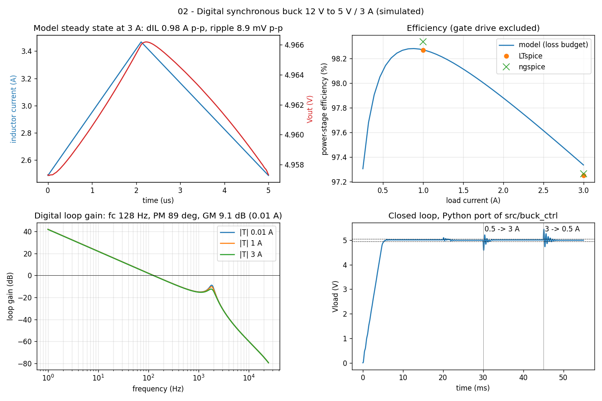
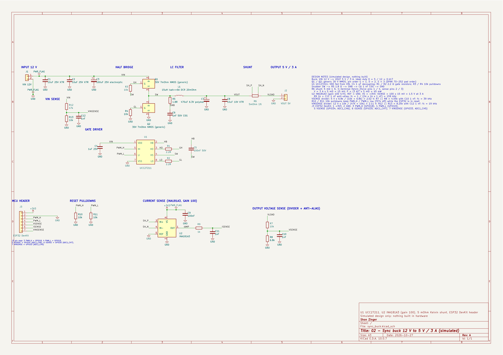
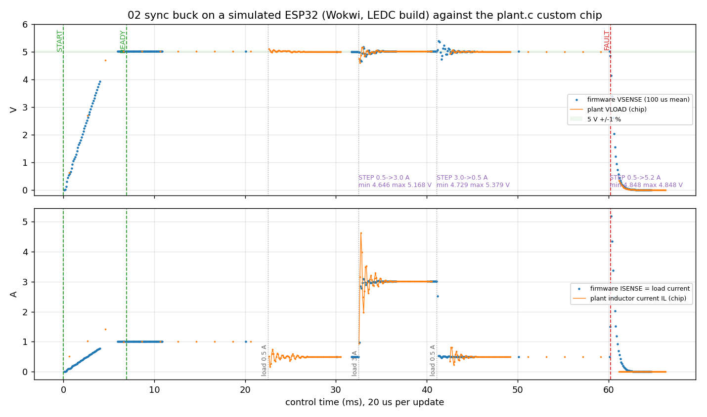
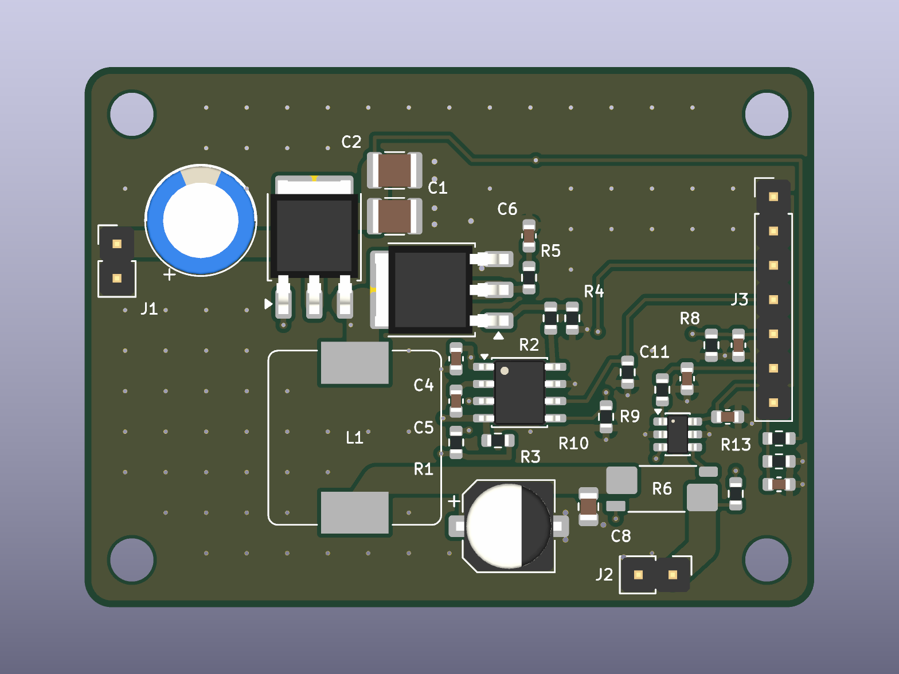
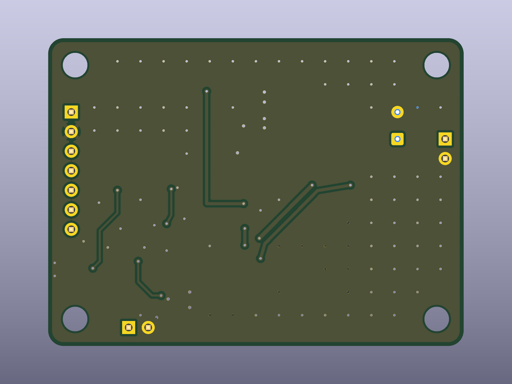
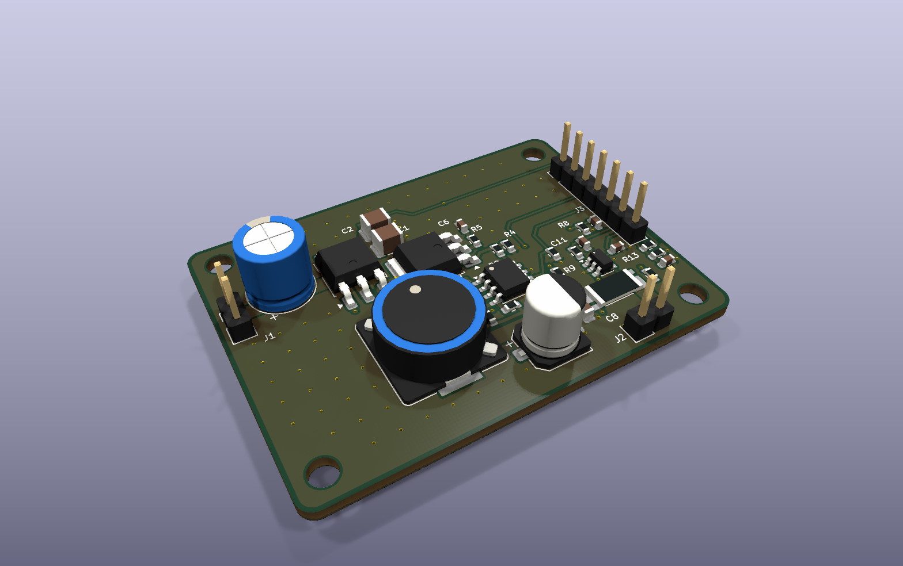

# 02 - Digital Synchronous Buck Converter (12 V to 5 V / 3 A)

## In plain words

- **What it is:** a power converter that steps 12 V down to 5 V, like the adapter that turns a car's supply into a phone charge, but with the control loop done in software on a microcontroller (a small programmable chip).
- **Why it matters:** converters like this sit inside nearly every electronic product, and wasting less power as heat means smaller, cooler devices.
- **What was done:** I designed the circuit, wrote the control code in C and laid out the PCB (the green circuit board), then tested them in circuit simulators and software tests. It is simulated only: no hardware was built.
- **Headline result:** in simulation the output ripple is 9 mV p-p and the efficiency is 97.3 % at 3 A (power stage only, gate drive excluded).
- **Try it:** `python3 main.py`

A simulated design of a digitally controlled synchronous buck: 12 V in, 5 V out at up to 3 A, 200 kHz, two discrete 40 V N-MOSFETs driven by a UCC27211 half-bridge driver, 15 uH / 470 uF output filter, RC snubber on the switch node, and an ESP32-class controller closing the loop in C. The controller samples the output (10k / 6.8k divider), the load current (5 mOhm shunt + INA181A3) and the input voltage (47k / 10k divider) at 50 kHz and runs a PI loop on volts with input-voltage and reference feed-forward, an integrator dead band, DPWM hysteresis, anti-windup, a pre-bias-safe soft start and a latching over-current trip. The ESP32 firmware around that controller compiles. A simulator build of it ran on a simulated ESP32 in Wokwi against the host test's power-stage model: soft start, load steps and an over-current trip. The board is laid out in KiCad: 2 layers, DRC clean, Gerbers and drill files exported. Everything is simulation, host tests and design files; no hardware was built.

| Item | Value |
|---|---|
| Input / output | 12 V (10.8 to 13.2 V) / 5.0 V, 3 A |
| Switching | 200 kHz, 400-tick DPWM (80 MHz MCPWM timer), 50 ns dead time |
| Power stage | 2 x 40 V N-MOSFET (about 7 mOhm), 15 uH (DCR 20 mOhm, Isat 6 A), 470 uF polymer + 10 uF X7R, 1.8 ohm + 1 nF snubber |
| Control | PI on volts, Kp 0.02 V/V, Ki 800 V/(V s), 50 kHz, crossover 128 Hz, PM 89 deg, GM 9.1 dB at no load |
| Simulated results | ripple 9 mV p-p, efficiency 97.3 % at 3 A and 98.3 % at 1 A (power stage, gate drive excluded), 2.5 A load step -8.3 % / +8.8 %, recovery 1.3 ms / 2.1 ms |
| Firmware | ESP32, Arduino-ESP32 core 3.2.0. Product build: MCPWM outputs with 50 ns hardware dead time, ADC1 sampling, 50 kHz control task on core 1, over-current and overrun latches (compile-only; never executed, not even in simulation). LEDC build for Wokwi |
| On-target run (Wokwi) | LEDC sim build at 20x time dilation (times are control time): soft start within +/-1 % in 5.4 ms; 0.5 -> 3 -> 0.5 A steps inside +/-10 %; 6.25 A overload: OCP latched 40 us after the first over-limit sample (3 samples) with both gates low; 0 shoot-through in 375,364 dead times |
| PCB | 54 x 40 mm, 2 layers, 1 oz. DRC: 0 violations, 0 unconnected, 0 parity errors. Layout checks: 39/39 (23 of them on sabotaged copies). Gerbers and Excellon drill files |

## Quick start

Python 3.9+ with numpy and matplotlib. The model needs no SPICE, simulator or hardware.

```
pip install numpy matplotlib
python3 main.py
```

It prints a PASS/FAIL self-check (design equations, the model against the LTspice and ngspice logs, LTspice against ngspice, the digital loop margins, and a Python port of the controller against the C host test) and writes docs/img/main_py_buck.png; add `--no-plot` to skip the figure.

Other checks, from this folder:

```
sh sim/run_spice.sh                 # LTspice + ngspice 47, logs to docs/ (about 50 s)
make -C test/host test              # controller host test, model in the loop
make -C test/host negative          # the same test against four broken controllers
cd hw/kicad && python3 gen_schematic.py --export && python3 check_netlist.py
```

Firmware (arduino-cli 1.2.0 with the esp32:esp32 core 3.2.0), from this folder. The first command builds the product (MCPWM). The second builds the Wokwi variant (LEDC) into sim/wokwi/build:

```
arduino-cli compile -b esp32:esp32:esp32 --warnings all --clean --library src/buck_ctrl src/buck_esp32
arduino-cli compile -b esp32:esp32:esp32 --warnings all --clean --library src/buck_ctrl \
  --build-property "compiler.cpp.extra_flags=-DBUCK_PWM_LEDC" \
  --build-property "compiler.c.extra_flags=-DBUCK_PWM_LEDC" \
  --output-dir sim/wokwi/build src/buck_esp32
```

On-target run in Wokwi. It needs a WASI-SDK clang for the power-stage chip and your own free Wokwi CI token. See [sim/wokwi/README_WOKWI.md](sim/wokwi/README_WOKWI.md):

```
sim/wokwi/build_chip.sh --web
cd sim/wokwi && WOKWI_CLI_TOKEN=... wokwi-cli . --scenario buck_steps.test.yaml --timeout 4000 --serial-log-file ../../docs/wokwi_serial.log
```

PCB. Run these with KiCad 10's bundled Python, which provides `pcbnew`; on macOS it is /Applications/KiCad/KiCad.app/Contents/Frameworks/Python.framework/Versions/3.9/bin/python3:

```
cd hw/kicad && python3 gen_pcb.py --export   # board, DRC, Gerbers, drill files, renders
python3 check_pcb.py                          # layout checks and sabotaged copies
```

## Engineering why

The 15 uH inductor keeps ripple at 32 % of the 3 A load and the peak at 3.5 A against a 6 A saturation rating, but the 470 uF output capacitor is sized for load steps rather than the 9 mV ripple, because a PI loop sampled at 50 kHz has to cross over near 130 Hz, far below the 1.9 kHz LC resonance, so the first millisecond of a 2.5 A step is carried by the filter's 0.18 ohm characteristic impedance (an 8 % dip) and not by the controller. Running the PI on volts with input-voltage and reference feed-forward keeps the loop gain constant from 10.8 to 13.2 V and lets soft start follow its ramp, while a 20 mV integrator dead band and 0.75 LSB of duty hysteresis stop the 30 mV DPWM step from pumping that resonance into a limit cycle, at the cost of up to about 20 mV of static error. On the switch node, 40 V FETs and a 1.8 ohm + 1 nF snubber spend about 40 mW (0.3 points of efficiency) to cut the simulated ringing peak from 27.9 V to 22.2 V in LTspice (22.8 V to 20.1 V in ngspice), leaving more than 40 % margin to the 40 V rating.

## Verification

Each block below is copied from the log named above it and was produced by the command shown. All runs were on macOS. The model, SPICE and host-test runs are from 2026-10-27. The schematic ERC, firmware, Wokwi and PCB runs are from 2026-11-03. Everything is simulation, host tests and design checks; no hardware was built.

### Standalone model (main.py)

`python3 main.py` (docs/main_py.log). Exit code 0 means every check passed.

```
Sync buck 02 - main.py (simulated design; no hardware built)
Constants from src/buck_ctrl/buck_config.h: Kp 0.02 V/V, Ki 800 V/(V s), Ts 20 us, DPWM 400 ticks, dead band 20 mV, hysteresis 0.75 LSB

[1] Netlist and firmware constants
  C01 model values = sim/buck_sync.cir           D, L, C7, ESR, DCR, Rsh, dead time           PASS
  C02 firmware fsw / ticks / dead time           200 kHz, 400 ticks, 4 x 12.5 ns = 50 ns      PASS

[2] Design equations (3 A, 12 V)
    D = 0.4167, dIL = 0.972 A p-p (32 % of 3 A), Ipk = 3.49 A, f0 = 1876 Hz, Z0 = 0.177 ohm
  C03 inductor ripple 20-40 % of Iout            32 %                                         PASS
  C04 Ipk <= Isat / 1.2                          3.49 A vs 5.00 A                             PASS
  C05 2.5 A step: Z0 * dI <= 10 % Vout           442 mV (limit 500 mV)                        PASS
  C06 LC resonance > 10 x loop crossover         f0 1876 Hz, fc 127 Hz                        PASS

[3] LTspice vs ngspice (cases: 1 = 3 A, 2 = 1 A, 3 = 3 A no snubber)
  C07 vout_avg case 1                            LT 4.9613  ng 4.965  rel 0.0752 %            PASS
  C07 vout_avg case 2                            LT 5.0457  ng 5.047  rel 0.0272 %            PASS
  C07 il_pp case 1                               LT 0.97635  ng 0.97772  rel 0.14 %           PASS
  C07 il_pp case 2                               LT 0.97872  ng 0.97857  rel 0.0155 %         PASS
  C07 vout_pp case 1                             LT 0.0091524  ng 0.0092951  rel 1.56 %       PASS
  C07 vout_pp case 2                             LT 0.0089283  ng 0.0089842  rel 0.626 %      PASS
  C07 pin case 1                                 LT 15.186  ng 15.207  rel 0.135 %            PASS
  C07 pin case 2                                 LT 5.1814  ng 5.1807  rel 0.0118 %           PASS
  C07 pout case 1                                LT 14.768  ng 14.791  rel 0.15 %             PASS
  C07 pout case 2                                LT 5.0917  ng 5.0945  rel 0.0544 %           PASS
  C07 eff case 1                                 LT 0.9725  ng 0.97264  abs 0.000146          PASS
  C07 eff case 2                                 LT 0.98271  ng 0.98336  abs 0.000651         PASS
  C07 pgate case 1                               LT 0.095451  ng 0.095092  rel 0.376 %        PASS
  C07 pgate case 2                               LT 0.095232  ng 0.095293  rel 0.0637 %       PASS
  C08 LTspice Vsw peak < 0.75 BVdss              max 27.9 V (limit 30 V)                      PASS
  C09 LTspice snubber lowers the Vsw peak        22.2 V with, 27.9 V without                  PASS
  C08 ngspice Vsw peak < 0.75 BVdss              max 22.8 V (limit 30 V)                      PASS
  C09 ngspice snubber lowers the Vsw peak        20.1 V with, 22.8 V without                  PASS

[4] Model vs SPICE
  C10 Vout full 3 A vs LT                        model 4.9619 V, SPICE 4.9613 V               PASS
  C11 dIL p-p full 3 A vs LT                     model 0.981 A, SPICE 0.976 A                 PASS
  C12 Vout ripple full 3 A vs LT                 model 8.91 mV, SPICE 9.15 mV                 PASS
  C13 efficiency full 3 A vs LT                  model 97.34 %, SPICE 97.25 %                 PASS
  C14 gate drive full 3 A vs LT                  model 87 mW, SPICE 95 mW                     PASS
  C15 snubber loss full 3 A vs LT                C Vin^2 fsw 28.8 mW (+/-50 %), SPICE 41.2 mW PASS
  C10 Vout full 3 A vs ng                        model 4.9619 V, SPICE 4.9650 V               PASS
  C11 dIL p-p full 3 A vs ng                     model 0.981 A, SPICE 0.978 A                 PASS
  C12 Vout ripple full 3 A vs ng                 model 8.91 mV, SPICE 9.30 mV                 PASS
  C13 efficiency full 3 A vs ng                  model 97.34 %, SPICE 97.26 %                 PASS
  C14 gate drive full 3 A vs ng                  model 87 mW, SPICE 95 mW                     PASS
  C15 snubber loss full 3 A vs ng                C Vin^2 fsw 28.8 mW (+/-50 %), SPICE 36.7 mW PASS
    loss budget at 3 A (mW): HS conduction 26, LS conduction 34, inductor DCR 179, shunt 44, Cin ESR 6, Cout ESR 1, HS switching 11, dead-time diode 45, reverse recovery 30, snubber 29
  C16 FET Tj at 50 degC ambient < 100 degC       HS 66 mW, LS 79 mW -> Tj 54 degC             PASS
  C17 inductor temperature < 100 degC            179 mW -> 57 degC                            PASS
  C10 Vout light 1 A vs LT                       model 5.0272 V, SPICE 5.0457 V               PASS
  C11 dIL p-p light 1 A vs LT                    model 0.979 A, SPICE 0.979 A                 PASS
  C12 Vout ripple light 1 A vs LT                model 8.94 mV, SPICE 8.93 mV                 PASS
  C13 efficiency light 1 A vs LT                 model 98.27 %, SPICE 98.27 %                 PASS
  C14 gate drive light 1 A vs LT                 model 87 mW, SPICE 95 mW                     PASS
  C15 snubber loss light 1 A vs LT               C Vin^2 fsw 28.8 mW (+/-50 %), SPICE 24.5 mW PASS
  C10 Vout light 1 A vs ng                       model 5.0272 V, SPICE 5.0470 V               PASS
  C11 dIL p-p light 1 A vs ng                    model 0.979 A, SPICE 0.979 A                 PASS
  C12 Vout ripple light 1 A vs ng                model 8.94 mV, SPICE 8.98 mV                 PASS
  C13 efficiency light 1 A vs ng                 model 98.27 %, SPICE 98.34 %                 PASS
  C14 gate drive light 1 A vs ng                 model 87 mW, SPICE 95 mW                     PASS
  C15 snubber loss light 1 A vs ng               C Vin^2 fsw 28.8 mW (+/-50 %), SPICE 24.7 mW PASS

[5] Digital loop (PI + feed-forward, 50 kHz, 1-sample delay)
  C18 margins 0.01 A                             fc 128 Hz, PM 89 deg, GM 9.1 dB              PASS
  C18 margins 1 A                                fc 127 Hz, PM 89 deg, GM 10.5 dB             PASS
  C18 margins 3 A                                fc 126 Hz, PM 89 deg, GM 12.9 dB             PASS
  C18 margins 0.01 A, L +20 %                    fc 128 Hz, PM 89 deg, GM 7.6 dB              PASS
  C18 margins 0.01 A, C -20 %                    fc 128 Hz, PM 90 deg, GM 8.9 dB              PASS
  C18 margins 0.01 A, L -20 % C +20 %            fc 128 Hz, PM 89 deg, GM 11.0 dB             PASS

[6] Python port of the controller vs the C host test
  C19 host test log RESULT all PASS              19/19                                        PASS
  C20 0.5 -> 3 A dip: Python vs C                Python 4.5864 V, C 4.5864 V                  PASS
  C21 3 -> 0.5 A peak: Python vs C               Python 5.4419 V, C 5.4419 V                  PASS

RESULT: 59/59 PASS
figure: docs/img/main_py_buck.png
```



*main.py: modelled inductor current and output ripple at 3 A (top left), efficiency from the loss budget with the LTspice and ngspice points (top right), digital loop gain at three loads (bottom left), and the Python port of the controller through soft start and the 2.5 A load steps (bottom right).*

### LTspice power stage

`sh sim/run_spice.sh` runs `LTspice -b sim/buck_sync.cir` (open loop, fixed duty 0.4195, three stepped cases: 1 = 3 A, 2 = 1 A, 3 = 3 A without snubber, measured over 1.00 to 1.05 ms after starting from the settled operating point). Measurement section of docs/sim_ltspice.log (the script converts LTspice's UTF-16 log to UTF-8):

```
Measurement: vout_avg
  step	AVG(v(vload))	FROM	TO
     1	4.96132	0.001	0.00105
     2	5.04566	0.001	0.00105
     3	4.95987	0.001	0.00105

Measurement: vout_pp
  step	PP(v(vload))	FROM	TO
     1	0.00915241	0.001	0.00105
     2	0.0089283	0.001	0.00105
     3	0.00914478	0.001	0.00105

Measurement: il_avg
  step	AVG(i(l1))	FROM	TO
     1	2.97249	0.001	0.00105
     2	1.00848	0.001	0.00105
     3	2.97174	0.001	0.00105

Measurement: il_pp
  step	PP(i(l1))	FROM	TO
     1	0.976345	0.001	0.00105
     2	0.978718	0.001	0.00105
     3	0.976289	0.001	0.00105

Measurement: pin
  step	AVG(-v(vsrc)*i(v1))	FROM	TO
     1	15.1862	0.001	0.00105
     2	5.18135	0.001	0.00105
     3	15.1747	0.001	0.00105

Measurement: pout
  step	AVG(v(vload)*v(vload)/rload)	FROM	TO
     1	14.7685	0.001	0.00105
     2	5.09174	0.001	0.00105
     3	14.7599	0.001	0.00105

Measurement: pgate
  step	AVG(-(v(ghd,sw)*i(vgh)+v(gld)*i(vgl)))	FROM	TO
     1	0.0954512	0.001	0.00105
     2	0.0952321	0.001	0.00105
     3	0.0945081	0.001	0.00105

Measurement: psnub
  step	AVG(v(sw,snb)*i(rsn))	FROM	TO
     1	0.0411916	0.001	0.00105
     2	0.0244952	0.001	0.00105
     3	6.20517e-10	0.001	0.00105

Measurement: vsw_max
  step	MAX(v(sw))	FROM	TO
     1	22.2205	0.001	0.00105
     2	17.8984	0.001	0.00105
     3	27.9306	0.001	0.00105

Measurement: eff
  step	pout/pin
     1	0.972498
     2	0.982705
     3	0.972665
```

### ngspice 47 cross-check

The same circuit and VDMOS card in ngspice dialect (sim/ngspice/buck_sync_ngspice.cir): the `.step`/`table()` sweep becomes a control-block loop with `alterparam` + `reset`, and the measurements move into the control block. Measurement lines of docs/sim_ngspice.log (`grep -E "^step|^[a-z_]+ += " docs/sim_ngspice.log`):

```
step 1 RLOAD=1.6667 SNUB=1
vout_avg            =  4.96505e+00 from=  1.00000e-03 to=  1.05000e-03
vout_pp             =  9.29507e-03 from=  1.00000e-03 to=  1.05000e-03
il_avg              =  2.97308e+00 from=  1.00000e-03 to=  1.05000e-03
il_pp               =  9.77716e-01 from=  1.00000e-03 to=  1.05000e-03
pin                 =  1.52067e+01 from=  1.00000e-03 to=  1.05000e-03
pout                =  1.47907e+01 from=  1.00000e-03 to=  1.05000e-03
pgate               =  9.50925e-02 from=  1.00000e-03 to=  1.05000e-03
psnub               =  3.66659e-02 from=  1.00000e-03 to=  1.05000e-03
vsw_max             =  2.01266e+01 at=  1.04506e-03
eff = 0.972644
step 2 RLOAD=5 SNUB=1
vout_avg            =  5.04703e+00 from=  1.00000e-03 to=  1.05000e-03
vout_pp             =  8.98421e-03 from=  1.00000e-03 to=  1.05000e-03
il_avg              =  1.00808e+00 from=  1.00000e-03 to=  1.05000e-03
il_pp               =  9.78566e-01 from=  1.00000e-03 to=  1.05000e-03
pin                 =  5.18074e+00 from=  1.00000e-03 to=  1.05000e-03
pout                =  5.09451e+00 from=  1.00000e-03 to=  1.05000e-03
pgate               =  9.52928e-02 from=  1.00000e-03 to=  1.05000e-03
psnub               =  2.47471e-02 from=  1.00000e-03 to=  1.05000e-03
vsw_max             =  1.76416e+01 at=  1.02006e-03
eff = 0.983356
step 3 RLOAD=1.6667 SNUB=0
vout_avg            =  4.96347e+00 from=  1.00000e-03 to=  1.05000e-03
vout_pp             =  9.22277e-03 from=  1.00000e-03 to=  1.05000e-03
il_avg              =  2.97294e+00 from=  1.00000e-03 to=  1.05000e-03
il_pp               =  9.77638e-01 from=  1.00000e-03 to=  1.05000e-03
pin                 =  1.52103e+01 from=  1.00000e-03 to=  1.05000e-03
pout                =  1.47813e+01 from=  1.00000e-03 to=  1.05000e-03
pgate               =  9.47475e-02 from=  1.00000e-03 to=  1.05000e-03
psnub               =  4.67871e-12 from=  1.00000e-03 to=  1.05000e-03
vsw_max             =  2.27861e+01 at=  1.01506e-03
eff = 0.971796
```

main.py compares the two simulators (check group [3] above): Vout within 0.08 %, inductor ripple within 0.14 %, output ripple within 1.6 %, efficiency within 0.07 points, gate-drive power within 0.4 %. The switch-node peaks differ (27.9 V vs 22.8 V without snubber) because the ringing lasts a few nanoseconds and each simulator resolves it with its own time-step control; both stay below 30 V (75 % of BVdss) and both show the snubber lowering the peak.

### Controller host test (model in the loop)

`make -C test/host test` (docs/host_test.log). The controller (src/buck_ctrl) is compiled for the host with `-Wall -Wextra -Werror` and run against an averaged model of the power stage (test/host/plant.c, same component values as the SPICE decks), with 12-bit ADC quantisation, the 1 nF anti-alias filter, the 400-tick DPWM and a one-period computation delay.

```
./build/test_buck
02 sync buck controller - host test (model in the loop)
Kp 0.02 V/V, Ki 800 V/(V s), Ts 20 us, DPWM 400 ticks, dead band 20 mV, DPWM hysteresis 0.75 LSB, OCP 4.5 A x 3
# closed loop: soft start at 1 A, Vin 12 V
PASS startup overshoot <= 2 %         max 5.0271 V (limit 5.10 V)
PASS startup settle +/-1 % <= 8 ms    5.26 ms (limit 8 ms)
# steady state 1 A, 12-20 ms
PASS dc error <= 0.5 %                mean 5.0081 V (target 5.0 V)
PASS no limit cycle (duty steady)     0 duty-code changes (limit 0)
PASS low-frequency p-p <= 5 mV        0.00 mV (limit 5 mV)
# load step 0.5 -> 3 A at 30 ms, release 3 -> 0.5 A at 45 ms
PASS step dip >= 4.50 V (-10 %)       min 4.5864 V (limit 4.50 V)
PASS step recovery +/-1 % <= 5 ms     1.30 ms (limit 5 ms)
PASS release peak <= 5.50 V (+10 %)   max 5.4419 V (limit 5.50 V)
PASS release recovery +/-1 % <= 5 ms  2.10 ms (limit 5 ms)
# line ramps at 1 A: 12 -> 10.8 V at 65 ms, 10.8 -> 13.2 V at 80 ms (1 ms each)
PASS line deviation <= 2 %            80.8 mV (limit 100 mV)
PASS line recovery +/-1 % <= 5 ms     0.86 ms (limit 5 ms)
# overload 0.8 ohm (6.25 A) at 100 ms
PASS OCP latches within 3 samples     3 samples (limit 3)
PASS inductor peak < Isat 6 A         2.19 A (limit 6.0 A)
PASS stays off after the trip         duty 0, state 3
# unit: integrator windup (output held at 0 V for 20 ms, then 5.5 V)
PASS Vref + integrator <= Dmax x Vin  10.800 V (limit 10.80 V)
PASS unwinds to 50 % within 1.1 x bound 11.96 ms (limit 13.17 ms)
# unit: OCP needs consecutive samples, then latches
PASS 2 + 2 split samples: no trip     state 2 (fault = 3)
PASS 3rd sample trips, start ignored  state 3, fault code 1
# unit: pre-biased start
PASS soft start begins at 3 V pre-bias vref 3.000 V (expected 3.0 V)
RESULT: 19/19 PASS
```

### Negative gate

`make -C test/host negative` (docs/host_negative.log) builds four broken controllers and passes only if the host test fails against every one: M1 without the integrator dead band (limit cycle), M2 with both anti-windup lines deleted (the integrator winds up to 75 V), M3 with the over-current trip out of reach (the inductor reaches 9.7 A), M4 with plain rounding instead of DPWM hysteresis (the load release rings for about 10 ms).

```
== mutant m1 ==
FAIL no limit cycle (duty steady)     5 duty-code changes (limit 0)
FAIL low-frequency p-p <= 5 mV        76.42 mV (limit 5 mV)
RESULT: 17/19 PASS
mutant m1: test FAILED as required
== mutant m2 ==
FAIL Vref + integrator <= Dmax x Vin  74.980 V (limit 10.80 V)
FAIL unwinds to 50 % within 1.1 x bound 40.00 ms (limit 13.17 ms)
RESULT: 17/19 PASS
mutant m2: test FAILED as required
== mutant m3 ==
FAIL OCP latches within 3 samples     -1 samples (limit 3)
FAIL inductor peak < Isat 6 A         9.65 A (limit 6.0 A)
FAIL stays off after the trip         duty 157, state 2
FAIL 3rd sample trips, start ignored  state 1, fault code 0
RESULT: 15/19 PASS
mutant m3: test FAILED as required
== mutant m4 ==
FAIL release recovery +/-1 % <= 5 ms  9.72 ms (limit 5 ms)
RESULT: 18/19 PASS
mutant m4: test FAILED as required
NEGATIVE GATE: 4/4 mutants caught
```

### KiCad ERC and netlist check

`cd hw/kicad && python3 gen_schematic.py --export`, then `kicad-cli sch erc` and `python3 check_netlist.py` (docs/kicad_erc.log; the ERC report also lists four checks set to ignore, as in project 01):

```
# cmd: cd hw/kicad && python3 gen_schematic.py --export
# cmd: kicad-cli sch erc --severity-all -o erc.rpt sync_buck.kicad_sch
# cmd: python3 check_netlist.py
 ** ERC messages: 0  Errors 0  Warnings 0
    - Global label only appears once in the schematic
    - Four connection points are joined together
    - SPICE model issue
    - Assigned footprint doesn't match footprint filters
PASS VIN      C1.1 C2.1 C3.1 C4.1 J1.1 Q1.2 R12.1 U1.1
PASS GND      C1.2 C10.2 C11.2 C12.2 C2.2 C3.2 C4.2 C6.2 C7.2 C8.2 C9.2 J1.2 J2.2 J3.2 Q2.3 R10.2 R11.2 R13.2 R4.2 R8.2 U1.7 U2.2 U2.5
PASS SW       C5.2 L1.1 Q1.3 Q2.2 R3.2 R5.1 U1.4
PASS GH       Q1.1 R1.2 R3.1
PASS GL       Q2.1 R2.2 R4.1
PASS HO       R1.1 U1.3
PASS LO       R2.1 U1.8
PASS HB       C5.1 U1.2
PASS SNB      C6.1 R5.2
PASS VOUT     C7.1 C8.1 L1.2 R6.1
PASS SH_P     R6.2 U2.3
PASS SH_N     R6.3 U2.4
PASS VLOAD    J2.1 R6.4 R7.1
PASS VSENSE   C10.1 J3.5 R7.2 R8.1
PASS VINSENSE C12.1 J3.7 R12.2 R13.1
PASS IAMP     R9.1 U2.1
PASS ISENSE   C11.1 J3.6 R9.2
PASS PWM_H    J3.3 R10.1 U1.5
PASS PWM_L    J3.4 R11.1 U1.6
PASS +3V3     C9.1 J3.1 U2.6
info: 0 single-pin nets (expected 0)
RESULT: PASS
```



*Schematic: KiCad 10, generated by hw/kicad/gen_schematic.py, ERC 0 errors / 0 warnings, netlist check PASS on every net.*

### ESP32 firmware build

The controller is compiled from src/buck_ctrl as a library: one copy, unmodified. With `--warnings all` the compiler prints no warnings for either build. The product build (MCPWM) is in docs/fw_compile_mcpwm.log:

```
# arduino-cli 1.2.0 (esp32:esp32 core 3.2.0), Tue Nov  3 14:16:39 EST 2026
arduino-cli  Version: 1.2.0 Commit: 9c495211 Date: 2025-02-24T15:57:28Z
# cmd: arduino-cli compile -b esp32:esp32:esp32 --warnings all --clean --library src/buck_ctrl src/buck_esp32
Sketch uses 324302 bytes (24%) of program storage space. Maximum is 1310720 bytes.
Global variables use 49348 bytes (15%) of dynamic memory, leaving 278332 bytes for local variables. Maximum is 327680 bytes.
EXIT=0
```

The Wokwi build (LEDC) is in docs/fw_compile_ledc.log. The log ends with a check that the binary rebuilt after the negative runs below matches the one the passing run used:

```
# arduino-cli 1.2.0 (esp32:esp32 core 3.2.0), Tue Nov  3 14:16:14 EST 2026
arduino-cli  Version: 1.2.0 Commit: 9c495211 Date: 2025-02-24T15:57:28Z
# cmd: arduino-cli compile -b esp32:esp32:esp32 --warnings all --clean --library src/buck_ctrl --build-property "compiler.cpp.extra_flags=-DBUCK_PWM_LEDC" --build-property "compiler.c.extra_flags=-DBUCK_PWM_LEDC" --output-dir sim/wokwi/build src/buck_esp32
Sketch uses 313682 bytes (23%) of program storage space. Maximum is 1310720 bytes.
Global variables use 49532 bytes (15%) of dynamic memory, leaving 278148 bytes for local variables. Maximum is 327680 bytes.
EXIT=0
# restore check (Tue Nov  3 14:16:39 EST 2026): cmp of the rebuilt sim/wokwi/build/buck_esp32.ino.bin against the binary that was in place before these runs (the one docs/wokwi_run.log ran):
#   sizes 313824 / 313824 bytes, differing bytes: 70
#   the 70 bytes are at offsets 177-208 (app ELF SHA-256 field), 2671-2677 (build time string) and 313792-313824 (image checksum and SHA-256 trailer); the code and data are identical
```

### On-target run in Wokwi (simulated ESP32)

The LEDC build runs on Wokwi's simulated ESP32 (wokwi-cli 0.29.1).

**The power stage.** It is a Wokwi custom chip, sim/wokwi/buck_plant.chip.c. The chip includes the host test's plant.c, so the run uses the same averaged model and component values as `make -C test/host test`. It works as follows:
- It reads the PWM_H and PWM_L edges.
- It averages each 6.4 us LEDC period into a switch-node voltage. A both-off gap longer than 100 ns lets the body diodes conduct.
- It drives VSENSE, ISENSE and VINSENSE into the ADC pins.
- It measures every dead time and latches its FLT pin on any H/L overlap.

**The scenario.** sim/wokwi/buck_steps.test.yaml repeats the host test:
1. Soft start at 1 A.
2. Load 0.5 -> 3 -> 0.5 A.
3. An overload of 6.25 A, which must latch the OCP with both gates low.

**Time scaling.** Wokwi runs this firmware much slower than real time. One control update costs about 91 us of simulated time. With the 50 kHz interrupt it costs about 500 us (docs/wokwi_timing_diag.log). So the Wokwi build changes the timing:
- The firmware paces the loop on the CPU cycle counter, once every 20 us x 20 of simulated time.
- The chip steps its plant by dt / 20.

Controller and plant therefore still see one update per 20 us. Every firmware time below is control time.

**The ADC.** The Wokwi build reads the ADC through Wokwi's 5 V transfer, one pipelined conversion per update. sim/wokwi/README_WOKWI.md gives the measurements behind each change. None of these changes is in the product build.

The run command was `cd sim/wokwi && wokwi-cli . --scenario buck_steps.test.yaml --timeout 4000 --serial-log-file ../../docs/wokwi_serial.log`, and its output is in docs/wokwi_run.log.

The firmware's own lines come from the command below. The sed removes the trace row that the CLI's serial log appends to a line after a `wait-serial` match.

```
$ grep -E "^(BOOT|WARNING|SIM|START|READY|SS|STEP|FAULT|STAT) " docs/wokwi_serial.log | sed "s/STEP_OK[0-9].*/STEP_OK/"
BOOT fw=buck_esp32 pwm=LEDC fsw_hz=156250 ctrl_hz=50000 adc_cal=WOKWI_5V_LINEAR baud=921600 cpu_mhz=240 overrun_limit=3
WARNING SIM_BUILD_NOT_FOR_HARDWARE mac=wokwi: not for hardware (5 V ADC transfer, time dilation)
SIM wokwi time_scale=20 tick_sim_us=400 (all t_us below are control time, 20 us per tick)
START t_us=20 vout_V=0.000
READY t_us=6960
SS t_us=7000 t_1pct_us=5380 t_run_us=6940
STAT t_us=20000 state=RUN exec_max_us=220.15 exec_mean_us=71.86 updates=1000 overruns=0 drop_samples=0 drop_events=0
STEP t_us=32500 i_from_A=0.501 i_to_A=3.008 vmin_V=4.646 vmax_V=5.168 settle_us=1500 STEP_OK
STAT t_us=40000 state=RUN exec_max_us=113.06 exec_mean_us=67.64 updates=1000 overruns=0 drop_samples=0 drop_events=0
STEP t_us=41100 i_from_A=3.008 i_to_A=0.501 vmin_V=4.729 vmax_V=5.379 settle_us=2000 STEP_OK
STAT t_us=60000 state=RUN exec_max_us=125.44 exec_mean_us=67.40 updates=1000 overruns=0 drop_samples=0 drop_events=0
FAULT OCP t_us=60240 trip_us=40 vout_V=4.299 il_A=5.234 vin_V=12.00 raw_v=1425 raw_i=2143 raw_vin=1724 duty_ticks=168 overruns=0
STEP t_us=60100 i_from_A=0.501 i_to_A=5.181 vmin_V=4.848 vmax_V=4.848 settle_us=-2 STEP_FAIL
```

The chip prints the plant's own view to the CLI: one PSEG row per load segment, and the gate statistics at each change. These lines and the scenario's checks come from the command below:

```
$ grep -E "PSEG|PGATE.*why=control|expect-pin|Scenario|^EXIT" docs/wokwi_run.log | tail -12
[chip-buck_plant] PGATE t_sim_us=997286 tp_us=49864 why=control deadtimes=140526 dt_min_ns=39 dt_max_ns=86 overlaps=0 overlap_ns=0 diode_us=547553.3 flt=0 dt_lt40=23 int_dt_min_ns=50 int_dt_max_ns=50 per_h_ns=13..6401 per_l_ns=6390..6436 dt_hist10ns=0,0,0,23,6041,134108,212,115,27,0,0
[chip-buck_plant] PSEG t0_us=49864 t1_us=59864 load_mA=500 vin_mV=12000 next_load_mA=3000 next_vin_mV=12000 vmin_V=4.9728 vmax_V=5.0973 settle_us=735 v_end_V=4.9997 il_end_A=0.5000
[chip-buck_plant] PGATE t_sim_us=1197286 tp_us=59864 why=control deadtimes=203026 dt_min_ns=39 dt_max_ns=86 overlaps=0 overlap_ns=0 diode_us=547553.3 flt=0 dt_lt40=23 int_dt_min_ns=49 int_dt_max_ns=51 per_h_ns=13..6401 per_l_ns=6390..6436 dt_hist10ns=0,0,0,23,17966,184621,274,115,27,0,0
[chip-buck_plant] PSEG t0_us=59864 t1_us=68451 load_mA=3000 vin_mV=12000 next_load_mA=500 next_vin_mV=12000 vmin_V=4.5867 vmax_V=5.1969 settle_us=2014 v_end_V=5.0137 il_end_A=3.0082
[chip-buck_plant] PGATE t_sim_us=1369043 tp_us=68452 why=control deadtimes=256700 dt_min_ns=39 dt_max_ns=86 overlaps=0 overlap_ns=0 diode_us=547553.3 flt=0 dt_lt40=24 int_dt_min_ns=50 int_dt_max_ns=51 per_h_ns=13..6401 per_l_ns=6390..6436 dt_hist10ns=0,0,0,24,20511,235744,278,115,28,0,0
[chip-buck_plant] PSEG t0_us=68451 t1_us=87438 load_mA=500 vin_mV=12000 next_load_mA=6250 next_vin_mV=12000 vmin_V=4.7018 vmax_V=5.4515 settle_us=1801 v_end_V=5.0007 il_end_A=0.5001
[chip-buck_plant] PGATE t_sim_us=1748768 tp_us=87438 why=control deadtimes=375364 dt_min_ns=39 dt_max_ns=86 overlaps=0 overlap_ns=0 diode_us=547553.3 flt=0 dt_lt40=25 int_dt_min_ns=50 int_dt_max_ns=50 per_h_ns=13..6401 per_l_ns=6376..6436 dt_hist10ns=0,0,0,25,20794,353870,470,177,28,0,0
[02 sync buck: soft start, load step, OCP latch] expect-pin esp:18 == 0
[02 sync buck: soft start, load step, OCP latch] expect-pin esp:19 == 0
[02 sync buck: soft start, load step, OCP latch] expect-pin plant:FLT == 0
[02 sync buck: soft start, load step, OCP latch] Scenario completed successfully
EXIT=0 wall_s=17
```

What the run shows:

- **Soft start.** The output is within 5 V +/-1 % 5.38 ms after START. The state reaches RUN at 6.94 ms. The host test settles in 5.26 ms.
- **Load step, 0.5 -> 3 A.** The firmware's 100 us means stay between 4.646 V and 5.168 V and are back in band after 1.5 ms. The plant's minimum is 4.5867 V; the host test gives 4.5864 V.
- **Load release, 3 -> 0.5 A.** The plant's maximum is 5.4515 V; the host test gives 5.4419 V. The firmware logs the output back in band after 2.0 ms.
- **Step limits.** Both steps print `STEP_OK`, the token the scenario waits for. It means the dip stayed at or above 4.50 V, the peak at or below 5.50 V, and the output settled within 5 ms. These are the host test's limits.
- **Overload, 6.25 A.** The firmware prints `FAULT OCP` on the third over-current sample (`trip_us=40`). Then `expect-pin` reads GPIO18 = 0 and GPIO19 = 0. The overload also logs a third STEP line with `settle_us=-2`, which means "interrupted by the fault".
- **Gates.** The chip measured 375,364 dead times with 0 overlaps; FLT stayed 0. The measured dead times range from 39 to 86 ns against the 50 ns setting. 25 of them measured 39 ns: 23 during soft start and 2 after READY. Their cause is not established; see item 4 of README_WOKWI.md.
- **Execution time.** One update took at most 220 us of simulated time against its 400 us budget, with 0 overruns. This is Wokwi's timing, not silicon's.

Each negative run rebuilds the firmware with one define and runs a scenario:
- OCP out of reach: the scenario must fail.
- Integral gain cut from 800 to 100: the scenario must fail on the load-step check. On the host model, that define passes soft start and fails both recovery checks.
- One update stalled for 4 ticks: `FAULT OVERRUN` must latch with both gates low.

The excerpts below come from docs/wokwi_negative.log, docs/wokwi_negative_step.log and docs/wokwi_stall.log:

```
$ grep -E "^# NEGATIVE|^Timeout|^EXIT=[0-9]+ wall" docs/wokwi_negative.log
# NEGATIVE run 1: firmware rebuilt with -DBUCK_OCP_TRIP_A=1e9f (OCP can never trip); buck_steps.test.yaml must fail (non-zero exit) at 'FAULT OCP'
Timeout: simulation did not finish in 4000ms
EXIT=42 wall_s=45
$ grep -E "^# NEGATIVE|^(PASS|FAIL) (startup settle|step recovery|release recovery)|STEP_FAIL|^Timeout|^EXIT=[0-9]+ wall" docs/wokwi_negative_step.log
# NEGATIVE run 2: firmware rebuilt with -DBUCK_KI=100.0f (integral gain 800 -> 100); buck_steps.test.yaml must fail (non-zero exit) at the first 'STEP_OK'
PASS startup settle +/-1 % <= 8 ms    5.70 ms (limit 8 ms)
FAIL step recovery +/-1 % <= 5 ms     6.86 ms (limit 5 ms)
FAIL release recovery +/-1 % <= 5 ms  5.62 ms (limit 5 ms)
STEP t_us=32500 i_from_A=0.501 i_to_A=2.981 vmin_V=4.626 vmax_V=5.092 settle_us=7000 STEP_FAIL
Timeout: simulation did not finish in 4000ms
EXIT=42 wall_s=65
$ grep -E "^# STALL|^FAULT OVERRUN|expect-pin|Scenario completed|^EXIT=[0-9]+ wall" docs/wokwi_stall.log
# STALL run: firmware rebuilt with -DFW_TEST_STALL_TICKS=4 (one control update busy-waits 4 ticks after 20 ms of control time); buck_stall.test.yaml passes only if FAULT OVERRUN latches with both gates low
FAULT OVERRUN
[02 sync buck: one stalled update must latch FAULT OVERRUN] expect-pin esp:18 == 0
[02 sync buck: one stalled update must latch FAULT OVERRUN] expect-pin esp:19 == 0
[02 sync buck: one stalled update must latch FAULT OVERRUN] Scenario completed successfully
EXIT=0 wall_s=8
```



*Wokwi run, plotted by sim/wokwi/plot_wokwi.py from docs/wokwi_serial.log and docs/wokwi_run.log, against control time. Blue: the firmware's 100 us means. They are printed only inside capture windows, hence the gap between 4 and 6 ms. Orange: the plant chip's own output voltage and inductor current. The third STEP label, at the fault, is the overload interrupted by the trip.*

### KiCad PCB: DRC, schematic parity, layout checks

The board is generated by `python3 gen_pcb.py --export`, run in hw/kicad with KiCad's Python; its log is docs/pcb_gen.log. The script places the parts and draws every track; there is no autorouter. It then does the following:
- pours GND on both layers;
- adds stitching vias until none are left to add;
- runs DRC with schematic parity (docs/pcb_drc.rpt);
- exports the fab files and both renders;
- exports the 3D models (STEP, GLB) and the angled 3D view.

A second run of the script wrote a byte-identical board file. The DRC lines from the log:

```
$ /Applications/KiCad/KiCad.app/Contents/MacOS/kicad-cli pcb drc --schematic-parity --severity-all --exit-code-violations -o ../../docs/pcb_drc.rpt sync_buck.kicad_pcb
Found 0 violations
Found 0 unconnected items
Found 0 schematic parity issues
Saved DRC Report to ../../docs/pcb_drc.rpt
```

The report includes warnings. It lists the same five checks set to ignore as project 01.

`python3 check_pcb.py` writes docs/pcb_checks.log and ends with `RESULT: PASS (39/39)`. It runs five whole-design checks:
- ERC;
- check_netlist.py;
- DRC on the board as committed;
- DRC again with the pours refilled;
- trace_width.py.

It also measures the layout. Each limit, with its basis, is in `LIMITS` in check_pcb.py:

| Check | Measured | Limit |
|---|---|---|
| hot loop (C1/C2 -> Q1 -> Q2 -> ground), plan-view area | 61.5 mm^2 through C1, 71.5 mm^2 through C2 | 63 mm^2 through C1 = 1.5 x the 42.1 mm^2 enclosed by the four FET pad centres |
| B.Cu GND pour under the hot loop | 100 % | 95 % |
| GND vias next to the hot-loop ground pads | C1.2: 3, C2.2: 3, Q2 source: 1 | at least one within 1.5 mm of each |
| driver beside the FETs | U1 LO pin -> Q2 gate 5.3 mm; HO pin -> Q1 gate 16.6 mm | 6 mm; 18 mm |
| low-side gate path, U1 pin 8 -> R2 -> Q2 gate | 7.0 mm | 10 mm |
| high-side gate loop, HO -> R1 -> GH -> Q1 and back on HS | 25.0 mm^2 (one crossing: lobes 1.6 + 23.4) | 30 mm^2 |
| GH and its HS return on B.Cu | side by side, largest gap 1.00 mm | 1.5 mm |
| bootstrap C5 at U1 pins 2 and 4 | 2.3 mm to each pin, loop 5.5 mm^2 | 3.0 mm, 10 mm^2 |
| Kelvin sense | SH_P only on R6 pad 2 and SH_N only on pad 3; loop with the shunt element 16.8 mm^2 | sense pads only, no force copper |
| analog tracks to SW copper and L1 | 11.2 mm at the closest point | 5 mm |
| power copper | none narrower than 1.4 mm | 1.4 mm |

Then 23 sabotaged copies of the board or the schematic. Each one must be rejected by the check it targets:
- the hot-loop ground detoured 1.5 mm;
- the hot-loop GND vias removed;
- U1 moved 1.5 mm east and 1.0 mm south;
- SH_N moved onto a force pad;
- a VSENSE track run next to L1;
- the SW, VIN and VOUT power tracks narrowed to 1.0 mm, and the hot-loop ground redrawn at 0.5 mm, each caught by DRC and by trace_width.py;
- the HB tracks removed;
- R5's value changed on the board only (a parity error);
- a B.Cu track cut across the pour under the hot loop;
- the GH lane moved, caught by the loop area, by the lane gap, and by DRC against the stale pour;
- C5 moved 2 mm;
- a net label renamed in the schematic, caught by ERC and by check_netlist.py.

The trace widths are checked by trace_width.py. This block is docs/pcb_trace_width.log without its header lines:

```
IPC-2221 outer layer, k = 0.048, 1 oz copper (35 um), allowed rise 10 degC
  rated output       3.0 A -> minimum width 1.37 mm
  OCP trip (60 us)   4.5 A -> minimum width 2.39 mm
F.Cu tracks of at least 1.37 mm joining the pads, in sync_buck.kicad_pcb:
net     pads           length   width   rise 3 A rise 4.5 A         R  drop @ 3 A
/VIN    J1.1-C3.1       6.2 mm  2.00 mm    5.3 degC   13.4 degC  1.52 mOhm     4.6 mV
/VIN    C3.1-Q1.2T      6.6 mm  2.00 mm    5.3 degC   13.4 degC  1.62 mOhm     4.9 mV
/VIN    Q1.2T-C1.1      2.5 mm  2.00 mm    5.3 degC   13.4 degC  0.61 mOhm     1.8 mV
/VIN    C1.1-C2.1       3.4 mm  2.00 mm    5.3 degC   13.4 degC  0.84 mOhm     2.5 mV
/SW     Q1.3-Q2.2T      2.7 mm  2.00 mm    5.3 degC   13.4 degC  0.67 mOhm     2.0 mV
/SW     Q1.3-L1.1       4.4 mm  2.40 mm    4.0 degC    9.9 degC  0.89 mOhm     2.7 mV
/VOUT   L1.2-C7.1      21.6 mm  2.00 mm    5.3 degC   13.4 degC  5.30 mOhm    15.9 mV
/VOUT   L1.2-C8.1      18.2 mm  2.00 mm    5.3 degC   13.4 degC  4.46 mOhm    13.4 mV
/VOUT   L1.2-R6.1      18.2 mm  2.00 mm    5.3 degC   13.4 degC  4.46 mOhm    13.4 mV
/VLOAD  R6.4-J2.1       6.7 mm  2.00 mm    5.3 degC   13.4 degC  1.65 mOhm     4.9 mV
GND     C2.2-C1.2       3.4 mm  2.00 mm    5.3 degC   13.4 degC  0.84 mOhm     2.5 mV
GND     C1.2-Q2.3       6.2 mm  2.00 mm    5.3 degC   13.4 degC  1.51 mOhm     4.5 mV
GND     C7.2-J2.2       7.0 mm  2.00 mm    5.3 degC   13.4 degC  1.72 mOhm     5.2 mV
GND     C8.2-J2.2       5.0 mm  2.00 mm    5.3 degC   13.4 degC  1.22 mOhm     3.7 mV
Length and R: the shortest chain of wide tracks between the pads, pad centre to pad centre at most.
GND rows are the drawn return alone; both GND pours run in parallel with them.
RESULT: PASS
```





*Top and bottom renders (kicad-cli pcb render). KiCad 10.0.7 ships no 3D models for L1 (Bourns SRP1245A) or R6 (Vishay WSK2512), and none were downloaded. gen_pcb.py points them at stock KiCad models instead: L1 shows the TDK SLF12555 body (12.5 x 12.5 x 5.5 mm; its height is not matched to the SRP1245A, against the footprint's 12.6 x 12.5 mm body outline; pads at the same +-5.55 mm), R6 the generic two-terminal R_2512_6332Metric body on its four-terminal Kelvin footprint (same 6.3 x 3.2 mm outline). docs/pcb_3d_models.log lists every model.*



*Angled 3D view (kicad-cli pcb render --perspective). 3D models of the assembled board, exported with kicad-cli 10.0.7: [STEP](hw/3d/sync_buck.step) for mechanical CAD, [GLB](hw/3d/sync_buck.glb) for web viewers. `gen_pcb.py --export` writes both and this view. L1 and R6 use the substitute bodies described above.*

## Design notes

- Duty and ripple: D = 5/12 = 0.417; with 15 uH at 200 kHz the inductor ripple is 0.97 A p-p (32 % of 3 A), peak 3.49 A against Isat 6 A (C04: limit Isat/1.2).
- Output capacitor: the ripple target alone would allow far less than 470 uF; the capacitor is sized so that Z0 x dI = 0.177 ohm x 2.5 A = 442 mV stays under 10 % of Vout (C05). The ripple is 9 mV p-p, mostly the polymer capacitor's 10 mOhm ESR.
- Losses at 3 A (main.py loss budget): inductor DCR 179 mW is the largest term, then dead-time body-diode conduction 45 mW, shunt 44 mW, low-side conduction 34 mW, reverse recovery 30 mW, snubber 29 mW, high-side conduction 26 mW, high-side switching 11 mW. A lower-DCR inductor is the first efficiency lever.
- Thermal: about 66 mW (high side) and 79 mW (low side) per FET; at an assumed 50 degC/W (SO-8 class on 1 in^2 of copper) and 50 degC ambient the junctions stay near 54 degC (C16).
- Effective duty: SPICE runs at a commanded 0.4195 but the high-side switch stays on longer than its gate command by its turn-off delay, which main.py estimates from the VDMOS card (gate RC to the Miller plateau); this is why the open-loop output is 4.96 V and not 0.4195 x 12 - drops.
- Snubber: R close to sqrt(Lloop / Coss) for a 1 nH commutation loop and about 0.3 nF of switch-node capacitance, C about 3 to 4 x Coss; its loss is close to C x Vin^2 x fsw = 29 mW (C15 accepts +/-50 % of that rule of thumb).
- Loop: with duty = (Vref + PI) / Vin the modulator gain is 1 V/V at any input voltage, so the margins in C18 hold across the input range; the worst corner (no load, L +20 %) still has 7.6 dB of gain margin.
- Limit cycle: the ADC resolves 2 mV at the output but one DPWM tick is 30 mV, so an integrator always finds an error to integrate; the dead band (20 mV, more than half a tick) and the 0.75 LSB hysteresis remove that, and M1 / M4 in the negative gate show what happens without them.

## Firmware (src/buck_esp32)

**Structure.** The controller in src/buck_ctrl is compiled as a library, unmodified. Each job sits in its own file:

| File | Job |
|---|---|
| control.cpp | the control task, on core 1 |
| adc_sense.cpp | ADC sampling |
| pwm_mcpwm.cpp, pwm_ledc.cpp | PWM backends, behind pwm_backend.h |
| telemetry.cpp | the telemetry task, on core 0 and at low priority; the only code that prints |

**Control tick.** A gptimer alarms every 20 us. Its ISR only counts the tick and notifies the control task, which keeps floating point out of interrupt context. Each update does the following:
1. reads the three ADC channels;
2. calls `buck_update()`;
3. loads the new duty;
4. does the fault bookkeeping;
5. pushes a trace sample into a ring buffer.

The cycle counter times every update.

**PWM, product build (MCPWM).**
- Timer: 80 MHz, 400 ticks, so 200 kHz.
- Generator A drives PWM_H. The dead-time module derives PWM_L as its complement, with 4-tick (50 ns) rising and falling delays.
- Off and hold: a software fault trips a one-shot brake that pulls both outputs low after the dead-time stage. Forcing the generator low alone would not do it: the dead-time stage would invert that onto PWM_L and turn the low side on.

**PWM, Wokwi build (LEDC).** Wokwi has no MCPWM on the classic ESP32, so this build uses two 9-bit LEDC channels at 156.25 kHz:
- H is high from count 0 to d.
- L is high from d + 4 to 512 - 4. That gives 50 ns gaps on both edges.
- The writes are ordered so that H and L cannot overlap, whether or not the hardware latches hpoint and duty together.

**ADC.** ADC1 runs at 12 dB attenuation. Line-fitting calibration is used when the eFuse holds calibration data; otherwise the raw code x 3300 / 4095 is used. Readings are rescaled to the controller's 3.3 V / 4096-count scale.

**Faults.** Every fault latches both gates low until reset:
- OCP: from the controller, 3 samples above 4.5 A.
- OVERRUN: 3 control ticks missed. One stall of 3 ticks is enough, which matches the 60 us OCP window.
- PWM: a driver call failed, for example the MCPWM refusing to release the brake.

**Telemetry.** The serial link runs at 921600 baud. It carries BOOT, START, READY, SS, STEP, FAULT and STAT lines. It also carries CSV trace rows: 100 us means inside capture windows around load steps and state changes, and one row every 10 ms otherwise. The line formats are listed at the top of buck_esp32.ino.

## PCB layout (hw/kicad/gen_pcb.py)

**Board.**
- 54 x 40 mm, 2 layers, 1.6 mm FR4, 1 oz copper.
- Four M3 corner holes: 3.2 mm, non-plated.
- Rules:
  - 0.2 mm track and clearance; signals are drawn at 0.25 mm.
  - 0.6 mm vias with a 0.3 mm drill; 0.8 / 0.4 mm vias at the hot-loop and output ground pads.
  - 0.5 mm copper to the board edge.

**Hot loop.** C1 and C2 close the loop between Q1's drain and Q2's source.
- The loop through C1 encloses 61.5 mm^2.
- The B.Cu GND pour under it is unbroken.
- 7 GND vias sit at its ground pads.

**Gate drive.**
- Low side: U1's LO pin is 5.3 mm from Q2's gate; the path through R2 is 7.0 mm of track.
- High side: GH and its HS return run as a pair on B.Cu, at most 1.0 mm apart. HS leaves from a via 1.6 mm from Q1's source pad. The UCC27211's HB/HO/HS pin order forces one crossing, and the loop encloses 25.0 mm^2.
- Bootstrap: C5 straddles HB and HS, 2.3 mm from each pin.

**Kelvin sense.** R6 is a 4-terminal WSK2512 shunt.
- Force pads 1 and 4 carry the load current. SH_P and SH_N leave only from sense pads 2 and 3.
- The sense pads sit at opposite corners. So SH_P drops to B.Cu and passes under the shunt to U2, as in project 01.
- The sense loop, closed through the shunt element, encloses 16.8 mm^2. The same two lines kept on F.Cu would enclose 24.2 mm^2.

**Analog parts.** The dividers, the filter capacitors and U2 sit on the east side, by J3. The nearest analog track is 11.2 mm from switch-node copper or from L1.

**Widths.**
- IPC-2221 asks for 1.37 mm at 3 A for a 10 degC rise. Power copper is drawn at 2.0 mm, and 2.4 mm into L1.
- Five custom DRC rules (sync_buck.kicad_dru) fail any power track narrower than 1.4 mm. Four rule areas name where they apply: PWR_VIN, PWR_SW (F.Cu), PWR_VLOAD and GND_HOT. The fifth rule covers every VOUT track.
- The 4.5 A OCP level would need 2.39 mm for the same rise. It lasts at most 60 us, so it is reported, not designed for.

**Ground.** Both layers carry a GND pour, tied by 77 stitching vias.

**Commutation-loop inductance.** It is not extracted from the board. As a rough upper bound, the hot-loop perimeter (33.6 mm) at the usual 1 nH/mm rule of thumb gives about 34 nH (docs/pcb_checks.log). The SPICE decks assume 1 nH, so that is a lower bound this layout does not reach. The snubber values are a starting point, to re-tune on a built board.

**Silkscreen.** Ten reference designators sit on the fab layer only, because there is no clear silkscreen spot for them: C3, C9, C10, C12, R7, R11, R12, U2, Q1 and Q2.

**Fabrication files (hw/fab/).**
- Gerber X2 for copper, mask, paste, silkscreen and the outline, plus a Gerber job file.
- Excellon drill files, plated and non-plated, with drill maps.
- Origin: the bottom-left board corner.

These files have not been sent to a fab.

## Pin map (ESP32 header J3)

| J3 pin | Signal | ESP32 |
|---|---|---|
| 1 | +3V3 | 3V3 |
| 2 | GND | GND |
| 3 | PWM_H (UCC27211 HI) | GPIO18, MCPWM high-side output |
| 4 | PWM_L (UCC27211 LI) | GPIO19, MCPWM complementary output with 50 ns dead time |
| 5 | VSENSE (VLOAD x 0.405) | GPIO34, ADC1_CH6 |
| 6 | ISENSE (0.5 V/A) | GPIO35, ADC1_CH7 |
| 7 | VINSENSE (VIN x 0.175) | GPIO33, ADC1_CH5 |

The Wokwi build drives GPIO18 and GPIO19 from LEDC instead of MCPWM, with the same 50 ns dead time.

## Known limitations

- **No hardware.** Nothing is built and no losses are measured. The board is designed and DRC-checked, not fabricated. The FET is a generic VDMOS card, not a vendor model.
- **The 1 nH commutation loop in SPICE is an assumption.** The layout's hot loop is not extracted, and the rule-of-thumb estimate is up to about 34 nH (see PCB layout). The snubber would need re-tuning on a built board.
- **Not modelled:** inductor core loss, Rds(on) temperature rise, and ADC noise and nonlinearity.
- **The MCPWM product build has never run.** It compiles, but Wokwi has no MCPWM on the classic ESP32. Its brake, force and dead-time ordering is argued from the ESP-IDF headers. Bring-up checks for a scope:
  - the 50 ns dead time;
  - both gates low at boot and after a fault;
  - the duty-0 state.
- **50 kHz timing on silicon is unmeasured.** The product reads three ADC channels per update with `adc_oneshot_read`; whether that plus the update fits in 20 us on a real ESP32 is not known. Wokwi measured 128 us for the three reads, but Wokwi's timing does not predict silicon. If the loop does not fit, the firmware latches FAULT OVERRUN with both gates low.
- **The Wokwi run is a different build.** It ran the LEDC variant, which differs from the product in four ways:
  - the loop runs 20x slower in simulated time;
  - it is paced on the cycle counter with no timer interrupt;
  - the ADC does one pipelined conversion per update;
  - the ADC reads through Wokwi's 5 V transfer.

  sim/wokwi/README_WOKWI.md gives each difference and its measurement. That build refuses to drive the gates unless it sees Wokwi's MAC address.
- **Dead-time scatter in Wokwi.** The measured dead times spread from 39 to 86 ns around the 50 ns setting. There was at least one runt H pulse: an H period of 13 ns against 6400 ns. The cause is not established.
- **The over-current trip is sampled** (3 x 20 us). It handles overloads. A hard short needs a hardware comparator into the MCPWM fault input, which is not in this design.
- **No firmware input UVLO.** Below about 7 V the UCC27211's own under-voltage lockout stops the bridge.

## Status

Done:
- main.py standalone model and self-check, all PASS.
- LTspice and ngspice 47 power-stage simulations, cross-checked.
- Controller in C with a model-in-the-loop host test (19/19) and a four-mutant negative gate.
- KiCad schematic: ERC clean, netlist verified.
- ESP32 firmware: ADC sampling, complementary PWM with 50 ns dead time, a 50 kHz control task, and OCP / overrun / PWM fault latches. Both builds compile with no warnings.
  - product build (MCPWM outputs, 50 kHz gptimer control task): compiled only, never executed;
  - LEDC sim build: run in Wokwi, with a cycle-counter control tick at 20x time dilation instead of the gptimer interrupt.
- On-target run in Wokwi against the host test's plant model:
  - soft start, the 0.5 -> 3 -> 0.5 A steps (both `STEP_OK`), and the 6.25 A overload tripping with both gates low; 0 shoot-through;
  - two negative builds make the scenario fail, as required;
  - a stalled update latches FAULT OVERRUN.
- PCB layout:
  - 2 layers, 54 x 40 mm;
  - DRC with schematic parity: 0 violations, 0 unconnected pads, 0 parity errors, warnings included;
  - check_pcb.py: 39/39, including 23 sabotaged copies that the checks reject;
  - Gerbers, drill files and renders exported.

Not done:
- Hardware: fabrication, assembly and bring-up. The silicon checks listed under Known limitations are still open.

## Tools used

- Python 3 + numpy + matplotlib
- LTspice (macOS, batch mode)
- ngspice 47
- clang (host test)
- arduino-cli 1.2.0 with the esp32:esp32 core 3.2.0 (firmware)
- Wokwi CLI 0.29.1 and WASI-SDK 25 clang (on-target run and the power-stage chip)
- KiCad 10.0.7 (kicad-cli and its Python `pcbnew` for the schematic, the PCB and their checks)

## Credits

Designed, specified and verified by Shon Zinger. Claude (Anthropic) assisted with:
- the power-stage and loop calculations;
- the LTspice and ngspice decks;
- the C controller and its host test harness;
- the ESP32 firmware;
- the Wokwi power-stage chip and scenarios;
- the KiCad schematic and PCB generators and their checks;
- main.py;
- documentation.
