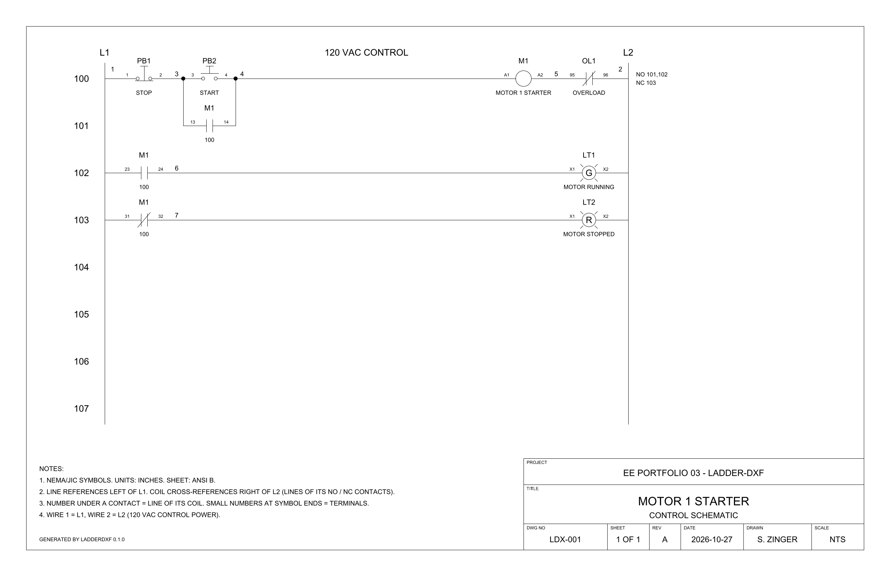

# 03 - ladder-dxf: motor-starter ladder schematics from a device list

A small Python tool that turns a device list (CSV or Excel) into an AutoCAD-compatible DXF control schematic: a NEMA/JIC 120 VAC motor-starter ladder with a title block, automatic device tags, wire numbers, line references and coil/contact cross-references, plus a BOM and a from-to wire list as XLSX. It runs on a Mac with plain Python (no AutoCAD, no Windows), as practice for the drawing conventions used in AutoCAD Electrical.



## What it does

- Reads `sample/motor_starter.csv`, or any `.csv` / `.xlsx` list in the same format.
- Draws one ANSI B sheet (17 x 11 in, inches, DXF R2010) with NEMA/JIC symbols as blocks with attributes.
- Tags devices per family in drawing order (`PB1`, `PB2`, `M1`, `OL1`, `LT1`, ...); a contact carries its coil's tag.
- Numbers line references from 100 and wires in rung order: wire 1 = L1, wire 2 = L2, then 3, 4, 5, ...
- Cross-references: each coil lists the lines of its NO and NC contacts to the right of L2; each contact shows its coil's line.
- Terminal numbers: pushbuttons 1-2 (NC) and 3-4 (NO), coils A1-A2, overload 95-96, lights X1-X2. A coil's auxiliary contacts get a sequence digit in drawing order plus a function digit (3-4 NO, 1-2 NC), so the sample's M1 contacts are 13-14, 23-24 and 31-32; a coil can have up to 9.
- Refuses rungs that make no sense, naming the row: no load (a short from L1 to L2), two loads in series, an overload contact left of its load, a contact whose device has no coil, a branch (`around`) that holds or bridges a coil, pilot light or overload, and more than 9 contacts on one coil. A CSV that is not UTF-8 or a damaged `.xlsx` gets a one-line error instead of a traceback.
- Writes `bom.xlsx` (one row per device), `wirelist.xlsx` (from-to rows per wire) and a PNG or PDF picture of the sheet.

## Quick start (macOS)

```bash
cd ~/Career/ee-portfolio-projects/03-ladder-dxf
python3 -m venv .venv
source .venv/bin/activate
pip install -r requirements.txt
python main.py
```

`python main.py` draws the sample into `out/` and re-checks the files it wrote. For your own list:

```bash
python -m ladderdxf my_list.csv --out out/ --title "CONVEYOR 2" --drawn-by "S. ZINGER"
```

Other options: `--render png|pdf|none`, `--project`, `--subtitle`, `--dwg-no`, `--rev`, `--date`. Run the tests with `pytest`.

## Device list format

One row per symbol. Rows with the same `rung` form one rung; rows without `around` are drawn left to right between L1 and L2.

| Column | Required | Meaning |
|---|---|---|
| `rung` | yes | Rung number; rungs are drawn in number order |
| `device` | yes | Your name for the physical device. Rows with the same name are one device (a coil and its contacts) |
| `kind` | yes | `PB_NO`, `PB_NC`, `STARTER_COIL`, `RELAY_COIL`, `CONTACT_NO`, `CONTACT_NC`, `OL_NC`, `PILOT_LIGHT` |
| `description` | no | Text under the symbol (keep it to about 16 characters); not drawn for contacts |
| `around` | no | Puts the row on a branch line under the rung, in parallel with the named device, e.g. the seal-in contact around `START`; only a contact or pushbutton can be branched or bridged |
| `color` | no | Pilot light color; its first letter is drawn in the lamp |
| `manufacturer`, `catalog` | no | Copied to the BOM and to hidden `MFG` / `CAT` attributes |

Each rung needs exactly one load (coil or pilot light), only overload contacts may sit to the right of the load, and a contact needs a coil row with the same `device`. Save CSV files as UTF-8 (in Excel: CSV UTF-8).

## Output

| File | Contents |
|---|---|
| `out/motor_starter.dxf` | The sheet. Layers: `LADDER`, `LINENO`, `WIRES`, `WIRENO`, `SYMS`, `TAGS`, `DESC`, `XREF`, `TERMS`, `MFGCAT`, `TITLE`, `BORDER`, `NOTES` |
| `out/bom.xlsx` | Item, Tag, Device, Description, Manufacturer, Catalog, Qty, Lines |
| `out/wirelist.xlsx` | Wire, From, From pin, To, To pin (each wire daisy-chained in drawing order) |
| `out/motor_starter.png` | Picture of the sheet (ezdxf drawing add-on with matplotlib) |

Symbol blocks carry attributes named the way AutoCAD Electrical names them (`TAG1`, `TAG2`, `DESC1`, `XREF`, `XREFNO`, `XREFNC`, `MFG`, `CAT`, `TERM01`, `TERM02`); each wire number is a `WIRENO` block with a `WIRENO` attribute. AutoCAD Electrical opens them as ordinary blocks, not as its smart components.

## Open the DXF on a Mac (free)

- **QCAD**: `brew install --cask qcad`, or download it from qcad.org. File > Open > `out/motor_starter.dxf`, then View > Auto Zoom. The Layer List can hide `TERMS` or `XREF`. Checked on 2026-10-27 with QCAD 3.33.1: its own DXF importer reads the sheet with no import errors and the same block, attribute, text and line counts as ezdxf, and reads the junction dots as solid hatches. The Homebrew cask is the QCAD Professional trial, whose command-line converters (`dwg2bmp`, `dwg2pdf`) output only a trial banner, so use the GUI or this tool's `--render` for pictures.
- **LibreCAD**: Homebrew disabled its cask on 2026-09-01 because the app does not pass the macOS Gatekeeper check, so download the macOS build from librecad.org and open it the first time with right-click > Open (or System Settings > Privacy & Security > Open Anyway). Then File > Open > `out/motor_starter.dxf` and View > Auto Zoom.
- The same file opens in AutoCAD, AutoCAD LT and AutoCAD Electrical (Windows) as plain blocks with attributes.

## Verification

`python main.py` (draws the sample, then re-opens the DXF and both workbooks):

```text
6 devices, 7 wires, lines 100-103
  wrote out/motor_starter.dxf
  wrote out/bom.xlsx
  wrote out/wirelist.xlsx
  wrote out/motor_starter.png
checks:
  [PASS] device tags unique: 6 of 6 -> LT1 LT2 M1 OL1 PB1 PB2
  [PASS] all 3 contact tags belong to a drawn device -> M1
  [PASS] wire numbers unique: 7 of 7 -> 1 2 3 4 5 6 7
  [PASS] BOM rows 6 = devices in the input list 6
  [PASS] wire list covers the same 7 wire numbers as the drawing
  [PASS] ezdxf audit of the DXF: 0 errors
ALL CHECKS PASSED
```

`pytest -v`:

```text
tests/test_ladderdxf.py::test_dxf_reopens_with_unique_device_tags PASSED [  3%]
tests/test_ladderdxf.py::test_wire_numbers_are_unique_and_match_the_wire_list PASSED [  6%]
tests/test_ladderdxf.py::test_bom_has_one_row_per_input_device PASSED    [  9%]
tests/test_ladderdxf.py::test_cross_references PASSED                    [ 12%]
tests/test_ladderdxf.py::test_lines_and_wire_numbers_follow_rung_order PASSED [ 16%]
tests/test_ladderdxf.py::test_tags_count_per_family_in_drawing_order PASSED [ 19%]
tests/test_ladderdxf.py::test_xlsx_input_gives_the_same_ladder PASSED    [ 22%]
tests/test_ladderdxf.py::test_terminals_of_every_symbol_insert PASSED    [ 25%]
tests/test_ladderdxf.py::test_bad_device_lists_are_rejected[rows0-no load] PASSED [ 29%]
tests/test_ladderdxf.py::test_bad_device_lists_are_rejected[rows1-one load per rung] PASSED [ 32%]
tests/test_ladderdxf.py::test_bad_device_lists_are_rejected[rows2-has no coil] PASSED [ 35%]
tests/test_ladderdxf.py::test_bad_device_lists_are_rejected[rows3-unknown kind] PASSED [ 38%]
tests/test_ladderdxf.py::test_bad_device_lists_are_rejected[rows4-around='NOPE'] PASSED [ 41%]
tests/test_ladderdxf.py::test_bad_device_lists_are_rejected[rows5-only overload contacts may follow the load] PASSED [ 45%]
tests/test_ladderdxf.py::test_bad_device_lists_are_rejected[rows6-right of the load] PASSED [ 48%]
tests/test_ladderdxf.py::test_bad_device_lists_are_rejected[rows7-whole number] PASSED [ 51%]
tests/test_ladderdxf.py::test_bad_device_lists_are_rejected[rows8-draws each pushbutton] PASSED [ 54%]
tests/test_ladderdxf.py::test_bad_device_lists_are_rejected[branch-around-a-coil] PASSED [ 58%]
tests/test_ladderdxf.py::test_bad_device_lists_are_rejected[load-as-branch] PASSED [ 61%]
tests/test_ladderdxf.py::test_bad_device_lists_are_rejected[overload-as-branch] PASSED [ 64%]
tests/test_ladderdxf.py::test_bad_device_lists_are_rejected[branch-around-an-overload] PASSED [ 67%]
tests/test_ladderdxf.py::test_bad_device_lists_are_rejected[superscript-rung-number] PASSED [ 70%]
tests/test_ladderdxf.py::test_bad_device_lists_are_rejected[ten-contacts-of-one-coil] PASSED [ 74%]
tests/test_ladderdxf.py::test_missing_column_is_reported PASSED          [ 77%]
tests/test_ladderdxf.py::test_non_utf8_csv_is_reported PASSED            [ 80%]
tests/test_ladderdxf.py::test_corrupt_xlsx_is_reported PASSED            [ 83%]
tests/test_ladderdxf.py::test_more_lines_than_one_sheet_is_rejected PASSED [ 87%]
tests/test_ladderdxf.py::test_too_many_symbols_on_one_line_is_rejected PASSED [ 90%]
tests/test_ladderdxf.py::test_cli_reports_input_errors_without_a_traceback PASSED [ 93%]
tests/test_ladderdxf.py::test_layout_is_the_same_in_a_fresh_process PASSED [ 96%]
tests/test_ladderdxf.py::test_render_writes_a_png PASSED                 [100%]

============================== 31 passed in 1.49s ==============================
```

## Engineering why

The drawing is written as DXF with ezdxf instead of driving AutoCAD Electrical, because DXF runs on a Mac and opens in any CAD program; the price is that tags, wire numbers and cross-references are computed once in Python and stored as attributes, not kept live by AutoCAD Electrical's project database. The layout is a fixed grid (inputs from L1, the load and its overload contacts against L2, one extra line per branch), which gives up free placement but makes every run identical, so the tests can pin exact tags, wire numbers and line references. Tags and wire numbers are sequential because that is easy to check by hand on a one-sheet drawing; line-reference numbering, which AutoCAD Electrical also offers, is left for a later version.

## What v0 does not do

- One drawing type (control ladder) and one standard (NEMA/JIC); no IEC symbols.
- One sheet: 8 lines (100-107) with up to 7 symbols each; no multi-sheet projects or sheet-to-sheet references.
- No power circuit (three-phase lines, disconnect, fuses, motor), terminal strips or PLC I/O.
- A branch holds one symbol and bridges one main-path symbol.
- Sequential tags and wire numbers only.
- No electrical-code (NEC/CSA) checks, wire sizing or catalog lookup; the sample's catalog numbers are placeholders.
- Not an AutoCAD Electrical project: the DXF holds plain blocks with attributes.

## Credits

- Shon Zinger: project owner; chose the drawing type, the NEMA/JIC standard and the v0 scope.
- Claude (Anthropic): drafted the Python code, the tests and this README.
- Ideas, not code, from these MIT-licensed projects: harrissohail6/AutoCAD-Automation-Scripts, puran-water/autocad-mcp and U-C4N/Autocad-MCP. Built on ezdxf, openpyxl and matplotlib.

## License

MIT, see the repository [LICENSE](../LICENSE).
