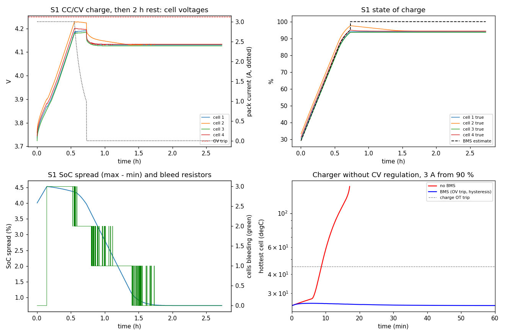
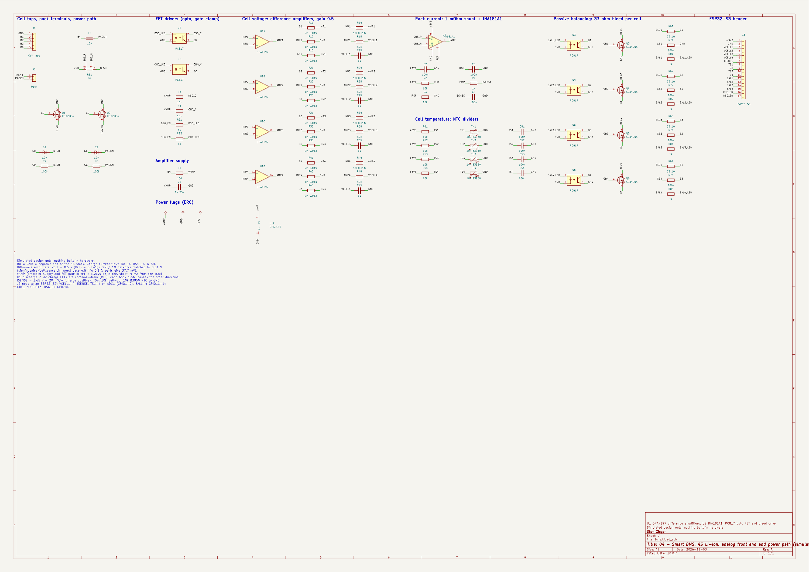

# 04 - Smart Battery Management System Simulator (4S Li-ion)

A simulated battery management system for a 4-cell series Li-ion pack (3.0 Ah NMC 18650-class cells, 14.8 V nominal). Each cell is a second-order equivalent-circuit model with temperature-dependent resistance, a lumped thermal mass, an overcharge side reaction and a lumped Arrhenius decomposition reaction, so overcharge and cooling failures can be driven all the way into thermal runaway. The BMS firmware is portable C (integer arithmetic, 10 Hz): it watches every cell voltage, the pack current and one thermistor per cell, drives back-to-back charge and discharge FETs, runs a Charging / Discharging / Standby / Fault state machine, estimates state of charge by coulomb counting with full and empty resets, and balances the cells with 33 ohm bleed resistors. A KiCad schematic of the analog front end and power path (cell-voltage difference amplifiers, current shunt, NTC dividers, opto-driven bleed and protection FETs) is generated by script and checked net by net, and the cell-voltage front end is simulated in ngspice. Everything is simulation and host tests; no hardware was built.

| Item | Value |
|---|---|
| Pack | 4S1P, 3.00 / 2.94 / 3.05 / 2.97 Ah cells (about +/-2 % spread), resistance spread 0.96-1.08 x |
| Cell model | OCV(SoC) table + R0 25 mOhm + 15 mOhm / 10 s + 20 mOhm / 200 s RC pairs, R x2 at 0 degC; 46 J/K, 15 K/W to ambient (60 K/W with failed cooling) |
| Protection | OV 4.25 V (0.3 s), UV 2.80 V (1 s), OCD 10 A (0.5 s), SCD 40 A (one sample), OCC 4.5 A, charge 0-45 degC, discharge up to 60 degC, open/shorted thermistor |
| Charge | external CC/CV charger 3 A / 16.8 V; BMS ends the charge when any cell reaches 4.20 V below C/3 |
| Cell sensing | 4 x difference amplifier (OPA4197 quad, gain 0.5, 2M / 1M networks matched to 0.01 %), 10k / 1 uF filter into an ESP32-S3 ADC; 1 mOhm low-side shunt + INA181A1 (+/-82 A); one 10k NTC per cell |
| Balancing | passive, 33 ohm per cell (about 125 mA), start at 8 mV above the lowest cell, stop at 3 mV, only above 3.90 V |
| Simulated results | charge from 30 % in 44 min with no cell above 97.6 % SoC; balancing 22 -> 7.4 mV; faulty charger held at 96 % SoC and 25.9 degC (without a BMS: 150 degC after 17 min); 105 A short cleared in 0.2 s with a 0.65 K rise; cell sensing within 4.5 mV worst case (ngspice corners) |

## Quick start

Python 3.9+ with numpy and matplotlib. The model needs no simulator or hardware.

```
pip install numpy matplotlib
python3 main.py
```

It prints a PASS/FAIL self-check (header constants, the cell and thermal-runaway model against closed forms, the overcharge case with and without the BMS, a Python port of the firmware against the C host test, and the ngspice corner results for the cell-sense front end), writes the figure docs/img/main_py_bms.png and logs the charge to docs/charge_log.csv (one row per 10 s: pack current, cell voltages, true and estimated SoC, bleed mask, temperature). Add `--no-plot` to skip the figure.

Firmware checks, from this folder (a C99 compiler and make):

```
make -C test/host test              # BMS host test, pack model in the loop (8 scenarios)
make -C test/host negative          # the same test against six broken BMS builds
sh sim/run_spice.sh                 # ngspice 47: cell-sense front end, log to docs/ (under 1 s)
cd hw/kicad && python3 gen_schematic.py --export && python3 check_netlist.py
```

## Engineering why

A pack charger regulates the sum of four cells to 16.8 V, so in a pack with 2 % capacity spread the smallest cell reaches 4.20 V first and, left alone, finishes at 101 % SoC; the BMS therefore ends the charge itself when any cell reaches 4.20 V below C/3 (at 3 A the IR drop would end it far too early), trading about 2 % of top-end capacity for never overcharging the weakest cell, and the 125 mA bleed balancing removes most of the remaining spread (22 mV to 7.4 mV of OCV after 80 minutes of bleeding, during and after the charge). Each protection acts on the FET that feeds the fault and leaves the other path open, so an over-voltage cell can still be discharged out of its fault and an under-voltage cell can still be charged, and the 100 mV hysteresis on OV means a charger that has lost CV regulation is chopped into 20 short pulses that stop at 96 % SoC instead of the 105 % and 150 degC the same charger reaches with no BMS. Short-circuit and overload faults latch until a charger is connected rather than retrying into the fault, and at 10 Hz the firmware SCD trip is only a backstop: a 105 A short flows for 200 ms (0.65 K of heating here, but enough to stress a FET), which is why a real pack needs the AFE's hardware short-circuit comparator in front of this code.

## Verification

Each block below is copied from the log named above it, produced by the command shown (run 2026-11-03 on macOS: Apple clang 21, Python 3.13, ngspice 47, KiCad 10.0.7). Everything is simulation and host tests; no hardware was built.

### Standalone model (main.py)

`python3 main.py` (docs/main_py.log). Exit code 0 means every check passed.

```
Smart BMS 04 - main.py (simulated design; no hardware built)
Limits from src/bms/bms_config.h: OV 4250 mV, UV 2800 mV, OCD 10.0 A, SCD 40 A, OT 45 / 60 degC, UT 0 degC, balance start 8 mV

[1] Constants and tables
  C01 headers parsed                             38 BMS + 21 plant constants                  PASS
  C02 OCV table monotonic, lookup inverts it     3000..4190 mV, 11 points                     PASS
  C03 OV trip < OCV(100 %) + margin; UV > OCV(0 %) - margin OV 4250 vs 4190 mV, UV 2800 vs 3000 mV       PASS

[2] Cell model (cell 1: 3.00 Ah, R scale 1.00)
  C04 3 A, 10 s pulse: sag vs closed form        sim 107.70 mV, analytic 107.83 mV            PASS
  C05 resistance x2 at 0 degC                    R(0 degC) / R(25 degC) = 1.995               PASS
  C06 C/2 to 2.80 V: capacity 95-105 % of 3.00 Ah 3.057 Ah, ends at -1.9 % of the table        PASS

[3] Thermal runaway model (lumped Arrhenius reaction)
  C07 self-heating calibration at 100 degC       0.300 W (x2 every 5.9 K)                     PASS
  C08 Semenov critical ambient > 60 degC         Rth 15: 97.0 degC, Rth 60: 85.2 degC         PASS
  C09 Rth 60 soak: stable at Ta_crit -5 K, runaway at +5 K peak 82.1 degC / 150.0 degC                  PASS

[4] Charger without CV regulation (3 A from 90 %), with and without the BMS
  C10 no BMS: overcharge drives thermal runaway  150 degC after 1026 s, peak SoC 104.9 %      PASS
  C11 BMS: no cell above 100 %, peak < 45 degC   SoC 96.00 %, 25.87 degC, 20 OV trips         PASS

[5] Charge and balance (test_bms.c S1) and the Python port vs the C host test
  C12 host test log RESULT all PASS              34/34                                        PASS
  C13 negative gate log: every mutant caught     6 mutants                                    PASS
  C14 S1 charge time: Python vs C                Python 2636.4, C 2636.4 s                    PASS
  C15 S1 peak cell voltage: Python vs C          Python 4229, C 4229 mV                       PASS
  C16 S1 OCV spread after balancing: Python vs C Python 7.38173, C 7.38 mV                    PASS
  C17 S1 balancing time: Python vs C             Python 4834.9, C 4834.9 s                    PASS
  C18 S1 peak cell SoC: Python vs C              Python 97.583, C 97.583 %                    PASS
  C19 S3 first OV trip: Python vs C              Python 70.6, C 70.6 s                        PASS
  C20 S3 OV trip count: Python vs C              Python 20, C 20                              PASS
  C21 S3 peak SoC: Python vs C                   Python 96.0028, C 96.003 %                   PASS

[6] Cell-voltage sense front end (ngspice: sim/ngspice/cell_sense.cir)
  C22 SPICE log complete                         128 corner runs, deck gain 1M/2M = 0.5       PASS
  C23 nominal error per channel < 0.5 mV         max 0.063 mV                                 PASS
  C24 0.01 % networks: worst case <= 10 mV       4.50 mV (16 corners x Vos +/-250 uV, 2.8/4.25 V) PASS
  C25 0.1 % networks would miss 10 mV            37.7 mV: common mode x mismatch, top cell worst PASS
  C26 tap-load imbalance < 1 % SoC per month     14.7 uA -> 0.35 %/month (Iq 4.0 mA common)   PASS
  C27 op-amp inputs inside supply, output in ADC range IN+ 5.60 V vs VAMP 16.40 V; VCELL at 4.30 V = 2.150 V PASS
  C28 4.00 -> 4.25 V step settles within one BMS step 55.9 ms to 1 mV (10k / 1 uF filter)          PASS

[7] KiCad schematic (hw/kicad/bms.kicad_sch)
  C29 schematic sense network = SPICE deck       91 parts, 24 network parts + supply match    PASS
  C30 ERC 0 errors 0 warnings, netlist check PASS 60 nets checked                              PASS

  S1: charge 2636 s, peak cell 4229 mV, OCV spread 22.0 -> 7.4 mV, balancing 4835 s
  wrote docs/charge_log.csv (983 rows, one per 10 s)

RESULT: 30/30 PASS
  wrote docs/img/main_py_bms.png
```



Top left: CC/CV charge of the unbalanced pack and the pack current; cell 2 (2.94 Ah, highest resistance) leads all the way and ends the charge at 4.20 V. Top right: true SoC of each cell against the BMS estimate (coulomb counting with a +15 mA current-sense offset, reset to 100 % at the end of charge). Bottom left: SoC spread and the number of bleed resistors on. Bottom right: hottest cell with a charger that has lost CV regulation, with and without the BMS.

### BMS host test (pack model in the loop)

`make -C test/host test` (docs/host_test.log). The C firmware runs as it would on the MCU: every 100 ms one AFE scan of the plant, one `bms_step()`, and the FET and bleed outputs applied to the plant for the next 100 ms. METRIC lines are read by main.py checks C14 to C21.

```
PASS unit: OCV -> SoC table lookup            3710 mV -> 45.0 %
# S1 charge 3 A / 16.8 V from 29-33 % SoC, then 2 h rest; 25 degC
PASS S1 no protection trip                    faults 0
PASS S1 max cell < OV trip - 10 mV            4229 mV (limit 4240 mV)
PASS S1 charger terminates < 3 h              2636 s
PASS S1 no cell above 100 % SoC               peak 97.58 %
PASS S1 SoC set to 100 % at end of charge     100.0 % at termination
PASS S1 balanced: OCV spread <= 10 mV         22.0 mV -> 7.4 mV
PASS S1 bleed resistors used                  4835 s of balancing
METRIC s1_t_chg_s 2636.4
METRIC s1_vpk_mv 4229
METRIC s1_spread_mv 7.38
METRIC s1_bal_s 4834.9
METRIC s1_socpk 0.97583
# S2 discharge 3 A from 15 % SoC to the UV trip, then 60 s rest
PASS S2 UV trip opens the discharge FET       after 546 s, dsg 0
PASS S2 smallest cell (2.94 Ah) trips first   cell 1
PASS S2 lowest cell >= UV trip - 50 mV        2799 mV (limit 2750 mV)
PASS S2 SoC reset to 0 % at UV                0.0 %
PASS S2 no FET chatter after the trip         1 FET transitions (limit 1)
METRIC s2_t_trip_s 546.2
# S3 faulty charger: 3 A constant current, no CV, from 90 % SoC, 2 h
PASS S3 OV trip opens the charge FET          first after 70.6 s, 20 trips
PASS S3 trip within 300 ms of 4.25 V          0.2 s (limit 0.3 s)
PASS S3 peak cell <= 4.30 V                   4250 mV
PASS S3 no cell above 100 % SoC               peak 96.00 %
PASS S3 peak temperature < 45 degC            25.87 degC
PASS S3 after 2 h: OV held, no current, dsg on 0.000 A, dsg 1
PASS S3 OV clears under 1 A discharge         after 0.2 s
METRIC s3_t_off_s 70.6
METRIC s3_trips 20
METRIC s3_vpk_mv 4250
METRIC s3_socpk 0.96003
# S4 50 mOhm short at t = 10 s, removed at 15 s, charger connected at 30 s
PASS S4 SCD trip opens the discharge FET      105 A peak
PASS S4 FET off within 200 ms                 0.2 s (limit 0.2 s)
PASS S4 cell temperature rise < 2 K           0.65 K
PASS S4 SCD stays latched without a charger   dsg 0 at 30 s
PASS S4 charger clears the latch              after 1.1 s
METRIC s4_ipk_a 105.26
# S5 12 A overload at t = 10 s
PASS S5 OCD (not SCD) trip                    faults 8
PASS S5 OCD after 0.5-0.6 s                   0.6 s
# S6 cooling failure: Rth 60 K/W, 40 degC ambient, 6 A discharge from 100 %
PASS S6 OTD trip opens the discharge FET      after 908 s
PASS S6 peak temperature <= 62 degC           60.01 degC
PASS S6 re-enabled after cooling below 55 degC 1
METRIC s6_t_otd_s 908.4
METRIC s6_tpk_c 60.010
# S7 charger at -5 degC ambient, ambient to 10 degC at 60 s
PASS S7 no charge current below 0 degC        0.000 A peak
PASS S7 charging starts once cells >= 3 degC  after 521 s at 2.95 degC
# S8 open thermistor 60-120 s, 1 A discharge
PASS S8 sensor fault opens both FETs          faults 256
PASS S8 sensor fault stays latched            dsg 0
RESULT: 34/34 PASS (ALL PASS)
```

### Negative gate

`make -C test/host negative` (docs/host_negative.log) builds six broken BMS builds and passes only if the host test fails against every one: M1 without over-voltage protection (the faulty charger takes a cell to 105 % SoC and 4.47 V; only the charge over-temperature trip then limits it, cycling the overcharged cell between 40 and 45 degC), M2 without balancing (spread grows to 63 mV), M3 without the short-circuit trip (the slower OCD clears the short after 0.6 s), M4 allowing charge below 0 degC, M5 without the discharge over-temperature trip (70 degC), M6 without the cell-level end of charge (the weakest cell reaches 101 % SoC).

```
== mutant m1 ==
FAIL S3 OV trip opens the charge FET          first after -0.1 s, 0 trips
FAIL S3 trip within 300 ms of 4.25 V          0.0 s (limit 0.3 s)
FAIL S3 peak cell <= 4.30 V                   4468 mV
FAIL S3 no cell above 100 % SoC               peak 104.94 %
FAIL S3 peak temperature < 45 degC            45.21 degC
FAIL S3 after 2 h: OV held, no current, dsg on 3.000 A, dsg 1
RESULT: 28/34 PASS
mutant m1: test FAILED as required
== mutant m2 ==
FAIL S1 balanced: OCV spread <= 10 mV         22.0 mV -> 63.5 mV
FAIL S1 bleed resistors used                  0 s of balancing
RESULT: 32/34 PASS
mutant m2: test FAILED as required
== mutant m3 ==
FAIL S4 SCD trip opens the discharge FET      108 A peak
FAIL S4 FET off within 200 ms                 0.6 s (limit 0.2 s)
FAIL S4 cell temperature rise < 2 K           3.23 K
FAIL S4 SCD stays latched without a charger   dsg 0 at 30 s
RESULT: 30/34 PASS
mutant m3: test FAILED as required
== mutant m4 ==
FAIL S7 no charge current below 0 degC        3.000 A peak
FAIL S7 charging starts once cells >= 3 degC  after 0 s at -4.10 degC
RESULT: 32/34 PASS
mutant m4: test FAILED as required
== mutant m5 ==
FAIL S6 OTD trip opens the discharge FET      after -0 s
FAIL S6 peak temperature <= 62 degC           70.48 degC
FAIL S6 re-enabled after cooling below 55 degC 0
RESULT: 31/34 PASS
mutant m5: test FAILED as required
== mutant m6 ==
FAIL S1 no cell above 100 % SoC               peak 101.00 %
RESULT: 33/34 PASS
mutant m6: test FAILED as required
NEGATIVE GATE: 6/6 mutants caught
```

### ngspice cell-sense front end

`sh sim/run_spice.sh` (docs/sim_ngspice.log). One deck, sim/ngspice/cell_sense.cir: the 4S stack, the four difference amplifiers with their 10k / 1 uF filters, and the amplifier supply (100 ohm + 1 uF from the top of the stack, 4 mA quiescent). The op-amp is a rail-to-rail macro (gain 1e5, offset as a parameter, about 1 MHz pole). The deck echoes one line per run; main.py checks C22 to C28 read them. CORNER fields: tolerance, cell voltage, the four resistor corners (-1 / +1), op-amp offset, then the input-referred error of cells 1 to 4 in volts.

```
TRAN settle_1mV_s 0.055878
NOMINAL err_V -6.29991E-05 -6.29991E-05 -6.29991E-05 -6.29991E-05
NOMINAL cell_A 0.0040203 0.0040182 0.0040133 0.0040056
NOMINAL pins_V 5.6 16.4 2.09997
CORNER 1e-4 2.8 -1 -1 -1 -1 -250u -0.000791988 -0.000791988 -0.000791988 -0.000791988
CORNER 1e-4 2.8 -1 -1 -1 -1 250u 0.000707989 0.000707989 0.000707989 0.000707989
CORNER 1e-4 2.8 -1 -1 -1 1 -250u -0.000605358 -0.000978723 -0.00135209 -0.00172545
CORNER 1e-4 2.8 -1 -1 -1 1 250u 0.000894719 0.000521354 0.000147989 -0.000225376
... (128 CORNER lines in all)
```

Worst case over all 64 corners per tolerance: 4.50 mV with 0.01 % networks, 37.7 mV with 0.1 % (C24, C25). The error is common-mode rejection: the top channel sits 12.6 V above ground and a 0.1 % mismatch converts part of that into differential error, so ordinary 0.1 % resistors cannot meet a +/-10 mV cell spec without per-channel calibration.

### KiCad ERC and netlist check

`cd hw/kicad && python3 gen_schematic.py --export`, then `kicad-cli sch erc` and `python3 check_netlist.py` (docs/kicad_erc.log). The generator writes the KiCad 10 schematic from a parts table, stock symbols only, deterministically (same file hash on every run). Every pin gets a short stub and a net label, so the drawing is exactly the table. check_netlist.py exports the netlist and compares all 60 named nets with an independently written list: nothing missing, nothing extra, and no unplanned net. Rewiring one resistor in the generator (R12 to B1 instead of GND) makes it fail 5 nets, which was checked by hand while building it. main.py C29 also checks that the schematic's sense-network values match the SPICE deck.

```
# cmd: cd hw/kicad && python3 gen_schematic.py --export
# cmd: kicad-cli sch erc --severity-all -o erc.rpt bms.kicad_sch
# cmd: python3 check_netlist.py
 ** ERC messages: 0  Errors 0  Warnings 0

 ** Ignored checks:
    - Global label only appears once in the schematic
    - Four connection points are joined together
    - SPICE model issue
    - Assigned footprint doesn't match footprint filters
PASS GND       C1.2 C15.2 C2.2 C25.2 C3.2 C35.2 C4.2 C45.2 C51.2 C52.2 C53.2 C54.2 J1.1 J3.2 Q3.2 R12.2 R13.1 R22.2 R3.2 R32.2 R42.2 R71.2 RS1.1 TH1.2 TH2.2 TH3.2 TH4.2 U1.11 U2.2 U3.2 U4.2 U5.2 U6.2 U7.2 U8.2
PASS B1        J1.2 Q4.2 R11.1 R23.1 R61.2 R72.2 U3.4
PASS B2        J1.3 Q5.2 R21.1 R33.1 R62.2 R73.2 U4.4
PASS B3        J1.4 Q6.2 R31.1 R43.1 R63.2 R74.2 U5.4
PASS B4        F1.1 J1.5 R1.1 R41.1 R64.2 U6.4
PASS PACK+     F1.2 J2.1
PASS PACKN     D2.2 J2.2 Q2.3 R8.2
PASS N_SH      D1.2 Q1.3 R7.2 RS1.4
PASS MID       Q1.2 Q2.2
PASS GD        D1.1 Q1.1 R7.1 U7.3
PASS GC        D2.1 Q2.1 R8.1 U8.3
PASS DSG_C     R5.2 U7.4
PASS CHG_C     R6.2 U8.4
PASS DSG_LED   R91.2 U7.1
PASS CHG_LED   R92.2 U8.1
PASS DSG_EN    J3.17 R91.1
PASS CHG_EN    J3.16 R92.1
PASS VAMP      C1.1 R1.2 R5.1 R6.1 U1.4
PASS ISNS_P    RS1.2 U2.3
PASS ISNS_N    RS1.3 U2.4
PASS +3V3      C2.1 J3.1 R2.1 R51.1 R52.1 R53.1 R54.1 U2.6
PASS IREF      C3.1 R2.2 R3.1 U2.5
PASS IAMP      R4.1 U2.1
PASS ISENSE    C4.1 J3.7 R4.2
PASS INP1      R11.2 R12.1 U1.3
PASS INN1      R13.2 R14.1 U1.2
PASS AMP1      R14.2 R15.1 U1.1
PASS VCELL1    C15.1 J3.3 R15.2
PASS TS1       C51.1 J3.8 R51.2 TH1.1
PASS GB1       Q3.1 R71.1 U3.3
PASS BLD1      Q3.3 R61.1
PASS BAL1      J3.12 R81.1
PASS BAL1_LED  R81.2 U3.1
PASS INP2      R21.2 R22.1 U1.5
PASS INN2      R23.2 R24.1 U1.6
PASS AMP2      R24.2 R25.1 U1.7
PASS VCELL2    C25.1 J3.4 R25.2
PASS TS2       C52.1 J3.9 R52.2 TH2.1
PASS GB2       Q4.1 R72.1 U4.3
PASS BLD2      Q4.3 R62.1
PASS BAL2      J3.13 R82.1
PASS BAL2_LED  R82.2 U4.1
PASS INP3      R31.2 R32.1 U1.10
PASS INN3      R33.2 R34.1 U1.9
PASS AMP3      R34.2 R35.1 U1.8
PASS VCELL3    C35.1 J3.5 R35.2
PASS TS3       C53.1 J3.10 R53.2 TH3.1
PASS GB3       Q5.1 R73.1 U5.3
PASS BLD3      Q5.3 R63.1
PASS BAL3      J3.14 R83.1
PASS BAL3_LED  R83.2 U5.1
PASS INP4      R41.2 R42.1 U1.12
PASS INN4      R43.2 R44.1 U1.13
PASS AMP4      R44.2 R45.1 U1.14
PASS VCELL4    C45.1 J3.6 R45.2
PASS TS4       C54.1 J3.11 R54.2 TH4.1
PASS GB4       Q6.1 R74.1 U6.3
PASS BLD4      Q6.3 R64.1
PASS BAL4      J3.15 R84.1
PASS BAL4_LED  R84.2 U6.1
info: 0 single-pin nets (expected 0)
RESULT: PASS
```



## Design notes

- State machine: FAULT whenever any protection flag is set, otherwise CHARGING above +50 mA, DISCHARGING below -50 mA, STANDBY in between. Both FETs stay off for the first second after reset so every protection has a full debounce window of data before anything is switched (without it, the first second of a cold charge would be allowed, because the under-temperature trip needs 1 s of samples).
- FET mapping: OV, OCC, charge over-temperature and under-temperature open the charge FET; UV, OCD, SCD open the discharge FET; discharge over-temperature (60 degC) and a thermistor fault open both. With back-to-back FETs the opposite direction still flows through the open FET's body diode, which the plant models as an ideal path.
- Recovery: OV, UV and the temperature faults clear with hysteresis (4.15 V, 3.10 V, 5 K / 3 K). OCD, SCD and the thermistor fault latch; a charger (>= 100 mA for 1 s) clears OCD and SCD, and nothing in firmware clears a thermistor fault.
- State of charge: integer coulomb counter in mA x ms, initialised from the lowest rested cell through the OCV table, reset to 100 % at the end of charge and to 0 % at the UV trip, the two points where the cell voltage is unambiguous. Between resets the +15 mA sensor offset in the plant drifts it by 0.5 % per hour.
- Balancing: decisions use the measured terminal voltage, so they run only above 3.90 V (where the OCV curve is steep enough that mV mean mAh), never while discharging, never above 50 degC, and not with any fault active. 3 mV of stop hysteresis keeps the bleed resistors from chattering.
- Cell-voltage front end: each cell is read by a difference amplifier against its own negative tap, Vout = 0.5 x (B(n) - B(n-1)), so the top channel rejects 12.6 V of common mode. The rejection depends on resistor matching, which is why the networks are specified as matched 0.01 % (C24, C25), and why the resistors are 2M / 1M: at 200k / 100k the unequal tap loads would unbalance the pack by about 3.5 % SoC per month; at 2M / 1M it is 0.35 % (C26). The op-amp inputs sit at a third of each tap voltage (5.6 V at most), inside the OPA4197's 36 V supply from the stack.
- Gate drive: the opto phototransistors pull each FET gate up from VAMP (discharge and charge FETs) or from the cell's own positive tap (bleed FETs, so each bleed switch is referenced to its own cell and needs no level shifter). 12 V zeners clamp the power-FET gates; the 10k collector resistors limit the clamp current to about 0.4 mA.
- Thermal runaway model: one lumped exothermic reaction (activation energy 135 kJ/mol, the order of published SEI-decomposition values, 12 kJ of heat) calibrated to 0.3 W at 100 degC. It is an illustration of the mechanism, not a calibrated abuse model: the Semenov critical ambient is 97 degC with normal cooling and 85 degC with failed cooling (C08, C09), and overcharge supplies the heat that gets a cell there (C10).

## Protection limits

| Fault | Trip | Delay | Action | Clears |
|---|---|---|---|---|
| Cell over-voltage | >= 4.250 V | 300 ms | charge FET off | highest cell < 4.150 V |
| Cell under-voltage | <= 2.800 V | 1 s | discharge FET off, SoC := 0 | lowest cell >= 3.100 V |
| End of charge (not a fault) | any cell >= 4.200 V at 50 mA-1 A | 1 s | charge FET off, SoC := 100 % | highest cell < 4.150 V |
| Charge over-current | >= 4.5 A | 1 s | charge FET off, latched | discharge >= 100 mA for 1 s |
| Discharge over-current | >= 10 A | 500 ms | discharge FET off, latched | charger >= 100 mA for 1 s |
| Short circuit | >= 40 A | one sample | discharge FET off, latched | charger >= 100 mA for 1 s |
| Charge over-temperature | >= 45 degC | 1 s | charge FET off | < 40 degC |
| Discharge over-temperature | >= 60 degC | 1 s | both FETs off | < 55 degC |
| Charge under-temperature | <= 0 degC | 1 s | charge FET off | >= 3 degC |
| Thermistor open or shorted | < -40 or > 120 degC | 1 s | both FETs off, latched | reset only |

All limits are in src/bms/bms_config.h; main.py and the host test read them from there.

## Pin map (ESP32-S3 header J3)

| J3 pin | Signal | ESP32-S3 |
|---|---|---|
| 1, 2 | +3V3, GND | 3V3, GND |
| 3-6 | VCELL1-4 (0.5 V/V) | GPIO1-4, ADC1_CH0-3 |
| 7 | ISENSE (1.65 V + 20 mV/A) | GPIO5, ADC1_CH4 |
| 8-11 | TS1-4 (10k / NTC divider) | GPIO6-9, ADC1_CH5-8 |
| 12-15 | BAL1-4 (opto LED, 1k) | GPIO11-14 |
| 16 | CHG_EN (opto LED, 1k) | GPIO15 |
| 17 | DSG_EN (opto LED, 1k) | GPIO16 |

An ESP32-S3 is used because the classic ESP32 has only 8 usable ADC1 channels and this needs 9 (ADC2 is unavailable while Wi-Fi is on).

## Known limitations

- Simulation only: no AFE, no FETs, no PCB. The cell parameters are generic NMC 18650 values, not a vendor datasheet, and the runaway reaction is one lumped Arrhenius term, not a multi-reaction abuse model.
- Each cell is thermally isolated (no cell-to-cell conduction), so one cell's runaway does not propagate in the model; the bleed resistors' own heat is not modelled.
- Short-circuit protection at a 10 Hz firmware rate is a backstop only; a real design needs the AFE's hardware SCD comparator (tens to hundreds of microseconds). The 100k gate pull-downs also turn the power FETs off slowly (on the order of a millisecond for a TO-220 FET with about 100 nC of gate charge); a production design needs an active gate turn-off or an AFE with FET drivers.
- VAMP (amplifier supply and gate drive) is always on in this schematic: about 4 mA from the stack (C26 reports it), which would empty the pack in about a month in storage. It needs a load switch under MCU control.
- The op-amp in the SPICE deck is a generic rail-to-rail macro with OPA4197-class offset, not a vendor model. The INA181 REF is a plain 10k / 10k divider, and opto current-transfer-ratio spread is not analysed.
- One thermistor per cell is assumed; a real 4S pack usually has two or three.
- SoC is coulomb counting with full/empty resets only; there is no model-based estimator (no Kalman filter), no capacity-fade or state-of-health tracking.
- The ESP32 glue (ADC sampling, GPIO drive of the opto LEDs) is not written, so nothing has run on an MCU. No PCB layout.

## Status

Done:
- Pack model (ECM, thermal, overcharge and runaway) and main.py self-check, all PASS.
- BMS firmware in C: protection, state machine, coulomb counting, balancing, cell-level end of charge.
- Host test with the pack model in the loop (34/34, 8 scenarios) and a six-mutant negative gate.
- Python port of the firmware matching the C host test to the logged digits.

- Cell-voltage front end simulated in ngspice 47: nominal, 128 tolerance and offset corners, tap loading, settling.
- KiCad 10 schematic of the front end and power path (91 parts, ERC clean, 60 nets verified).

Not done:
- ESP32-S3 glue and an on-target run.
- Load switch for VAMP, PCB layout.

## Tools used

- Python 3 + numpy + matplotlib
- C99, Apple clang (host test), make
- ngspice 47
- KiCad 10 (kicad-cli)

## Credits

Designed, specified and verified by Shon Zinger. Claude (Anthropic) assisted with: the cell, thermal and runaway model, the BMS firmware and its host test harness, the Python port and main.py, the ngspice deck, the KiCad schematic generator and netlist check, and documentation.
