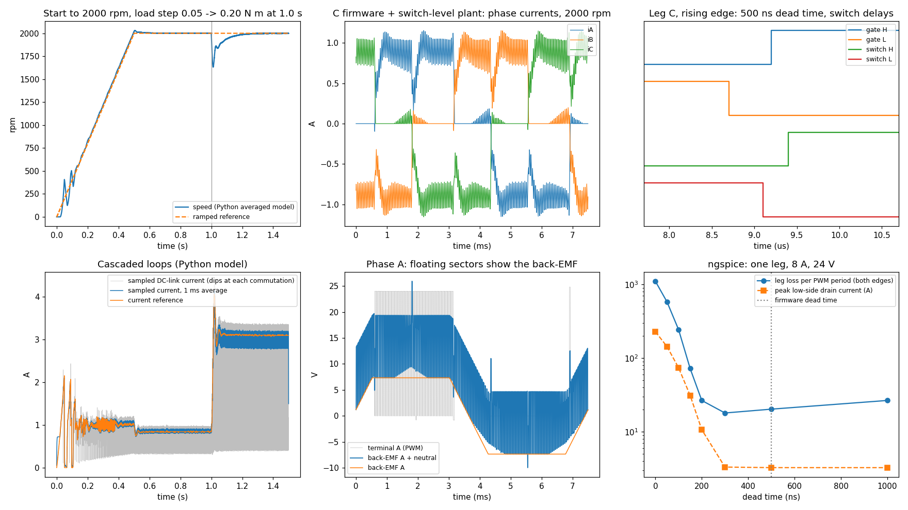
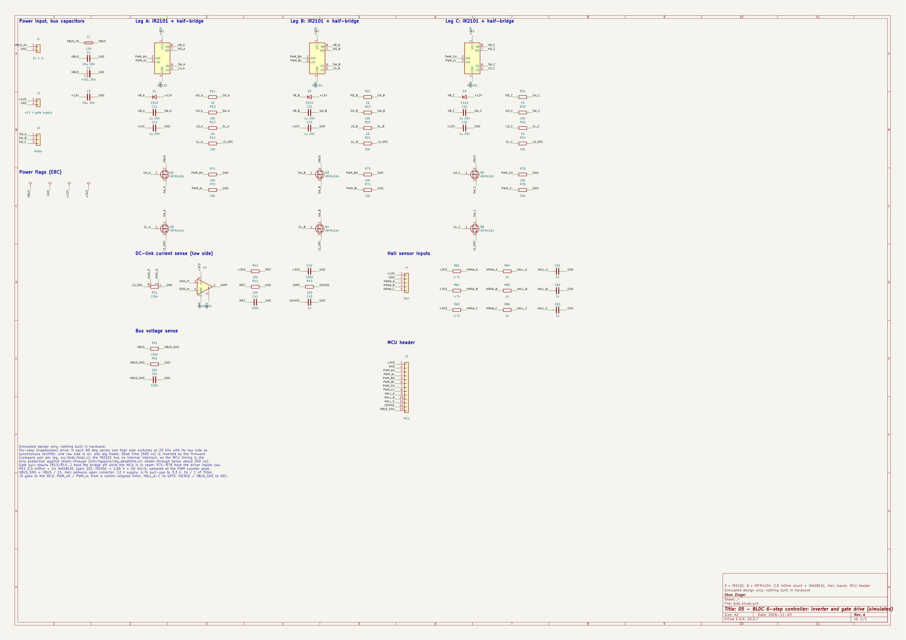

# 05 - BLDC Motor Controller, 6-Step with Hardware-in-the-Loop Simulation

## In plain words

- **What it is:** the controller for a brushless motor, the quiet, efficient kind found in drones, fans and power tools, which must switch its three windings in the right order to spin.
- **Why it matters:** a motor controller that switches wrongly can short its own power transistors or burn out the motor, so protection matters as much as speed.
- **What was done:** I wrote the controller code in C and tested it against a software model of the motor and power electronics (hardware-in-the-loop style, with the hardware replaced by a model). It is simulated only: no hardware was built and no motor was spun.
- **Headline result:** starting from standstill the simulated motor settles within 1 % of 2000 rpm at 0.514 s with 1.50 % overshoot.
- **Try it:** `python3 main.py`

A simulated controller for a 24 V brushless DC motor (4 pole pairs, trapezoidal back-EMF, about 3071 rpm at full duty and no load). The firmware is portable C: a 20 kHz PWM update interrupt on a centre-aligned timer drives a 3-phase MOSFET inverter with Hall-sensor 6-step commutation, inserts a 500 ns dead time between the two switches of each leg, runs a cascaded speed (1 kHz) and current (20 kHz) PI loop on the DC-link shunt current, trips on over-current, a broken Hall wire and a stalled rotor, and releases the motor to coast when commanded to stop. It is tested hardware-in-the-loop style against a switch-level C model of the inverter and motor that steps every timer tick (31.25 ns), cross-checked against an independent PWM-averaged Python model and against ngspice runs with MOSFET and gate-driver models, and the power stage is drawn as a script-generated KiCad schematic checked net by net. Everything is simulation and host tests; no hardware was built and no motor was spun.

| Item | Value |
|---|---|
| Motor model | star-connected, 0.40 ohm and 0.40 mH per phase, back-EMF 0.035 V/(rad/s) per phase with 120 deg flat tops, 4 pole pairs, J 3e-5 kg m^2, viscous + Coulomb friction, reactive load torque; Hall sensors with -1.5 to +2 deg placement error |
| Inverter | 24 V bus, 6 x IRFR4104-class MOSFETs (10 mOhm hot, 0.8 V body diode), 3 x IR2101 half-bridge drivers, 10 ohm gate resistors, 2.5 mOhm low-side DC-link shunt + INA181A1 (50 mV/A) |
| PWM | centre-aligned, 32 MHz timer, ARR 800, 20 kHz; two preloaded compare registers per leg; dead time 500 ns (16 ticks) inserted in firmware |
| Commutation | 6-step, Hall table aligned to the back-EMF flat tops; the PWM phase is synchronously rectified, the low phase is held on, the third leg floats |
| Control | speed PI at 1 kHz (ramp 4000 rpm/s) -> current reference 0..8 A; current PI at 20 kHz with back-EMF feed-forward; current sampled at the counter peak (centre of the ON pulse) |
| Protection | over-current 20 A (sampled, outputs off at once), Hall code 000 / 111 on two samples, stall (torque demanded, no Hall edge for 500 ms); all latch. Stop: the reference ramps to 0, then all gates off |
| Simulated results | start from standstill within 1 % of 2000 rpm at 0.514 s with 1.50 % overshoot; 0.05 -> 0.20 N m load step: 18.32 % dip, back within 1 % in 0.184 s; locked rotor held at 8.005 A, stall trip at 0.501 s; shorted low-side MOSFET tripped 25.3 us after the first shoot-through; inverter + winding efficiency 95.04 %; SPICE inverter and switch-level plant within 1.5 % (C18-C20) |

## Quick start

Python 3.9+ with numpy and matplotlib. The model needs no simulator or hardware.

```
pip install numpy matplotlib
python3 main.py
```

It prints a PASS/FAIL self-check (header constants, the averaged model against closed forms, the averaged closed loop against the C firmware on the switch-level plant, the ngspice dead-time sweep and fixed-point comparison, and the logs of the other gates) and writes the figure docs/img/main_py_bldc.png. Add `--no-plot` to skip the figure.

Firmware checks, from this folder (a C99 compiler and make):

```
make -C test/host test              # firmware + switch-level plant, 7 scenarios
make -C test/host negative          # the same test against seven broken controllers
make -C test/host gains             # design record: speed-loop gains doubled (gain margin)
sh sim/run_spice.sh                 # ngspice 47: dead-time sweep of one leg + full inverter
cd hw/kicad && python3 gen_schematic.py --export && python3 check_netlist.py
```

## Engineering why

The IR2101 drivers have no interlock, so the firmware's compare pair is the only thing preventing shoot-through: ngspice shows this MOSFET and driver still conducting through both switches at 200 ns of dead time (a 10.67 A spike) and clean from 300 ns, so the firmware uses 500 ns, and the host-test plant takes the fastest SPICE turn-on and the slowest turn-off so that the margin is checked pessimistically (a 250 ns both-off gap at the switches). A low-side DC-link shunt is the cheapest current sensor but sees the motor current only while a high side conducts, so the ADC samples the centre of the ON pulse, the loop accounts for the two-period register pipeline, and the running duty never drops below the 3 % pulse the ADC can sample; the switch-level host test exposed the limit cycle and the start-up lock-up that the simpler versions cause, and a speed-estimate glitch from uneven Hall spacing, before any of it could reach hardware. Protection is checked as behaviour rather than read as code: each of seven mutants removes one safeguard (dead time, commutation alignment, over-current trip, Hall check, stall timeout, current limit, minimum sampled duty) and the host test fails against every one, which is how a shorted MOSFET is shown to be switched off 25.3 us after the first shoot-through and a locked rotor held at 8.0 A and then shut down at 0.501 s.

## Verification

Each block below is copied from the log named above it, produced by the command shown (run 2026-11-03 on macOS: Apple clang 21, Python 3.13, ngspice 47, KiCad 10.0.7). Everything is simulation and host tests; no hardware was built.

### Standalone model (main.py)

`python3 main.py` (docs/main_py.log). Exit code 0 means every check passed.

```
BLDC 05 - main.py (simulated design; no hardware built)
Firmware src/bldc/bldc_config.h: PWM 20000 Hz, dead time 16 ticks = 500 ns, current limit 8.0 A, OC trip 20 A

[1] Constants
  C01 headers parsed                             25 firmware + 17 plant constants               PASS
  C02 PWM 20 kHz, dead time 500 ns in ticks      20000 Hz, 16 x 31.25 ns                        PASS
  C03 firmware Ke and poles = plant              Ke_LL 0.070 = 2 x 0.0350, 4 pole pairs         PASS
  C04 current-sense scale = shunt x INA181A1 gain 0.0025 ohm x 20 = 50 mV/A, range +/-33 A       PASS

[2] Averaged model (Python) against closed forms
  C05 no-load speed at max duty vs closed form   model 3071, flat-top formula 3075 rpm          PASS
  C06 locked rotor, duty 0.2: final current, tau 5.659 A (formula 5.698), at tau 3.500 A        PASS
  C07 dead-time voltage loss (pair, i > 0)       0.120 V of 24 V = (DT + ton - toff) / 2 ARR    PASS

[3] Closed loop: Python averaged model vs C firmware on the switch-level plant
  C08 S1 settling time to +/-1 %                 Python 0.514, C 0.514 s (tol 0.050)            PASS
  C09 S1 peak speed                              Python 2030.5, C 2030.0 rpm (tol 15.0)         PASS
  C10 S1 supply current at 2000 rpm, 0.05 N m    Python 0.545, C 0.544 A (tol 0.030)            PASS
  C11 S2 lowest speed after 0.20 N m step        Python 1631, C 1634 rpm (tol 40)               PASS
  C12 S2 recovery to +/-1 %                      Python 0.181, C 0.184 s (tol 0.030)            PASS
  C13 S2 supply current at 0.20 N m              Python 2.151, C 2.143 A (tol 0.050)            PASS

[4] Dead time (ngspice: sim/ngspice/leg_deadtime.cir)
  C14 DT = 0: shoot-through                      228 A peak, 1102 uJ vs 20.3 uJ at 500 ns       PASS
  C15 shortest safe dead time < firmware DT      200 ns (loss within 25 % of DT = 1 us), firmware 500 ns PASS
  C16 plant switch delays bound SPICE (pessimistic) on 187.5 <= 195.9 ns, off 437.5 >= 437.2 ns    PASS
  C17 both-off gap: SPICE gates >= plant switches SPICE 277 ns, host test 250.0 ns               PASS

[5] Fixed operating point, 2000 rpm, duty 0.75: ngspice inverter vs host-test plant
  C18 supply current: SPICE vs plant             SPICE 1.882, plant 1.909 A (-1.39 %)           PASS
  C19 phase A rms current: SPICE vs plant        SPICE 2.224, plant 2.257 A (-1.46 %)           PASS
  C20 phase A peak current: SPICE vs plant       SPICE 3.551, plant 3.597 A (-1.26 %)           PASS
  C21 averaged model at the same point           Isrc 1.915, Ia rms 2.262 A                     PASS
  C22 SPICE back-EMF flat top = Ke x w           phase 7.330 V, line 14.661 V (Ke w = 7.330 V)  PASS

[6] Host test, negative gate, KiCad
  C23 host test log RESULT all PASS              33/33                                          PASS
  C24 negative gate log: every mutant caught     7 mutants                                      PASS
  C25 schematic values = firmware and SPICE      65 parts; shunt 2.5m, divider 1/11, Rg 10 ohm  PASS
  C26 ERC 0 errors 0 warnings, netlist check PASS 42 nets checked                                PASS

  S1/S2 (Python): settle 0.514 s, peak 2030.5 rpm, dip to 1631 rpm, Isrc 0.545 / 2.151 A

RESULT: 26/26 PASS
  wrote docs/img/main_py_bldc.png
```



Top left: start from standstill to 2000 rpm against a 0.05 N m load, then a step to 0.20 N m (Python averaged model; the C firmware on the switch-level plant gives the same curve to within the C08-C13 tolerances). Bottom left: the current reference from the speed loop and the sampled DC-link current. Top middle: phase currents over one electrical revolution from the C host test (docs/hil_trace.csv): each phase carries current for 120 deg, and the short pulses after each commutation are the outgoing phase freewheeling through its body diode. Bottom middle: phase A terminal voltage; in the two floating sectors the terminal follows the back-EMF plus the neutral voltage, which is what a sensorless controller would read. Top right: one rising edge of the PWM leg at 31.25 ns resolution (docs/pwm_trace.csv): low gate off, 500 ns later high gate on, and the switches following 437.5 ns and 187.5 ns after their gates. Bottom right: ngspice dead-time sweep of one leg.

### Host test (firmware + switch-level plant in the loop)

`make -C test/host test` (docs/host_test.log). The C firmware runs as it would on the MCU: the plant advances one timer tick at a time, and at every update event (counter = 0) the latched Hall code, ADC readings and capture timer are handed to `bldc_pwm_isr()`, whose compare-register writes take effect at the next update event. Scenarios: S0 fixed operating point without the controller (for the SPICE comparison), S1 start to 2000 rpm with the microsecond timer wrapping mid-ramp, S2 load step, S4 broken Hall wire, S3 locked rotor, S5 shorted low-side MOSFET, S6 stop. Currents in the checks are the plant's phase currents, not the firmware's own reading. METRIC lines are read by main.py checks C08 to C13 and C17 to C20.

```
cc -std=c99 -O2 -Wall -Wextra -Werror -I../../src/bldc -I. -o build/test_bldc ../../src/bldc/bldc.c plant.c test_bldc.c -lm
./build/test_bldc --trace ../../docs
# BLDC host test: timer tick 31.25 ns, PWM 20000 Hz, dead time 16 ticks (500 ns)
PASS unit: commutation table on back-EMF flat tops 6 sectors 6/6
PASS unit: PWM frequency 20 kHz                   20000 Hz
# S0 fixed operating point: 2000 rpm imposed, duty 0.75, no controller
PASS S0 no shoot-through                          0 ticks
  info: Isrc 1.9088 A, Ia rms 2.2573 A, Ia peak 3.5966 A
METRIC s0_isrc_a 1.90885
METRIC s0_ia_rms 2.25727
METRIC s0_ia_pk 3.59658
# S1 start to 2000 rpm (ramp 4000 rpm/s), 0.05 N m load, 1.0 s; us timer wraps at 0.3 s
PASS S1 dead time in the compare pair >= 500 ns   500.0 ns (16 ticks)
PASS S1 no fault                                  faults 0
PASS S1 no shoot-through                          0 ticks overlap
PASS S1 both-off gap at the switches >= 200 ns    min 250.0 ns (limit 200 ns)
PASS S1 within +/-1 % of 2000 rpm by 0.7 s        last outside band 0.514 s
PASS S1 overshoot < 5 %                           peak 2030.0 rpm (1.50 %)
PASS S1 steady-state speed error < 0.5 %          2000.11 rpm
PASS S1 speed ripple < 2 % peak-peak              2.08 rpm p-p
PASS S1 phase current <= 1.1 x limit              2.90 A (limit 8.8 A)
PASS S1 inverter + winding efficiency > 90 %      95.04 % (air-gap power / supply)
  info: load power / supply power 80.28 % (friction takes the rest at 0.05 N m)
METRIC s1_t_settle_s 0.51365
METRIC s1_rpm_pk 2030.03
METRIC s1_rpm_ss 2000.11
METRIC s1_rpm_pp 2.0846
METRIC s1_isrc_a 0.543525
METRIC s1_eff 0.950363
METRIC s1_eff_load 0.802815
METRIC s1_gap_ns 250
METRIC s1_iph_pk 2.89766
# S2 load step 0.05 -> 0.20 N m at 1.0 s, 0.5 s
PASS S2 no fault                                  faults 0
PASS S2 speed dip < 25 %                          min 1633.6 rpm (18.32 %)
PASS S2 back within +/-1 % in < 250 ms            0.184 s
PASS S2 steady-state speed error < 0.5 %          1999.17 rpm
PASS S2 no shoot-through                          0 ticks overlap
METRIC s2_rpm_min 1633.65
METRIC s2_t_rec_s 0.1836
METRIC s2_rpm_ss 1999.17
METRIC s2_isrc_a 2.1431
METRIC s2_i_ref 3.1113
# S4 Hall A wire breaks (reads 0) at 1.5 s
PASS S4 Hall fault latched                        faults 2
PASS S4 fault within 10 ms of the break           after 2.60 ms
PASS S4 gates off, phase currents zero            moe 0, sum |i| 0 A
METRIC s4_t_fault_ms 2.6
# S3 locked rotor, 2000 rpm commanded, 0.8 s
PASS S3 current held at the limit                 8.005 A in the phases (limit 8.0 A)
PASS S3 phase current <= 1.1 x limit              8.16 A
PASS S3 stall fault (not over-current)            faults 4
PASS S3 stall trip after 0.5 s of torque          at 0.501 s
PASS S3 gates off, phase currents zero            moe 0
METRIC s3_i_mean_a 8.00522
METRIC s3_t_stall_s 0.501
# S5 low-side MOSFET of phase B failed short, start to 2000 rpm, 0.3 s
PASS S5 over-current fault latched                faults 1
PASS S5 trip within 2 PWM periods                 25.3 us after the first shoot-through
PASS S5 total shoot-through time < 50 us          1.28 us, peak 600 A
PASS S5 gates off                                 moe 0
METRIC s5_t_trip_us 25.3437
METRIC s5_overlap_us 1.28125
# S6 no load: start to 2000 rpm, stop command (0 rpm) at 0.8 s, 3.0 s
PASS S6 stop: idle, no fault                      from 2000 rpm, state 0, faults 0
PASS S6 outputs released after the 0.5 s ramp     after 0.500 s
PASS S6 rotor stopped, gates off                  at 1.710 s, moe 0
METRIC s6_t_idle_s 0.500026
METRIC s6_t_stop_s 1.71045
RESULT: 33/33 PASS (ALL PASS)
```

### Negative gate

`make -C test/host negative` (docs/host_negative.log) builds seven broken controllers and passes only if the host test fails against every one: M1 without dead time (the switches overlap at every edge, inverter efficiency falls to 7.90 %), M2 with the commutation table one sector early (efficiency 45.85 %, still outside the 1 % band at 0.755 s), M3 without the over-current trip (a shorted low-side MOSFET conducts shoot-through current for 6196 us in 0.3 s), M4 without the invalid-Hall check (the motor keeps driving 7.8 A on a broken sensor wire), M5 without the stall timeout, M6 without the current limit (a locked rotor runs into the over-current trip at 0.230 s instead of being held at 8 A), M7 without the minimum sampled duty (the current loop loses its measurement and a locked rotor draws 13.8 A against an 8 A limit).

```
cc -std=c99 -O2 -Wall -Wextra -Werror -I../../src/bldc -I. -DBLDC_DT_NS=0 -o build/m1 ../../src/bldc/bldc.c plant.c test_bldc.c -lm
cc -std=c99 -O2 -Wall -Wextra -Werror -I../../src/bldc -I. -DBLDC_COMM_ADVANCE=1 -o build/m2 ../../src/bldc/bldc.c plant.c test_bldc.c -lm
cc -std=c99 -O2 -Wall -Wextra -Werror -I../../src/bldc -I. -DBLDC_OC_TRIP_A=1e9f -o build/m3 ../../src/bldc/bldc.c plant.c test_bldc.c -lm
cc -std=c99 -O2 -Wall -Wextra -Werror -I../../src/bldc -I. -DBLDC_HALL_CHECK=0 -o build/m4 ../../src/bldc/bldc.c plant.c test_bldc.c -lm
cc -std=c99 -O2 -Wall -Wextra -Werror -I../../src/bldc -I. -DBLDC_STALL_MS=100000 -o build/m5 ../../src/bldc/bldc.c plant.c test_bldc.c -lm
cc -std=c99 -O2 -Wall -Wextra -Werror -I../../src/bldc -I. -DBLDC_I_LIMIT_A=1e9f -o build/m6 ../../src/bldc/bldc.c plant.c test_bldc.c -lm
cc -std=c99 -O2 -Wall -Wextra -Werror -I../../src/bldc -I. -DBLDC_DUTY_MIN_SAMPLE=0.0f -o build/m7 ../../src/bldc/bldc.c plant.c test_bldc.c -lm
== mutant m1 ==
FAIL S0 no shoot-through                          11168 ticks
FAIL S1 dead time in the compare pair >= 500 ns   0.0 ns (0 ticks)
FAIL S1 no shoot-through                          319968 ticks overlap
FAIL S1 both-off gap at the switches >= 200 ns    no gap: the switches always overlap
FAIL S1 inverter + winding efficiency > 90 %      7.90 % (air-gap power / supply)
FAIL S2 no shoot-through                          479968 ticks overlap
FAIL S5 trip within 2 PWM periods                 57775.6 us after the first shoot-through
FAIL S5 total shoot-through time < 50 us          579.28 us, peak 600 A
RESULT: 25/33 PASS
mutant m1: test FAILED as required
== mutant m2 ==
FAIL unit: commutation table on back-EMF flat tops 6 sectors 0/6
FAIL S1 within +/-1 % of 2000 rpm by 0.7 s        last outside band 0.755 s
FAIL S1 inverter + winding efficiency > 90 %      45.85 % (air-gap power / supply)
FAIL S2 back within +/-1 % in < 250 ms            0.294 s
RESULT: 29/33 PASS
mutant m2: test FAILED as required
== mutant m3 ==
FAIL S5 over-current fault latched                faults 0
FAIL S5 trip within 2 PWM periods                 no trip (0)
FAIL S5 total shoot-through time < 50 us          6196.12 us, peak 600 A
FAIL S5 gates off                                 moe 1
RESULT: 29/33 PASS
mutant m3: test FAILED as required
== mutant m4 ==
FAIL S4 Hall fault latched                        faults 0
FAIL S4 fault within 10 ms of the break           no trip (0)
FAIL S4 gates off, phase currents zero            moe 1, sum |i| 7.8 A
RESULT: 30/33 PASS
mutant m4: test FAILED as required
== mutant m5 ==
FAIL S3 stall fault (not over-current)            faults 0
FAIL S3 stall trip after 0.5 s of torque          no trip (0)
FAIL S3 gates off, phase currents zero            moe 1
RESULT: 30/33 PASS
mutant m5: test FAILED as required
== mutant m6 ==
FAIL S3 current held at the limit                 0.000 A in the phases (limit 1000000000.0 A)
FAIL S3 stall fault (not over-current)            faults 1
FAIL S3 stall trip after 0.5 s of torque          at 0.230 s
RESULT: 30/33 PASS
mutant m6: test FAILED as required
== mutant m7 ==
FAIL S3 current held at the limit                 13.832 A in the phases (limit 8.0 A)
FAIL S3 phase current <= 1.1 x limit              14.56 A
RESULT: 31/33 PASS
mutant m7: test FAILED as required
NEGATIVE GATE: 7/7 mutants caught
```

### ngspice: dead time and the full inverter

`sh sim/run_spice.sh` (docs/sim_ngspice.log). Two decks with the same MOSFET model (generic 40 V VDMOS with IRFR4104-class capacitances, about 10 mOhm, not a vendor model) and IR2101-class drivers (160 / 150 ns propagation delay, 46 ohm up / 22 ohm down, 10 ohm gate resistor):

- sim/ngspice/leg_deadtime.cir: one leg switching 8 A at 24 V. SWEEP fields: dead time, energy lost in the leg at the low-to-high and the high-to-low transition (J), peak low-side drain current (A). DELAY: gate command to Vgs crossing Vth (2.6 V) for each edge at 500 ns, and the resulting both-off gaps at the gates.
- sim/ngspice/inverter_6step.cir: all six MOSFETs, the drivers and the motor at a fixed 2000 rpm and duty 0.75, gate commands generated exactly as in the host test's S0 case. SIXSTEP: supply current, phase A rms and peak current (A), averaged 20-35 ms. BEMF: phase and line back-EMF on the flat top (V).

```
# ngspice -b sim/ngspice/leg_deadtime.cir
SWEEP 0 0.000544599 0.000557688 228.214
SWEEP 50n 0.000286732 0.000292831 143.274
SWEEP 100n 0.000122237 0.000120961 73.9373
SWEEP 150n 4.41152E-05 2.78638E-05 31.0783
SWEEP 200n 1.61655E-05 1.04153E-05 10.6694
SWEEP 300n 6.94319E-06 1.10352E-05 3.31863
SWEEP 500n 8.06564E-06 1.21985E-05 3.2611
DELAY td_on_h 1.95905E-07 td_off_h 4.37192E-07 td_on_l 2.14642E-07 td_off_l 3.2643E-07
DELAY gap_lh 3.69475E-07 gap_hl 2.7745E-07
SWEEP 1u 1.12827E-05 1.53095E-05 3.25833
# ngspice -b sim/ngspice/inverter_6step.cir
SIXSTEP 1.88228 2.22428 3.55137
BEMF 7.33038 14.6608
```

Shoot-through vanishes between 200 and 300 ns of dead time: at 0 ns the leg loses 1102 uJ per PWM period with a 228 A spike, at 200 ns a 10.67 A spike remains, and from 300 ns up only the switching loss is left (C14, C15). The SPICE turn-off delays (326 and 437 ns, the high side longer because of the Miller plateau) and turn-on delays (196 and 215 ns) set the plant's switch delays, which take the shortest turn-on and the longest turn-off so the host test sees a smaller both-off gap (250 ns) than SPICE (277 ns) (C16, C17). The full inverter in SPICE and the ideal-switch plant agree within 1.5 % on supply, rms and peak current at the same operating point (C18-C20).

### KiCad ERC and netlist check

`cd hw/kicad && python3 gen_schematic.py --export`, then `kicad-cli sch erc` and `python3 check_netlist.py` (docs/kicad_erc.log). The generator writes the KiCad 10 schematic from a parts table, stock symbols only, deterministically (same file hash on every run); every pin gets a short stub and a net label, so the drawing is exactly the table. check_netlist.py exports the netlist and compares all 42 named nets with a list typed by hand from the design: nothing missing, nothing extra, and no unplanned net. Rewiring the three low-side gate pull-downs to GND instead of the shunt node makes it fail, which was checked while building it. main.py C25 checks that the schematic's shunt, divider, gate resistor and MOSFET values match the firmware constants and the SPICE decks.

```
# cmd: cd hw/kicad && python3 gen_schematic.py --export
# cmd: kicad-cli sch erc --severity-all -o erc.rpt bldc.kicad_sch
# cmd: python3 check_netlist.py
 ** ERC messages: 0  Errors 0  Warnings 0

 ** Ignored checks:
    - Global label only appears once in the schematic
    - Four connection points are joined together
    - SPICE model issue
    - Assigned footprint doesn't match footprint filters
PASS VBUS_IN   F1.1 J1.1
PASS VBUS      C1.1 C2.1 F1.2 Q1.2 Q3.2 Q5.2 R51.1
PASS +12V      C12.1 C22.1 C3.1 C32.1 D1.2 D2.2 D3.2 J2.1 J4.1 U1.1 U2.1 U3.1
PASS +3V3      C42.1 J5.1 R41.1 R61.1 R62.1 R63.1 U4.6
PASS GND       C1.2 C12.2 C2.2 C22.2 C3.2 C32.2 C41.2 C42.2 C43.2 C51.2 C61.2 C62.2 C63.2 J1.2 J2.2 J4.2 J5.2 R42.2 R52.2 R71.2 R72.2 R73.2 R74.2 R75.2 R76.2 RS1.4 U1.4 U2.4 U3.4 U4.2
PASS LS_SRC    Q2.3 Q4.3 Q6.3 R14.2 R24.2 R34.2 RS1.1
PASS ISNS_P    RS1.2 U4.3
PASS ISNS_N    RS1.3 U4.4
PASS IREF      C41.1 R41.2 R42.1 U4.5
PASS IAMP      R43.1 U4.1
PASS ISENSE    C43.1 J5.12 R43.2
PASS VBUS_SNS  C51.1 J5.13 R51.2 R52.1
PASS PWM_AH    J5.3 R71.1 U1.2
PASS PWM_AL    J5.4 R72.1 U1.3
PASS HO_A      R11.1 U1.7
PASS LO_A      R12.1 U1.5
PASS GH_A      Q1.1 R11.2 R13.1
PASS GL_A      Q2.1 R12.2 R14.1
PASS VB_A      C11.1 D1.1 U1.8
PASS SW_A      C11.2 J3.1 Q1.3 Q2.2 R13.2 U1.6
PASS HRAW_A    J4.3 R61.2 R64.1
PASS HALL_A    C61.1 J5.9 R64.2
PASS PWM_BH    J5.5 R73.1 U2.2
PASS PWM_BL    J5.6 R74.1 U2.3
PASS HO_B      R21.1 U2.7
PASS LO_B      R22.1 U2.5
PASS GH_B      Q3.1 R21.2 R23.1
PASS GL_B      Q4.1 R22.2 R24.1
PASS VB_B      C21.1 D2.1 U2.8
PASS SW_B      C21.2 J3.2 Q3.3 Q4.2 R23.2 U2.6
PASS HRAW_B    J4.4 R62.2 R65.1
PASS HALL_B    C62.1 J5.10 R65.2
PASS PWM_CH    J5.7 R75.1 U3.2
PASS PWM_CL    J5.8 R76.1 U3.3
PASS HO_C      R31.1 U3.7
PASS LO_C      R32.1 U3.5
PASS GH_C      Q5.1 R31.2 R33.1
PASS GL_C      Q6.1 R32.2 R34.1
PASS VB_C      C31.1 D3.1 U3.8
PASS SW_C      C31.2 J3.3 Q5.3 Q6.2 R33.2 U3.6
PASS HRAW_C    J4.5 R63.2 R66.1
PASS HALL_C    C63.1 J5.11 R66.2
info: 0 single-pin nets (expected 0)
RESULT: PASS (42 nets checked)
```



## Design notes

- Dead time in firmware: each leg gets two compare registers, `ccr_h = C + DT/2` and `ccr_l = C - DT/2` around the duty compare value C. On a centre-aligned counter the counter crosses `ccr_l` first on the way up (low side off) and `ccr_h` 16 ticks later (high side on), and the reverse on the way down, so the dead time is symmetric about the duty edge. The IR2101 has no internal interlock or dead time, so this is the only thing between the firmware and a shoot-through.
- Commutation never needs its own dead time: at the update event (counter = 0) the high side of every leg is off, so a phase can only go from "low on" or "floating" to any other state there. The registers are preloaded, so a commutation computed in the middle of a period never cuts a pulse short.
- Current sampling: with a low-side DC-link shunt, the shunt carries the motor current only while the PWM leg's high side conducts, so the ADC is triggered at the counter peak, the centre of the ON pulse, where it also reads the average of the ripple. The sample read in ISR k was taken in the period running the registers from ISR k-2. The host test found two failure modes while this was built: at duty 0 the shunt reads 0 A and the current loop limit-cycled around a locked rotor; holding the last reading instead locked the loop at duty 0 during start-up. The fix is a 3 % duty floor while running (a 33-tick ON pulse, sampled 500 ns after the gate edge, against a SPICE turn-on of at most 215 ns). Mutant M7 shows what removing it does.
- Speed: the Hall intervals of one electrical revolution are averaged so the sensors' placement errors cancel, but only intervals inside the last 10 ms, because at low speed six intervals lag a speed that is still changing. The time since the last edge bounds the estimate so it falls when the rotor stops, but only once the wait is longer than every recent interval: bounding against the average made the estimate dip about 5 % for one sample inside each naturally long Hall interval, and the speed loop turned that into a torque kick. The timer difference is signed, so the 32-bit microsecond timer can wrap (S1 wraps it mid-ramp).
- Speed loop gain margin: `make -C test/host gains` (docs/gain_margin.log) reruns the test with both speed-loop gains doubled. The loop then hunts (30.95 rpm peak-to-peak at steady state against 2.08 rpm) and misses the settling limit:

```
cc -std=c99 -O2 -Wall -Wextra -Werror -I../../src/bldc -I. -DBLDC_SPD_KP=0.016f -DBLDC_SPD_KI=0.24f -o build/gains2x ../../src/bldc/bldc.c plant.c test_bldc.c -lm
== speed-loop gains x2 (KP 0.016 A/rpm, KI 0.24 A/rpm/s) ==
FAIL S1 within +/-1 % of 2000 rpm by 0.7 s        last outside band 0.750 s
PASS S1 overshoot < 5 %                           peak 2086.7 rpm (4.34 %)
PASS S1 speed ripple < 2 % peak-peak              30.95 rpm p-p
PASS S2 speed dip < 25 %                          min 1725.3 rpm (13.74 %)
PASS S2 back within +/-1 % in < 250 ms            0.167 s
RESULT: 32/33 PASS
```

- Load: the load torque is reactive (it opposes motion like friction and cannot turn the rotor backwards), as for a fan, pump or conveyor.
- Stop: when the command is 0 and the ramped reference reaches 0, the firmware returns to idle with all gates off and the motor coasts. Staying in run mode would keep the 3 % pulse on, which creeps or brakes, and accumulates the stall timer at standstill (found in review; S6 covers it).
- Faults latch and switch all six gates off (main output enable cleared at once, not at the next update). A broken Hall wire shows up as code 000 or 111; one bad sample only coasts for one period, two in a row latch the fault. The stall timer counts PWM periods with torque demanded and no Hall edge.

## Pin map (MCU header J5)

| J5 pin | Signal | Function |
|---|---|---|
| 1, 2 | +3V3, GND | logic supply from the MCU board |
| 3, 4 | PWM_AH, PWM_AL | timer channel pair, leg A (to U1 HIN / LIN) |
| 5, 6 | PWM_BH, PWM_BL | leg B (U2) |
| 7, 8 | PWM_CH, PWM_CL | leg C (U3) |
| 9-11 | HALL_A, HALL_B, HALL_C | GPIO inputs (open-collector Hall sensors, 4.7k pull-ups to 3.3 V, 1k / 1 nF filter) |
| 12 | ISENSE | ADC, 1.65 V + 50 mV/A, sampled at the PWM counter peak |
| 13 | VBUS_SNS | ADC, VBUS / 11 |

10k pull-downs on all six PWM inputs and on all six gates keep the bridge off while the MCU is in reset.

## Known limitations

- Simulation only: no MCU, no inverter board, no motor. The motor parameters are a generic 24 V / 60 W-class BLDC, not a datasheet, and the MOSFET is a generic VDMOS with IRFR4104-class capacitances, not a vendor model. The body diode has no reverse recovery in either the plant or SPICE, so the real switching loss at the high-to-low transition is higher.
- The plant has ideal switches with fixed delays and a stiff 24 V bus: no bus capacitor ripple, no stray inductance, no ringing, and energy returned while braking simply disappears into the source. There is no bus over-voltage protection. Shoot-through current is a fixed 600 A estimate (24 V over the loop resistance), not a transient.
- The over-current trip is a sampled software check, one sample per PWM period at the counter peak, so it cannot see a shoot-through at a PWM edge. A real drive needs a hardware comparator on the shunt into the timer's break input that cuts the gates within microseconds; here a shorted MOSFET still conducts for 1.28 us before the trip.
- The stall timer is cleared by any Hall edge, so Hall chatter at a locked rotor would keep it from tripping; a direction-aware edge count would not. The ADC and the INA181 are ideal (no settling or offset).
- The firmware assumes a timer with two independent compare outputs per leg (or combined/asymmetric PWM mode) and a 1 MHz capture timer for the Hall edges. The register mapping to a specific MCU is not written, so nothing has run on a target.
- The Python port in main.py covers the control loops and stop, not the fault handling; the faults are tested only in C. Forward rotation only, no regenerative braking control, no reversal. Six-step commutation has torque ripple at each commutation (visible in the phase currents); field-oriented control was not attempted.
- No PCB layout; the schematic is the power stage and sensing only (no MCU, no 12 V / 3.3 V regulators).

## Status

Done:
- Switch-level plant (timer, MOSFET delays, body diodes, floating phase, trapezoidal back-EMF, Hall sensors, shunt ADC) and the BLDC firmware in C.
- Host test with the firmware in the loop (33/33, 7 scenarios) and a seven-mutant negative gate.
- Independent PWM-averaged Python model with a port of the controller, agreeing with the C closed loop.
- ngspice: dead-time sweep of one leg and the full inverter at a fixed operating point.
- KiCad 10 schematic of the inverter, gate drive and sensing (ERC clean, nets verified).

Not done:
- Target port (timer, ADC trigger, break input) and a run on an MCU.
- Hardware over-current comparator, PCB layout.

## Tools used

- Python 3 + numpy + matplotlib
- C99, Apple clang (host test), make
- ngspice 47
- KiCad 10 (kicad-cli)

## Credits

Designed, specified and verified by Shon Zinger. Claude (Anthropic) assisted with: the switch-level plant and the averaged motor model, the controller firmware and its host test harness, main.py, the ngspice decks, the KiCad schematic generator and netlist check, and documentation.
