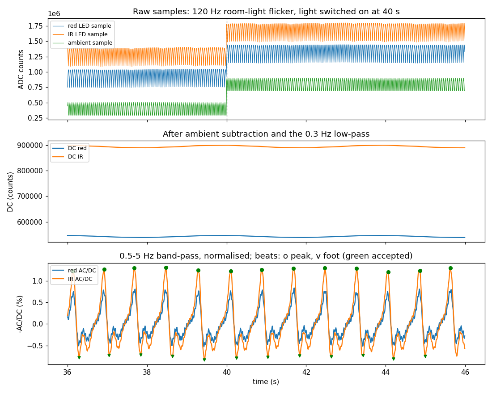
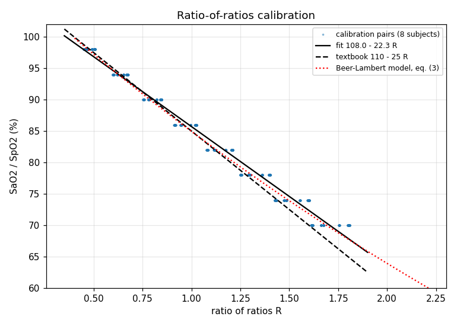
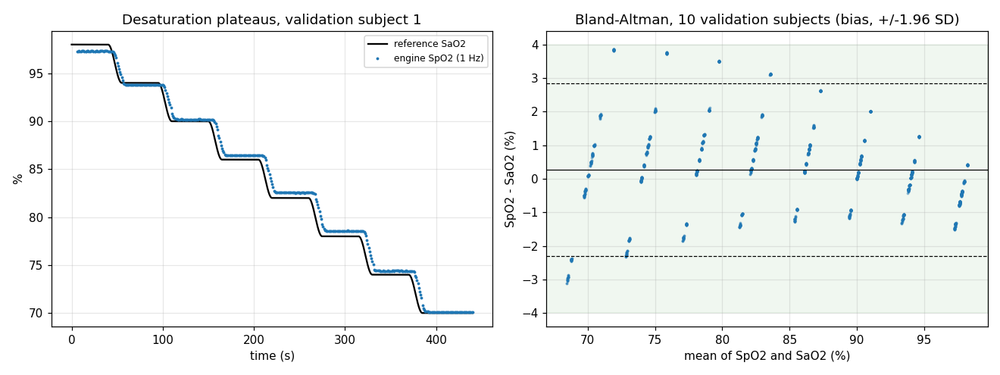
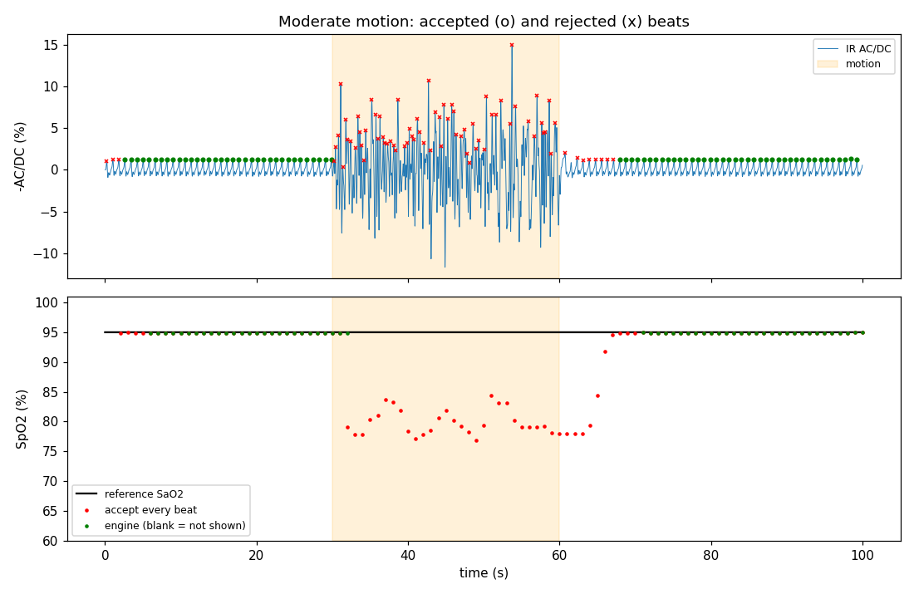
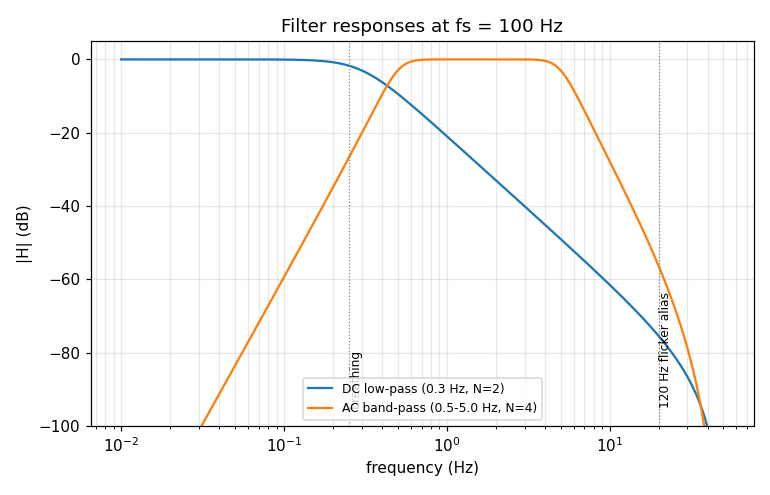

# 06 - PPG Pulse Oximetry Engine (SpO2 and Pulse Rate)

## In plain words

- **What it is:** the signal-processing part of a pulse oximeter, the clip-on fingertip device that reports blood oxygen (SpO2) and pulse rate from red and infrared light.
- **Why it matters:** motion and room light corrupt the raw signal, so a good device must filter them and refuse to show a number it cannot trust.
- **What was done:** I wrote the processing in Python and tested it on synthetic (computer-generated) signals with known true values. No sensor was used and no patient data: no hardware was built.
- **Headline result:** A_rms (a typical-error measure) is 1.34 % on 10 other synthetic subjects, against an ISO limit of 4.0 %. This checks the code against its own model and is not a clinical accuracy claim.
- **Try it:** `python3 main.py`

A Python DSP engine for two-wavelength (red and infrared) photoplethysmogram (PPG) data, as a pulse oximeter's signal processing would run it. It generates synthetic raw ADC samples with a known ground truth (arterial saturation, beat times) and corrupts them with ambient light (room-light flicker and light switched on) and probe motion, then recovers SpO2 and pulse rate once per second: ambient subtraction, AC/DC separation filters, beat-by-beat peak tracking, the ratio of ratios, and a calibration curve fitted on one synthetic cohort and tested on another, the way ISO 80601-2-61 describes a desaturation study. Every reading carries status flags, and the engine shows nothing rather than a number it cannot support (probe off, saturation, motion, low perfusion). Everything here is simulation: no sensor, no hardware and no patient data; the accuracy figures check the signal processing against its own physical model and are not a clinical accuracy claim.

| Item | Value |
|---|---|
| Signal model | modified Beer-Lambert law at red 660 nm and IR 940 nm (Prahl haemoglobin extinction coefficients), arterial pulse with heart-rate variability, breathing, venous blood; nominal DPF_red / DPF_ir 1.5 |
| Front end | multiplexed AFE4490-style frame at 100 Hz: red, ambient, IR, ambient samples; 22-bit ADC, full scale 2097151 counts |
| Interference | room light with 120 Hz flicker and a light switched on, probe motion (moved venous blood and optical coupling, in the pulse band), ADC noise, saturation, probe off, ADC stuck |
| DSP chain | ambient subtraction; DC low-pass 0.3 Hz (order 2) and AC band-pass 0.5-5.0 Hz (order 4); -AC/DC normalisation; causal peak/valley tracking on IR with sub-sample peak timing; ratio of ratios per beat by a least-squares fit of red to IR over the cycle |
| Beat checks | rate 30-220 bpm, perfusion >= 0.05 %, red/IR correlation >= 0.95, amplitude 0.5-2.0x and interval +/-30 % of recent beats, R within +/-(0.1 + 10 %) of recent beats, cycle shape; learning from 3 agreeing beats after 5 s without a rejected beat |
| Output | every 1 s: median of the last 8 accepted beats within 10 s (at least 4), withheld when the beats' R scatters by more than 4 % around its trend; status flags SATURATED, NO_SIGNAL, LOW_PERFUSION, MOTION, STALE, LEARNING, CLIPPED_HIGH, BELOW_CAL_RANGE, R_OUT_OF_RANGE, LOW_QUALITY |
| Calibration | SpO2 = 107.97 - 22.25 R, fitted on 8 synthetic subjects (plateaus 98 to 70 % SaO2) |
| Simulated results | A_rms 1.34 % on 10 other synthetic subjects over 70-100 % (ISO limit 4.0 %), every paired reading shown; pulse rate A_rms 0.45 bpm; room-light flicker moves SpO2 by 0.07 % rms; 48 motion runs on seeds not used in design: 0 runs with a shown value more than 3 % off (A_rms 0.17 %), readings back 13 s after motion at worst; probe off or moved to another patient never shows an old reading |

## Quick start

Python 3 with numpy, scipy and matplotlib (pytest for the tests); tested with the versions listed under Tools used. No hardware or simulator is needed.

```
pip install -r requirements.txt
python3 main.py                  # 28 checks, metrics, figures in docs/img/
python3 -m pytest                # unit and regression tests
python3 tools/negative_gate.py   # the checks against 15 engines with safeguards removed
```

`python3 main.py --no-plot` skips the figures. The engine on its own:

```python
from ppg_spo2 import PpgSpo2Engine, generate_recording

recording = generate_recording(60, fs_hz=100.0, sao2_pct=92.0, pulse_rate_bpm=80.0)
result = PpgSpo2Engine(100.0).process(recording)          # or process_block() per ADC block
print(result.spo2_pct[-1], result.pulse_rate_bpm[-1], result.status[-1])
```

`PpgSpo2Engine(fs_hz, calibration)` takes the fitted calibration from `fit_linear_calibration` (main.py fits one); without it the textbook line 110 - 25 R is used.

## Engineering why

A pulse oximeter never measures saturation directly: it compares how much the pulsing part of the light changes at two wavelengths, and the ratio of ratios cancels path length, LED power and detector gain only if each AC is divided by its own clean DC and both channels are measured the same way, which is why the chain subtracts an ambient sample from the same frame, places the filter edges between breathing, the pulse and the 20 Hz alias of 120 Hz room-light flicker, and fits red to IR over the whole beat instead of reading red at the IR extremes (picked on a noisy trace, those extremes bias R, which showed up as a SpO2 offset under flicker until the estimator was changed). Motion moves venous blood and the probe coupling in the same band as the pulse and has its own ratio of ratios, so accepting every beat would show a value more than 3 % off in 42/48 motion runs; the engine instead makes a reading earn its place (per-beat rate, perfusion, saturation, red/IR proportionality, amplitude, interval, R-continuity and shape checks, learning only from agreeing beats after a quiet spell, and a scatter limit on the beat-to-beat R) and goes blank with a MOTION or LOW_QUALITY flag, which costs readings during motion (29 % of the motion windows shown) but showed no wrong value in the 48 motion runs. The calibration is fitted rather than assumed and tested on different subjects, and the artifact limits are checked against the opposite failure too: during a real desaturation at 1 %/s readings are still shown (the 8-beat median lags it, by up to 5.2 %), and what the limits cost at 2 %/s is measured and reported instead of hidden.

## Verification

Each block below is copied from the log named above it, produced by the command shown (run 2026-11-07 on macOS). Everything is simulation; no hardware was built and no patient data was used.

### Validation script (main.py)

`python3 main.py` (docs/main_py.log). Exit code 0 means every check passed. The log's METRIC lines (machine-readable copies of the same numbers) are left out here.

```
$ python3 main.py   # 2026-11-07, Python 3.13.2, numpy 2.2.6, scipy 1.17.1, matplotlib 3.10.8
PPG SpO2 06 - main.py (simulated signals; not a medical device, no clinical data)
Configuration
  optics: red 660 nm, IR 940 nm, Prahl haemoglobin extinction coefficients, nominal DPF_red / DPF_ir 1.5
  sample rate 100 Hz per channel (red, ambient, IR, ambient per frame); ADC full scale 2097151 counts (22-bit)
  DC low-pass 0.3 Hz order 2; AC band-pass 0.5-5.0 Hz order 4 (Butterworth, SOS)
  beat checks: rate 30-220 bpm, perfusion >= 0.05 %, red/IR correlation >= 0.95, amplitude 0.5-2.0x, interval +/-30 %, R +/-(0.1 + 10 %)
  seeding: 3 agreeing beats (R within 15 %), 5 s quiet; relearn after 6 rejections or 4 s without a beat
  output every 1 s: median of last 8 accepted beats within 10 s, at least 4 beats, R scatter <= 4 %; min DC 0.5 % of full scale
  study: plateaus 98, 94, 90, 86, 82, 78, 74, 70 % SaO2, hold 40 s, transition 15 s, pairs from the last 25 s of each hold; DPF ratio spread 5 % (1 sigma)
  motion seeds 500-505; the beat-check thresholds were chosen on seeds 100-111 and 300-305
  limits: A_rms <= 4.0 % (ISO 80601-2-61); design targets: coverage >= 95 %, pulse rate A_rms <= 3.0 bpm, any shown value within 3.0 %, recovery <= 20 s

[1] Optics model and generator
  C01 eq. (3) R(S) and its inverse round trip              max error 3.3e-16 (limit 1e-9)               PASS
  C02 engine R on a clean 97 % recording vs eq. (3)        0.5101 vs 0.5092 (0.17 %)                    PASS

[2] Filters
  C03 DC low-pass rejects the pulse (1 Hz)                 -21.0 dB (limit -20 dB)                      PASS
  C04 AC band-pass flat over 0.8-3.5 Hz (48-210 bpm)       max deviation 0.09 dB (limit 0.5 dB)         PASS
  C05 AC band-pass rejects breathing and flicker alias     0.25 Hz -26.9 dB, 20 Hz -56.4 dB (-20/-40)   PASS

[3] Calibration and accuracy (ISO 80601-2-61 style desaturation study)
  C06 linear calibration describes its own cohort          SpO2 = 107.97 - 22.25 R, residual 1.23 %, R^2 0.982 PASS
      info: 1664 calibration pairs, 0 blanked outputs excluded
  C07 validation cohort (10 other subjects) A_rms 70-100 % 1.34 % (limit 4.0), shown 100.0 % of 2080    PASS
      info: bias +0.27 %, precision 1.31 %, blanked 0 of 2080 paired outputs
  C08 A_rms in each band 70-80, 80-90, 90-100 %            1.73 / 1.31 / 0.81 %                         PASS
      info: same readings through the textbook line 110 - 25 R: A_rms 1.78 % (the fitted line: 1.34 %)
  C09 pulse rate A_rms vs 8-beat reference                 0.45 bpm (target 3.0 bpm), n 2080            PASS

[4] Ambient light and motion
  C10 120 Hz flicker + room-light step: SpO2 change        rms 0.07 % (limit 0.5 %), 0 blanked          PASS
      info: ambient 2.0e5 counts + 3.0e5 counts 120 Hz flicker, +4.0e5 step at 40 s; LED DC red ~5.5e5, IR ~9.0e5 counts
      info: not handled: the same light on 50 Hz mains (100 Hz flicker, phase-locked to the 100 Hz frame) shifts SpO2 by -10.2 %
      info: motion 0.002/0.001  worst shown error 1.85 %, runs with a value > 3 % off 0/6, shown  46 % of 30-80 s, back 7 s after
      info: motion 0.005/0.003  worst shown error 0.16 %, runs with a value > 3 % off 0/6, shown  29 % of 30-80 s, back 11 s after
      info: motion 0.01/0.005   worst shown error 0.16 %, runs with a value > 3 % off 0/6, shown  27 % of 30-80 s, back 11 s after
      info: motion 0.02/0.01    worst shown error 0.16 %, runs with a value > 3 % off 0/6, shown  28 % of 30-80 s, back 12 s after
      info: motion 0.05/0.03    worst shown error 0.15 %, runs with a value > 3 % off 0/6, shown  25 % of 30-80 s, back 13 s after
      info: motion 0.2/0.1      worst shown error 0.15 %, runs with a value > 3 % off 0/6, shown  25 % of 30-80 s, back 13 s after
      info: motion 0/0.005      worst shown error 0.18 %, runs with a value > 3 % off 0/6, shown  29 % of 30-80 s, back 11 s after
      info: motion 0/0.02       worst shown error 0.15 %, runs with a value > 3 % off 0/6, shown  25 % of 30-80 s, back 13 s after
  C11 motion (48 runs): shown values, MOTION flag          A_rms 0.17 %, 0 runs with a value > 3 % off (limit 5 %) PASS
      info: worst single value shown 1.85 %; values shown in 29 % of the 30-80 s windows; MOTION flagged in every run
  C12 motion: SpO2 shown again after motion stops          worst 13 s (limit 20 s)                      PASS
  C13 motion scenarios are a real test (accept-all)        accepting every beat shows a value > 3 % off in 42/48 runs PASS
  C14 fast desaturation 97 -> 70 % at 1 %/s: still shown   shown 100 % of the time (limit 95 %); lag error up to 5.2 % (not limited) PASS
      info: trade-off: at 2 %/s the artifact checks also reject real beats; shown 56 % of the time, max lag error 12.5 %

[5] Pulse rate and perfusion range
  C15 pulse rate A_rms at 40, 120 and 200 bpm              worst 1.13 bpm (target 3.0)                  PASS
  C16 pulse rate step 60 -> 130 bpm settles within 3 bpm   10 s after the step (limit 15 s)             PASS
  C17 SpO2 A_rms for perfusion index 0.2-10 % (at 90 %)    0.49 0.45 0.44 0.43 0.41 0.38 %, shown >= 100 % PASS
  C18 perfusion index 0.02 %: no value shown, flagged      0 values shown, LOW_PERFUSION set            PASS
  C19 perfusion drop 3 % -> 0.3 % (cold finger): resumes   shown and within 3 % for all of 50-90 s      PASS

[6] Edge cases
  C20 probe off: zero light, and 0.5 % light in a lit room NO_SIGNAL at the next output (1 / 1 s), 0 shown after 30 s PASS
  C21 probe moved to another patient (97 -> 80 %)          first reading 5 s after re-attach, max |error| 0.92 % PASS
  C22 ADC saturation (sunlight): SATURATED, no beats used  flag after 1 s, 0 beats accepted, 0 shown    PASS
  C23 pulse tops clipped 20-40 s: clipped beats never used 0 clipped beats used, max |error| 0.42 %, back 16 s after PASS
      info: 29 % of red samples clipped in 20-40 s; 15 readings before, every second with a clipped sample blank and SATURATED
  C24 flat line (ADC stuck mid-scale): NO_SIGNAL, blank    0 values shown after 31 s (1 s detection window) PASS
  C25 zero and near-zero DC (0 / 30 counts): never divided AC/DC never computed, no beats, blank, NO_SIGNAL PASS
  C26 R outside any SpO2 (wrong LED): blank, flagged       R 2.70, 0 values shown                       PASS
  C27 SpO2 never above 100 %, clipping flagged             max shown 100.0 %, CLIPPED_HIGH set          PASS
  C28 sample-rate mismatch and too-low rate rejected       ValueError for 100 Hz data into a 250 Hz engine and for fs 10 Hz PASS

28/28 checks passed
figures written to docs/img/
exit code 0
```

C06 is a sanity check (a straight line describes the calibration data); the accuracy test is C07 on different subjects, next to the textbook line's result on the same readings. How to read the motion lines: values shown in the 30-80 s window are the readings before the engine stops trusting the beats and after it has learned them again; while the probe moves, the engine shows nothing. The thresholds of the beat checks were chosen while looking at motion seeds 100-111 and 300-305; the reported motion runs use seeds 500-505, which played no part in any choice.

### Unit and regression tests (pytest)

`python3 -m pytest -v` (docs/pytest.log).

```
$ python3 -m pytest -v   # 2026-11-07, Python 3.13.2, numpy 2.2.6, scipy 1.17.1, pytest 9.0.2
============================= test session starts ==============================
platform darwin -- Python 3.13.2, pytest-9.0.2, pluggy-1.6.0
rootdir: /Users/shonzinger/Career/ee-portfolio-projects/06-ppg-spo2
configfile: pytest.ini
testpaths: tests
plugins: asyncio-1.4.0, anyio-4.13.0
asyncio: mode=Mode.STRICT, debug=False, asyncio_default_fixture_loop_scope=None, asyncio_default_test_loop_scope=function
collected 47 items

tests/test_engine.py .....................                               [ 44%]
tests/test_filters_synth.py ..............                               [ 74%]
tests/test_optics_calibration_metrics.py ............                    [100%]

============================== 47 passed in 2.24s ==============================
exit code 0
```

The regression tests include four findings of a fresh-context review that were fixed: a reading from the previous patient after the probe is moved, a probe slipping off flagged only after the DC filter decayed, a dark-room probe-off reported as saturation, and a flat-line detector that depended on the processing block size. Each of these tests was run against the engine as it was before the fixes and failed there.

### Negative gate

`python3 tools/negative_gate.py` (docs/negative_gate.log). Each mutant removes one safeguard from the engine and runs the full check list; it is caught when at least one check fails.

```
$ python3 tools/negative_gate.py   # 2026-11-07, Python 3.13.2
PPG SpO2 06 - negative gate (each mutant removes one safeguard)
baseline: all checks pass
  M1   ambient sample not subtracted                  caught      failing: C10, C20
  M2   saturated frames not detected                  caught      failing: C22, C23
  M3   AC not divided by its own DC                   caught      failing: C02, C06, C07, C08, C11, C19, C23, C26, C27
  M4   no minimum-DC (probe-off) threshold            caught      failing: C25
  M5   band-pass without its 5 Hz upper edge          caught      failing: C10, C28
  M6   calibration output limits removed              caught      failing: C26, C27
  M7   beat amplitude/interval/shape checks off       NOT CAUGHT  failing: -
  M8   red/IR proportionality check off               NOT CAUGHT  failing: -
  M9   seeding without quiet period or R agreement    caught      failing: C11
  M10  no un-seed timeout                             caught      failing: C19
  M11  no flat-line detection                         caught      failing: C24
  M12  no R-continuity check                          NOT CAUGHT  failing: -
  M13  no minimum beat count per output               NOT CAUGHT  failing: -
  M14  no R-scatter quality limit                     NOT CAUGHT  failing: -
  M15  whole motion layer off (M7 + M8 + M12 + M14)   caught      failing: C11

10/15 mutants caught
exit code 1
```

Ten of the fifteen mutants are caught one at a time, including every protection outside the motion layer (ambient subtraction, saturation, DC normalisation, the probe-off threshold, the band-pass upper edge, calibration limits, seeding, the un-seed timeout and flat-line detection). The five motion checks overlap: with any one of M7, M8, M12, M13 or M14 removed, the others still kept every wrong reading off the display in the 48 motion runs, so the checks cannot show that each is needed on its own. Removing the motion layer as a whole (M15) is caught. Each of the five was added after a specific failure on the design seeds; they are kept as overlapping protection rather than proven individually here, and the gate's exit code stays 1 to say so.

### Figures

Signal chain under room light (raw samples, DC after ambient subtraction, normalised AC with tracked beats):



Ratio-of-ratios calibration: calibration pairs, the fitted line, the textbook line and the Beer-Lambert model:



Desaturation study: one validation subject over time, and Bland-Altman of the validation cohort:



Motion: accepted and rejected beats, the engine's output and what accepting every beat would show:



Filter responses:



## Standards

- **ISO 80601-2-61** (pulse oximeter equipment, basic safety and essential performance): SpO2 accuracy is stated as A_rms = sqrt(mean((SpO2 - SaO2)^2)) over 70-100 % SaO2, with a limit of 4.0 %, and determined in a controlled desaturation study with arterial blood samples measured by CO-oximetry (Annex EE). main.py follows that shape (plateaus, pairing at steady state, calibration and validation on different subjects, A_rms per band) on synthetic subjects, which makes it a test of the signal processing, not a clinical accuracy figure. The standard also asks the manufacturer to state the pulse-rate accuracy; 3.0 bpm A_rms is this project's own target.
- The US FDA guidance for pulse oximeter 510(k) submissions asks for a tighter A_rms for most sensor types and, in its newer draft, for subjects covering a range of skin pigmentation; neither can be addressed with synthetic data.
- IEC 60601-1-8 (alarm systems) is not implemented: the engine gives status flags, not alarms.

## Design notes

- Ambient light: the front end samples ambient light in the same frame as each LED, so subtraction removes room light and sunlight below saturation. What is left is the flicker that changed between the two samples; with 60 Hz mains it is a 120 Hz tone that aliases to 20 Hz (and 40 Hz for its harmonics) at 100 Hz and is removed by the band-pass. With 50 Hz mains the flicker is phase-locked to a 100 Hz frame and leaves a constant offset that no filter can remove (see Known limitations).
- Ratio of ratios: the IR peak-to-peak of each beat comes from the tracked foot and peak, and R from a least-squares fit of the detrended red cycle to the detrended IR cycle, R = sum(r i) / sum(i^2). Reading red at the IR extremes biased R because those extremes are picked on the noisy IR trace.
- Pulse rate stays on the display when SpO2 is blanked only because R maps outside any plausible saturation (R_OUT_OF_RANGE): the beats themselves passed every check, so their timing is still valid.
- Gaps: any saturated or no-signal sample restarts the filters, the beat tracker and its statistics, and starts a new epoch; readings only ever come from beats accepted in the current epoch, so a probe moved to another patient cannot show the first patient's value.
- Equations are written next to the code: Beer-Lambert absorbance and the ratio of ratios (ppg_spo2/optics.py), the front-end and interference model (ppg_spo2/synth.py), filter responses (ppg_spo2/filters.py), the signal chain and beat checks (ppg_spo2/engine.py), calibration and accuracy statistics (ppg_spo2/calibration.py, ppg_spo2/metrics.py).

## Known limitations

- Synthetic only. The calibration and validation cohorts come from the same optical model, with the subject-to-subject spread of DPF_red / DPF_ir set to 5 % (an assumption that sets most of the 1.34 % A_rms). Nothing models skin pigmentation, carboxy- or methaemoglobin, venous pulsation at the probe site, nail polish, probe fit or tissue heating. Real accuracy has to come from a desaturation study on people.
- The calibration is a straight line; the Beer-Lambert model is curved (visible in calibration.png), which is part of the 1.23 % fit residual. A real device fits its own curve to its own study data.
- Motion is handled by refusing to read through it, not by measuring through it: there is no adaptive filter and no accelerometer reference, so readings are withheld during motion (29 % of the motion windows shown). The beat-check thresholds were tuned on synthetic motion and would need retuning on real recordings.
- The artifact checks trade against fast real change: at 2 %/s desaturation the engine showed readings 56 % of the time; at 1 %/s it follows the change but the 8-beat median lags (max lag error 5.2 %).
- 50 Hz mains at a 100 Hz frame rate is not handled: the same room light shifts SpO2 by -10.2 %. A real front end avoids it with a frame rate that is not a sub-multiple of the flicker, or with ambient samples placed symmetrically around the LED pulse.
- Fixed 100 Hz frame rate (other rates are rejected, not resampled); floating-point Python, not fixed-point firmware; no alarms.

## Status

Done:
- Synthetic two-wavelength PPG generator with a known ground truth: optics, front-end timing, ambient light, motion, saturation and probe-off cases.
- Engine: ambient subtraction, AC/DC filters, beat tracking with quality checks, ratio of ratios, calibration, 1 s SpO2 and pulse-rate output with status flags.
- Validation script (28 checks, figures), 47 unit and regression tests, a 15-mutant negative gate (10 caught one at a time; the five overlapping motion checks are caught together), and a fresh-context review whose findings were fixed.

Not done:
- Real PPG recordings, a real desaturation study, a fixed-point port, 50 Hz-mains-safe sampling, motion compensation with an accelerometer, alarms.

## Tools used

- Python 3.13.2 with numpy 2.2.6, scipy 1.17.1, matplotlib 3.10.8
- pytest 9.0.2

## Credits

Designed, specified and verified by Shon Zinger. Claude (Anthropic) assisted with: the optical and front-end model, the signal generator, the DSP engine, the validation script, the tests and negative gate, and documentation.
