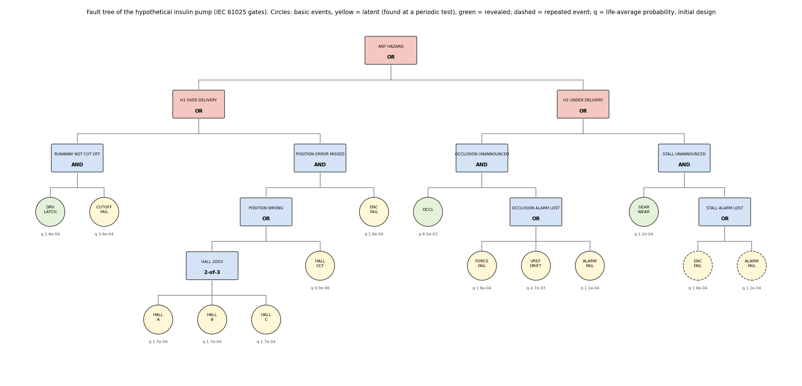
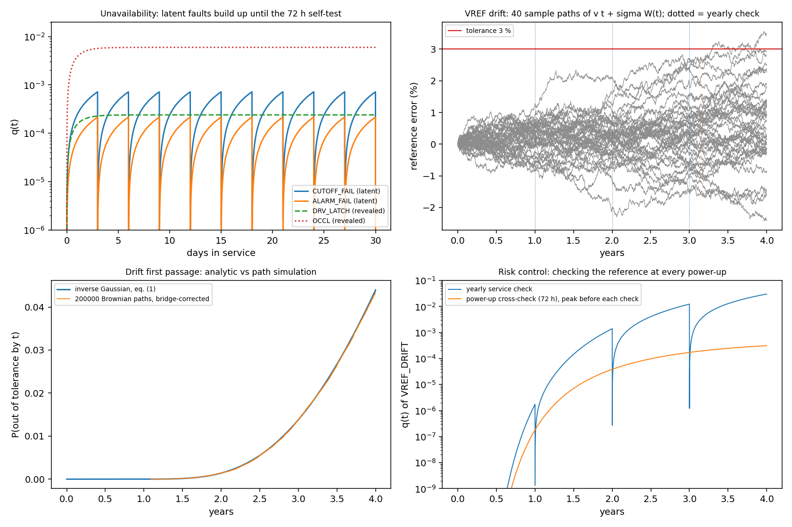
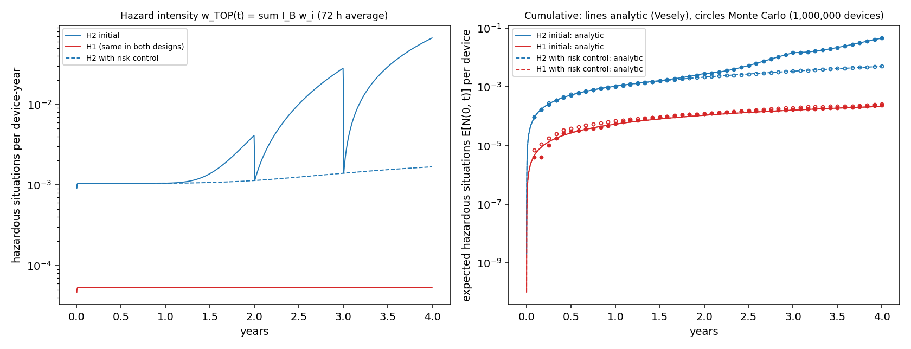
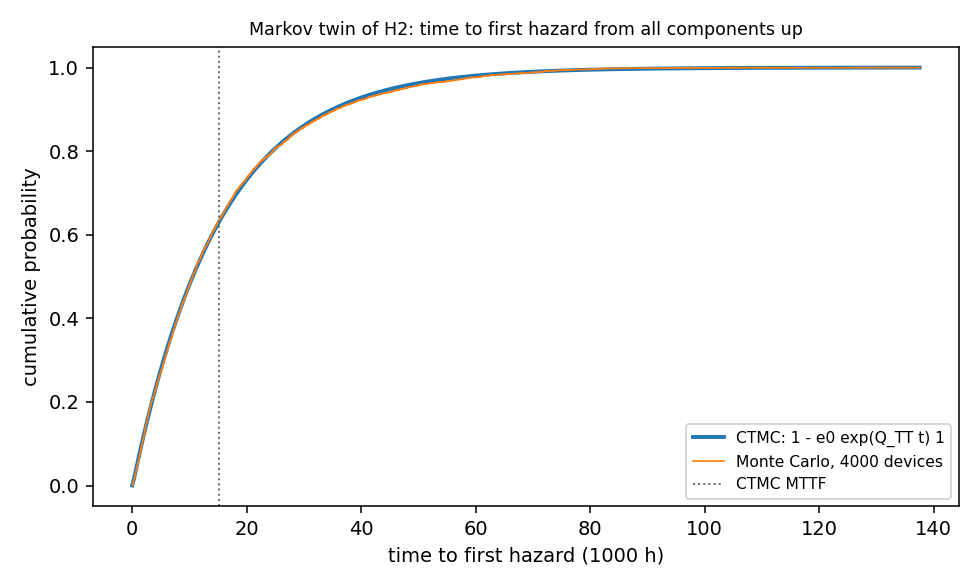
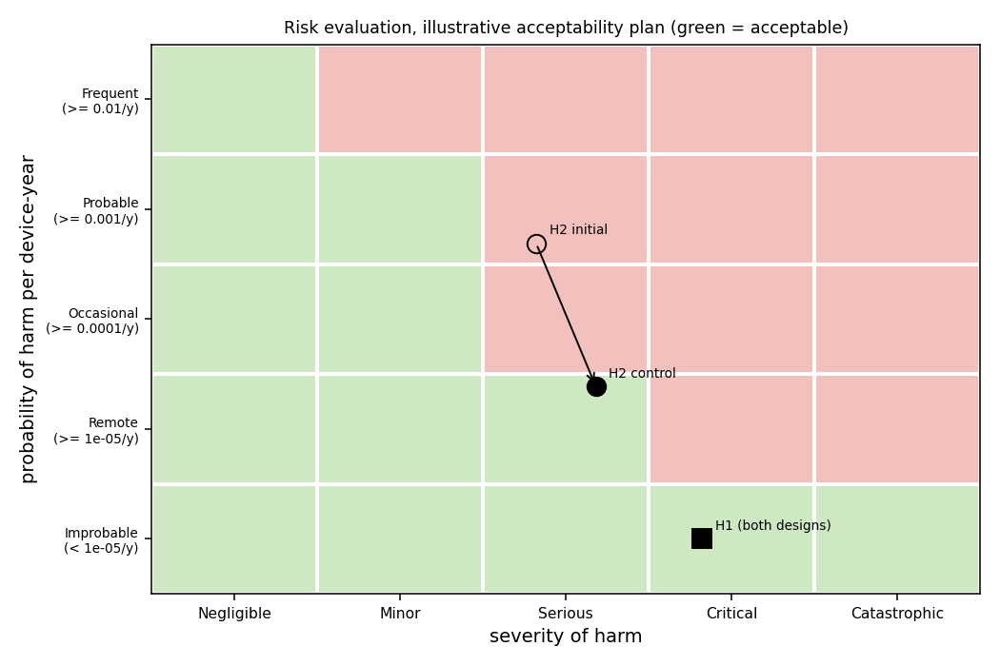
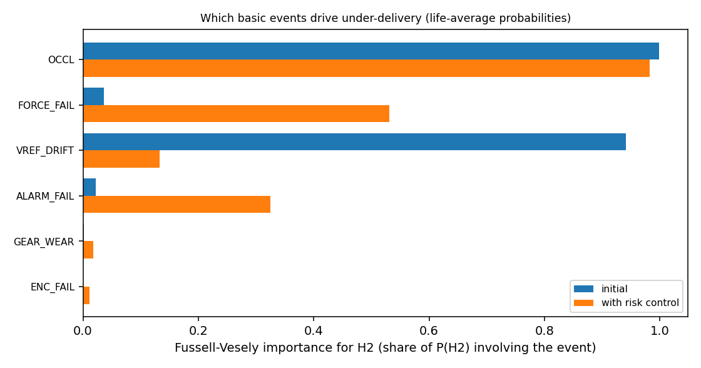

# 07 - Fault Tree and Monte Carlo Risk Simulator (ISO 14971 style, hypothetical insulin pump)

## In plain words

- **What it is:** a tool that estimates how likely a medical device is to fail dangerously, using a hypothetical insulin pump as the worked example, much like asking which combinations of small faults could lead to a serious one.
- **Why it matters:** medical device makers must show that risks are understood and reduced (the ISO 14971 standard), and doing the probability arithmetic correctly is the hard part.
- **What was done:** I wrote the analysis in Python: a fault tree (a diagram of fault combinations) solved exactly, plus a Monte Carlo (many random simulated pump lifetimes) cross-checked against other methods. All numbers are assumptions for a made-up pump: no hardware was built and it is not a claim about any real device.
- **Headline result:** one added risk control gives 9.2x fewer undetected (not annunciated) under-delivery situations over the pump's life.
- **Try it:** `python3 main.py`

A Python tool for quantitative safety analysis of a medical device, worked through on a hypothetical automated insulin pump. It builds a fault tree from component-level faults (motor driver latch-on, infusion-set micro-occlusions, ADC reference drift, drive-train wear, latent faults in the safety mechanisms) up to two hazardous situations, computes minimal cut sets and exact probabilities, runs a Monte Carlo of component state transitions over a 4-year service life to get hazard rates and MTBF, cross-checks the Monte Carlo (component failures and unavailability, hazard counts, MTBF) against independent analytic and Markov solutions, and evaluates each hazardous situation the way ISO 14971 describes, before and after one risk control measure.

Everything is simulation. The pump, its architecture, every failure rate, the severity and P2 values and the acceptability plan are assumptions made for this project, chosen so the example has something to show: the initial design's under-delivery hazard lands in the not-acceptable region and one risk control moves it into the acceptable region. Nothing here is a regulatory, compliance or clinical claim about any real device.

| Item | Value |
|---|---|
| Fault tree | 12 basic events, AND / OR / 2-of-3 vote gates (IEC 61025 style), repeated events (encoder and alarm feed both hazards), beta-factor common cause on the Hall sensors; 10 minimal cut sets (7 of order 2, 3 of order 3) |
| Exact analysis | MOCUS cut sets with absorption; reduced ordered binary decision diagram (exact with repeated events); Birnbaum, Fussell-Vesely, RAW, RRW importance |
| Component models | random failure (exponential), wear-out (Weibull, renewal equation solved numerically), reference drift as a Wiener process with drift reaching a tolerance (inverse Gaussian first passage), latent faults restored at periodic tests (renewal on the test grid) |
| Monte Carlo | 1,000,000 pumps per design over 35064 h: every component's up/down history, cut sets and hazards by a vectorised interval sweep |
| Cross-checks | Vesely onset-frequency integral, exact Markov chain (64 states) for MTTF / MTBF / time-to-first-hazard distribution, Brownian path simulation for the drift model |
| Simulated results | device MTBF 18533 h (4-year average, 1.892 hardware failures per pump life); under-delivery H2 worst year 3.10e-02 situations per device-year in the initial design, 1.54e-03 with the risk control (9.2x fewer over the life); over-delivery H1 5.34e-05 per device-year; Markov twin MTBF 12901 h exact vs 12878 h Monte Carlo |

## Quick start

Python 3 with numpy, scipy and matplotlib (pytest for the tests). No hardware is needed.

```
pip install -r requirements.txt
python3 main.py                  # 23 checks, metrics, figures in docs/img/  (~30 s)
python3 -m pytest                # unit and regression tests
python3 tools/negative_gate.py   # the checks against 15 broken versions of the method (~8 min)
python3 tools/recheck_h1.py      # six more Monte Carlo runs of the over-delivery hazard
```

The library on its own:

```python
from fta_risk import BDD, pump
from fta_risk.analysis import component_curves, expected_onsets, hour_midpoints

tree = pump.fault_tree("H2_UNDER_DELIVERY")
print(tree.minimal_cut_sets())
q, w = component_curves(pump.components(), hour_midpoints(pump.SERVICE_LIFE_H))
print(expected_onsets(BDD(tree), q, w))   # expected hazardous situations per pump life
```

## Engineering why

A risk analysis is only as good as the arithmetic under it, and the two easiest mistakes in fault tree work are multiplying gate probabilities when an event feeds more than one gate and treating a latent fault as if its probability were constant, so the tool uses a binary decision diagram for exact probabilities and models when each fault is found (at once, at the next self-test, or at the yearly check). A Monte Carlo is easy to get subtly wrong, so every number it gives is compared with a result computed a different way: an exact Markov chain where all times are exponential, and the Vesely onset-frequency integral where they are not. The risk control was chosen from the importance ranking, not by guess: reference drift accounts for most of the under-delivery risk because it is only checked once a year, and checking it at every power-up removes that.

## Verification

Each block below is copied from the log named above it, produced by the command shown (run 2026-11-08 on macOS). Everything is simulation; no hardware was built.

### Validation script (main.py)

`python3 main.py` (docs/main_py.log). Exit code 0 means every check passed. The log's METRIC lines (machine-readable copies of the same numbers) are left out here.

```
$ python3 main.py   # 2026-11-08, Python 3.13.2, numpy 2.2.6, scipy 1.17.1, matplotlib 3.10.8
Fault tree risk simulator 07 - main.py (hypothetical insulin pump; simulation only, not a regulatory or clinical claim)
Configuration
  service life 4 years = 35064 h (1 year = 8766 h); self-test every 72 h; yearly service check every 8766 h
  DRV_LATCH   exponential lambda 1e-05/h, revealed, mean repair 24 h
  CUTOFF_FAIL exponential, lambda 1e-05 /h, latent, tested every 72 h
  HALL_A      exponential, lambda 4.75e-06 /h, latent, tested every 72 h
  HALL_B      exponential, lambda 4.75e-06 /h, latent, tested every 72 h
  HALL_C      exponential, lambda 4.75e-06 /h, latent, tested every 72 h
  HALL_CCF    exponential, lambda 2.5e-07 /h, latent, tested every 72 h
  ENC_FAIL    exponential, lambda 5e-06 /h, latent, tested every 72 h
  OCCL        exponential lambda 0.00025/h, revealed, mean repair 24 h (use-related, not hardware)
  FORCE_FAIL  exponential, lambda 5e-06 /h, latent, tested every 72 h
  VREF_DRIFT  drift first passage, v 0.02/kh, sigma 0.2/sqrt(kh), tolerance 3, latent, tested every 8766 h
  GEAR_WEAR   Weibull, beta 3, eta 6e+04 h, revealed, mean repair 24 h
  ALARM_FAIL  exponential, lambda 3e-06 /h, latent, tested every 72 h
  Hall sensors: total rate 5e-06/h each, beta factor 0.05 (common cause)
  VREF_DRIFT: e(t) = v t + sigma W(t), v 0.02 %/kh, sigma 0.2 %/sqrt(kh), tolerance 3 %; restored only when a check finds it out of tolerance
  designs: initial = reference checked at the yearly service only (8766 h); with risk control = reference compared with a second reference at every power-up self-test (72 h)
  H1: insulin over-delivery (runaway or wrong plunger position not caught) -> severe hypoglycaemia; severity 4 (Critical), P2 0.1
  H2: insulin under-delivery not annunciated (occlusion or stall) -> hyperglycaemia / ketoacidosis; severity 3 (Serious), P2 0.05
  probability of harm per device-year (illustrative plan): Frequent >= 0.01, Probable >= 0.001, Occasional >= 0.0001, Remote >= 1e-05, Improbable below
  acceptability (illustrative plan): Negligible up to Frequent, Minor up to Probable, Serious up to Remote, Critical up to Improbable, Catastrophic up to Improbable
  P1 for the risk evaluation = expected hazardous situations in the worst year of the life (analytic), with the Monte Carlo 97.5 % upper bound for that year as a second test
  Monte Carlo: 1000000 devices per design, seeds 7001 (initial) and 7002 (control); sample times 4000.5, 17000.5, 30000.5 h
  Markov twin of H2 (two-state exponential, rate / mean repair): OCCL 0.002/h 24 h, FORCE_FAIL 0.0002/h 36 h, VREF_DRIFT 0.0001/h 200 h, ALARM_FAIL 0.0001/h 36 h, GEAR_WEAR 0.0002/h 24 h, ENC_FAIL 0.0001/h 36 h; 4000 devices over 300000 h (MTBF counted after a 10000 h burn-in), seed 7003
  drift paths: 200000 Brownian paths, 48 h steps, seed 7004
  statistics: Monte Carlo vs analytic agrees when |z| < Bonferroni limit for the family at 1 % family-wise error (e.g. 2.58 for 1, 3.34 for 12 comparisons)

[1] Fault tree logic (IEC 61025 gates, minimal cut sets, exact probability)
  C01 MOCUS minimal cut sets = brute-force enumeration     10 cut sets (7 of order 2, 3 of order 3), 2^12 states PASS
      info: cut set {ALARM_FAIL, GEAR_WEAR}
      info: cut set {ALARM_FAIL, OCCL}
      info: cut set {CUTOFF_FAIL, DRV_LATCH}
      info: cut set {ENC_FAIL, GEAR_WEAR}
      info: cut set {ENC_FAIL, HALL_CCF}
      info: cut set {FORCE_FAIL, OCCL}
      info: cut set {OCCL, VREF_DRIFT}
      info: cut set {ENC_FAIL, HALL_A, HALL_B}
      info: cut set {ENC_FAIL, HALL_A, HALL_C}
      info: cut set {ENC_FAIL, HALL_B, HALL_C}
  C02 BDD P(top) = sum over all 4096 states (at q-bar)     max relative difference 2.3e-16 (limit 1e-12) PASS
      info: BDD nodes: H1 23, H2 17, any 49; P(top) at life-average q (q-bar): H1 8.794e-08, H2 2.972e-05, any 2.981e-05
      info: time-average of P(top) over the life (BDD at every hour): H1 8.852e-08, H2 2.974e-05, any 2.983e-05 (latent faults on one test grid add up in phase, so the time average exceeds P at q-bar)
      info: multiplying gate probabilities instead (ignores repeated ALARM_FAIL, ENC_FAIL): any 2.980809e-05 vs exact 2.980801e-05 (+0.000 %)
  C03 exact <= min-cut upper bound <= rare-event sum       rare-event above exact by 0.000 / 0.028 / 0.028 % (H1/H2/any) PASS
  C04 2-of-3 vote + common cause = 1-(1-qc)(1-3q^2+2q^3)   relative difference 2.7e-12; common cause 99.0 % of it PASS
  C05 Birnbaum importance = dQ/dq_i (finite difference)    max relative difference 4.9e-11 (limit 1e-9) PASS

[2] Component models: Monte Carlo (1000000 devices, 4 years) vs analytic
  C06 drift first passage eq. (1) vs Brownian paths        worst |z| 0.99 of 4 times (limit 3.02); F(4 y) 0.0439 PASS
      info: without the Brownian-bridge correction, checking the level only every 48 h misses crossings: F(4 y) -4.5 %
  C07 failures per life, 12 components (eqs. 3-5)          worst |z| 2.49 (ENC_FAIL, limit 3.34)        PASS
      info: DRV_LATCH   analytic 0.35056  Monte Carlo 0.35020 +/- 0.00059 per life
      info: CUTOFF_FAIL analytic 0.35051  Monte Carlo 0.35104 +/- 0.00059 per life
      info: HALL_A      analytic 0.16653  Monte Carlo 0.16640 +/- 0.00041 per life
      info: HALL_B      analytic 0.16653  Monte Carlo 0.16676 +/- 0.00041 per life
      info: HALL_C      analytic 0.16653  Monte Carlo 0.16692 +/- 0.00041 per life
      info: HALL_CCF    analytic 0.00877  Monte Carlo 0.00861 +/- 0.00009 per life
      info: ENC_FAIL    analytic 0.17529  Monte Carlo 0.17633 +/- 0.00042 per life
      info: OCCL        analytic 8.71375  Monte Carlo 8.71262 +/- 0.00293 per life
      info: FORCE_FAIL  analytic 0.17529  Monte Carlo 0.17565 +/- 0.00042 per life
      info: VREF_DRIFT  analytic 0.04397  Monte Carlo 0.04402 +/- 0.00021 per life
      info: GEAR_WEAR   analytic 0.18283  Monte Carlo 0.18263 +/- 0.00039 per life
      info: ALARM_FAIL  analytic 0.10518  Monte Carlo 0.10522 +/- 0.00032 per life
  C08 unavailability q(t) at 3 times, 12 components        min exact binomial p 0.0005 of 36 (limit 2.8e-04) PASS
  C09 renewal solver (eq. 5), shape 1 vs closed form (3)   max error q 1.4e-04, w 1.2e-04 (limit 1e-3), 1 h grid PASS
  C10 test-grid renewal (eq. 4) = 1-exp(-lambda u) for exp. max difference 5.1e-16 (limit 1e-12)         PASS

[3] Markov state-transition model: exponential twin of H2 (6 components, 64 states)
  C11 CTMC hazard frequency (eq. 2) = Vesely sum I_B w     7.751093e-05 /h, relative difference 3.5e-16 PASS
  C12 Monte Carlo MTTF from all-up vs CTMC (eq. 3)         15391 vs 15230 h, z +0.66, 0 censored        PASS
  C13 Monte Carlo MTBF (steady state) vs CTMC 1 / w        12878 vs 12901 h, z -0.45, 90074 onsets      PASS
  C14 time to first hazard: MC vs CTMC exp(Q t) (eq. 4)    KS distance 0.0095 (limit 0.0258, 1 %)       PASS

[4] Hypothetical insulin pump over a 4-year life: Monte Carlo vs analytic (initial design)
      info: initial H1  expected per pump life: analytic 2.1343e-04, Monte Carlo 2.3200e-04 +/- 1.5e-05 (232 onsets); P(>= 1 in the life) 2.3100e-04; fleet average 1 per 1.87e+04 device-years
      info: initial H2  expected per pump life: analytic 4.5411e-02, Monte Carlo 4.5776e-02 +/- 3.2e-04 (45776 onsets); P(>= 1 in the life) 2.7819e-02; fleet average 1 per 88.1 device-years
      info: initial any expected per pump life: analytic 4.5625e-02, Monte Carlo 4.6008e-02 +/- 3.2e-04 (46008 onsets); P(>= 1 in the life) 2.8044e-02; fleet average 1 per 87.7 device-years
  C15 hazardous situations per life, H1/H2/any (Vesely)    z +1.21 / +1.16 / +1.21 (limit 3.14)         PASS
  C16 device MTBF, 4-year average (hardware failures)      18515 h MC vs 18533 h, z +1.32               PASS
      info: 1.892 hardware failures per pump life (repair or replacement); 4-year average MTBF 18533 h = 2.11 years (analytic; wear-out and drift make the failure rate rise with age)

[5] ISO 14971 style risk estimation, evaluation and one risk control (illustrative acceptability plan)
      info: initial H1 situations per device-year, years 1-4: 5.33e-05, 5.34e-05, 5.34e-05, 5.34e-05 (life average 5.34e-05)
      info: initial H1 worst year 4: P1 5.342e-05 x P2 0.1 = harm 5.34e-06/device-year: Improbable, severity Critical -> acceptable under the illustrative plan
      info: initial H2 situations per device-year, years 1-4: 1.05e-03, 1.78e-03, 1.16e-02, 3.10e-02 (life average 1.14e-02)
      info: initial H2 worst year 4: P1 3.096e-02 x P2 0.05 = harm 1.55e-03/device-year: Probable, severity Serious -> NOT acceptable under the illustrative plan
      info: control H1 situations per device-year, years 1-4: 5.33e-05, 5.34e-05, 5.34e-05, 5.34e-05 (life average 5.34e-05)
      info: control H1 worst year 4: P1 5.342e-05 x P2 0.1 = harm 5.34e-06/device-year: Improbable, severity Critical -> acceptable under the illustrative plan
      info: control H2 situations per device-year, years 1-4: 1.04e-03, 1.08e-03, 1.26e-03, 1.54e-03 (life average 1.23e-03)
      info: control H2 worst year 4: P1 1.545e-03 x P2 0.05 = harm 7.72e-05/device-year: Remote, severity Serious -> acceptable under the illustrative plan
  C17 design target: plan flags initial H2, not H1         not acceptable (illustrative plan): H2       PASS
      info: H2 Fussell-Vesely importance (initial, at q-bar): OCCL 0.999, VREF_DRIFT 0.941, FORCE_FAIL 0.036, ALARM_FAIL 0.022 -> risk control on VREF_DRIFT
      info: control H1  expected per pump life: analytic 2.1343e-04, Monte Carlo 2.5200e-04 +/- 1.6e-05 (252 onsets); P(>= 1 in the life) 2.5200e-04; fleet average 1 per 1.87e+04 device-years
      info: control H2  expected per pump life: analytic 4.9228e-03, Monte Carlo 4.9920e-03 +/- 7.1e-05 (4992 onsets); P(>= 1 in the life) 4.9570e-03; fleet average 1 per 813 device-years
      info: control any expected per pump life: analytic 5.1362e-03, Monte Carlo 5.2440e-03 +/- 7.3e-05 (5244 onsets); P(>= 1 in the life) 5.2080e-03; fleet average 1 per 779 device-years
  C18 with risk control: MC vs analytic, H1/H2/any         z +2.43 / +0.97 / +1.48 (limit 3.14)         PASS
      info: control H1 year 4 Monte Carlo 5.800e-05 +/- 7.6e-06 situations per device-year (analytic 5.342e-05); 97.5 % bound -> harm 7.29e-06/device-year, Improbable
      info: control H2 year 4 Monte Carlo 1.598e-03 +/- 4.0e-05 situations per device-year (analytic 1.545e-03); 97.5 % bound -> harm 8.38e-05/device-year, Remote
  C19 design target: control meets plan (analytic + MC bound) H1 Improbable, H2 Remote; H2 down 9.2x over the life PASS

[6] Edge cases and input handling
  C20 invalid trees, rates, probabilities rejected         14/14 raised ValueError                      PASS
  C21 repeated event (absorption), single event, q = 0/1   A AND (A OR B): P 0.30 (naive 0.22), cut set {A}; q 0/1 exact PASS
  C22 drift away from limit (v < 0) and no drift (v = 0)   P(ever) 0.0498 vs 0.0503; v=0 F(4 y) 0.0113 vs 0.0112 PASS
  C23 same seed reproduces, a new seed differs             onsets 3068 / 3068 (same seed), 2985 (seed + 1) PASS

23/23 checks passed
figures written to docs/img/
exit code 0
```

How to read it:
- C01-C16 and C18 are cross-checks: two independent methods must agree, Monte Carlo against analytic within a Bonferroni-corrected limit at 1 % family-wise error.
- C17 and C19 are design-target checks of this illustrative scenario: they show the risk evaluation flags the initial design and that the risk control meets the illustrative plan, both by the analytic worst-year rate and by the Monte Carlo 97.5 % upper bound. They are not evidence that the numbers are right; the cross-checks are.
- The Fussell-Vesely ranking and the P(top) values in section 1 use the life-average probability of each event (q-bar). With two latent faults on the same test grid the time average of P(top) is higher, because their probabilities rise and fall in phase (H1 8.852e-08 against 8.794e-08 at q-bar). Hazard rates and the risk table do not use q-bar: they come from the time-dependent Vesely integral.

### Unit and regression tests (pytest)

`python3 -m pytest -v` (docs/pytest.log).

```
$ python3 -m pytest -v   # 2026-11-08, Python 3.13.2, numpy 2.2.6, scipy 1.17.1, matplotlib 3.10.8
============================= test session starts ==============================
platform darwin -- Python 3.13.2, pytest-9.0.2, pluggy-1.6.0
rootdir: /Users/shonzinger/Career/ee-portfolio-projects/07-fault-tree-risk
configfile: pytest.ini
testpaths: tests
plugins: asyncio-1.4.0, anyio-4.13.0
asyncio: mode=Mode.STRICT, debug=False, asyncio_default_fixture_loop_scope=None, asyncio_default_test_loop_scope=function
collected 68 items

tests/test_components.py ...................                             [ 27%]
tests/test_montecarlo_markov_risk.py ...........                         [ 44%]
tests/test_tree_bdd.py ......................................            [100%]

============================= 68 passed in 31.32s ==============================
exit code 0
```

The tests include random fault trees checked against brute-force enumeration, closed forms for every component model, hand-built interval sets for the Monte Carlo sweep, and regression tests for the findings of a fresh-context review (an implicit step in the renewal solver, immutable component models, two latent faults on one test grid against the Vesely integral, per-window onset counts).

### Negative gate

`python3 tools/negative_gate.py` (docs/negative_gate.log). Each mutant breaks one part of the method and runs the full check list; it is caught when at least one check fails.

```
$ python3 tools/negative_gate.py   # 2026-11-08, Python 3.13.2
Fault tree risk simulator 07 - negative gate (each mutant breaks one part of the method)
baseline: all checks pass
  M1   BDD replaced by gate-by-gate multiplication  caught      failing: C02, C05, C11, C20, C21
  M2   MOCUS without absorption                     caught      failing: C21
  M3   2-of-3 vote gate built as OR                 caught      failing: C02, C03, C04, C15, C18
  M4   drift CDF without the reflection term        caught      failing: C06, C07, C08, C15, C16, C18, C22
  M5   latent fault restored one test late (MC)     caught      failing: C08, C15, C18, C19
  M6   Birnbaum = Q(q_i = 1), not the difference    caught      failing: C05, C11
  M7   CTMC generator without its diagonal          caught      failing: C11, C12, C13, C14
  M8   Weibull renewals ignored (w = f)             caught      failing: C07, C09, C16
  M9   common-cause failure not simulated           caught      failing: C07, C08, C16
  M10  failed components never restored (MC)        caught      failing: C07, C08, C12, C13, C14, C15, C16, C18, C19, C23
  M11  fault tree input validation removed          caught      failing: C20
  M12  every risk judged acceptable                 caught      failing: C17
  M13  risk control not applied                     caught      failing: C19
  M14  drift away from limit always crosses         caught      failing: C22
  M15  latent q as constant lambda tau / 2          caught      failing: C08, C10

15/15 mutants caught
exit code 0
```

All 15 mutants are caught. Each breaks one part of the method: the exact probability (M1, M3, M6), the cut sets (M2), a component model (M4, M8, M15), the Monte Carlo (M5, M9, M10), the Markov chain (M7), input validation (M11), the risk evaluation (M12), the risk control (M13) and the drift sampler (M14). A crash would be listed separately and not counted as caught. M2 is caught only by C21: no cut set of the pump tree contains another, so absorption is tested on a small tree with a repeated event.

### Review follow-up: over-delivery Monte Carlo

The review noticed that H1 came out above the analytic value in both main.py runs (232 and 252 onsets against 213.4 expected). Six more runs of 1,000,000 pumps, then pooled with the two main.py runs (docs/h1_recheck.log). All eight together: 1785 onsets against 1707.5 expected, z +1.88, inside the 1 % limit; the six new runs alone give z +0.57. The control run's H1 z +2.43 (limit 3.14) is the closest call in main_py.log.

```
$ python3 tools/recheck_h1.py   # 2026-11-08, Python 3.13.2, numpy 2.2.6, scipy 1.17.1, matplotlib 3.10.8
seed 9101: 227 H1 onsets in 1,000,000 pumps (expected 213.4)
seed 9102: 220 H1 onsets in 1,000,000 pumps (expected 213.4)
seed 9103: 197 H1 onsets in 1,000,000 pumps (expected 213.4)
seed 9104: 226 H1 onsets in 1,000,000 pumps (expected 213.4)
seed 9105: 221 H1 onsets in 1,000,000 pumps (expected 213.4)
seed 9106: 210 H1 onsets in 1,000,000 pumps (expected 213.4)
pooled new runs: 1301 vs 1280.6 expected, z +0.57 (Poisson)
main.py seed 7001 (initial): 232 H1 onsets
main.py seed 7002 (with risk control): 252 H1 onsets
pooled all 8 runs: 1785 vs 1707.5 expected, z +1.88 (Poisson)
exit code 0
```

### Figures

Fault tree (initial design, life-average probabilities):



Component models: latent-fault sawtooth, reference drift paths, drift first passage against path simulation, and the risk control's effect on the drift fault:



Hazard intensity and cumulative hazardous situations, analytic against Monte Carlo:



Markov twin: time to first hazard, Markov chain against Monte Carlo:



Risk evaluation under the illustrative plan, before and after the risk control:



Fussell-Vesely importance for under-delivery:



## Standards

- **ISO 14971:2019** (application of risk management to medical devices): risk is estimated from the severity of harm and its probability, here split as P(harm) = P1 x P2, evaluated against criteria the manufacturer sets in a risk management plan, and reduced with risk control measures whose effect is verified. This project covers estimation, evaluation, one risk control and the check of its effect, for two hazardous situations. It does not cover the rest of the process: the plan and file, hazard identification from intended use, usability, benefit-risk, production and post-production information. The probability levels and acceptability policy are an illustrative example, not taken from the standard.
- **ISO/TR 24971:2020** (guidance on ISO 14971) lists fault tree analysis among the techniques for risk analysis.
- **IEC 61025:2006** (fault tree analysis): gate types, minimal cut sets and quantitative evaluation; repeated events need exact Boolean treatment (here a BDD), not gate-by-gate multiplication.
- **IEC 61508-6**: the beta-factor model used for the Hall sensors' common-cause failure.
- The project brief frames the example as a high-risk (Class III) device. The regulatory class of a real insulin pump depends on the product and jurisdiction and is not addressed; nothing here is a submission or a compliance claim.

## Design notes

- Equations are written next to the code: BDD probability and importance measures (fta_risk/bdd.py), cut sets (tree.py), component models, drift first passage and the renewal solutions (components.py), the interval sweep (montecarlo.py), the Markov chain (markov.py), the Vesely integral and Brownian-bridge path simulation (analysis.py), the risk evaluation (risk.py).
- Drift: the force-sensor reference error follows v t + sigma W(t); its first passage to the 3 % tolerance is inverse Gaussian. Path simulation needs a Brownian-bridge correction: checking the level only every 48 h misses crossings (F(4 y) -4.5 %).
- The risk table uses the worst year of the life, not the life average: the drift and wear-out faults make H2 rise with age (initial design, years 1-4: 1.05e-03, 1.78e-03, 1.16e-02, 3.10e-02 situations per device-year).
- The Markov MTBF check counts onsets only after a 10000 h burn-in, so the start with every component up does not bias it.

## Known limitations

- Hypothetical device and assumed rates. The failure rates are set high enough that the Monte Carlo can count the events; they are not from a reliability database or field data.
- Independence: all basic events are independent apart from the Hall sensors' beta-factor common cause. Not modelled: software, use errors, the risk control's own failure modes (a fault of the second reference or of the comparison, a common-cause drift of both references), which ISO 14971 would ask to assess.
- Revealed failures renew only the failed component; latent faults elsewhere carry over and other hazards may start during the 24 h restoration (conservative).
- The reference error resets only when a check finds it out of tolerance and counts as failed from its first crossing until the next check (conservative); only the drift direction that hides an occlusion is modelled.
- P1 is an expected count per device-year used as a probability, which is fine at these small values.

## Status

Done:
- Fault tree, exact analysis, component models, Monte Carlo, Markov cross-check and an ISO 14971 style risk table with one risk control.
- Validation script (23 checks, figures), 68 unit and regression tests, a 15-mutant negative gate, and a fresh-context review whose items were applied.

Not done:
- Real failure data, software and use-error branches, the risk control's own failure modes, the rest of the ISO 14971 process.

## Tools used

- Python 3.13.2 with numpy 2.2.6, scipy 1.17.1, matplotlib 3.10.8
- pytest 9.0.2

## Credits

Designed, specified and verified by Shon Zinger. Claude (Anthropic) assisted with: the fault tree and component models, the BDD and Monte Carlo code, the Markov cross-check, the validation script, the tests and negative gate, and documentation.
